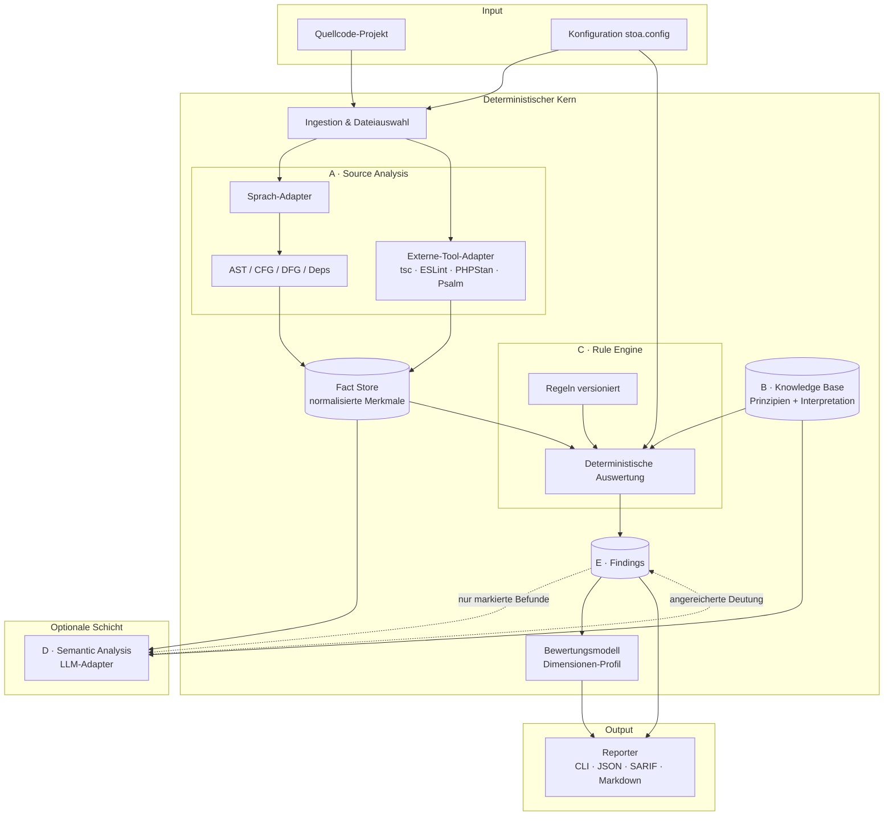
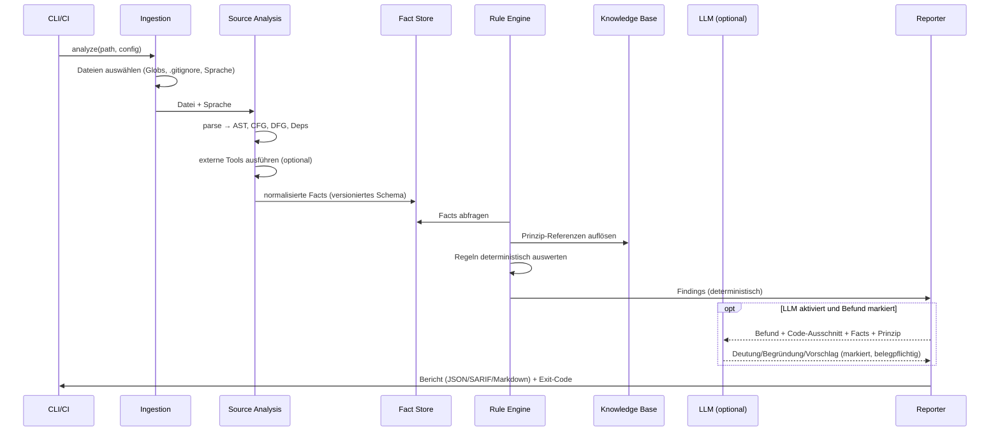
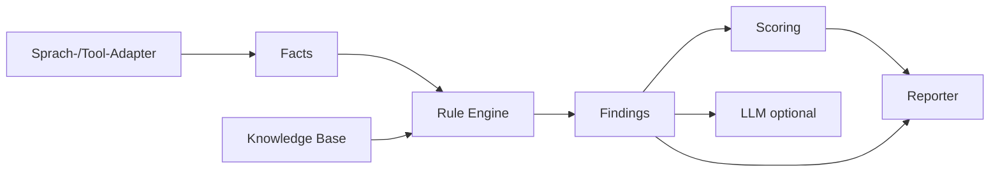

# Architektur – Stoic Code Analysis Engine

> Status: Konzeptphase. Beschreibt Komponenten, Schnittstellen und Datenflüsse.
> Die Technologiewahl (Sprache/Laufzeit) ist in
> [technology-decision.md](./technology-decision.md) begründet.

## 1. Architekturziele und -prinzipien

Abgeleitet aus den Produkt-Leitprinzipien (siehe [vision.md](./vision.md#4-leitprinzipien-des-produkts)):

- **Trennung der Verantwortlichkeiten**: Quelle → Interpretation → Regel →
  Analyse → Befund → Bewertung sind eigenständige Schichten mit klaren Verträgen.
- **Deterministischer Kern**: Kein Nichtdeterminismus (Uhr, Zufall, Netz) im
  Analysekern. Reproduzierbarkeit ist testbar.
- **Adapter statt Monolith**: Programmiersprachen und externe Werkzeuge
  (Compiler, Linter) werden über Adapter angebunden, nicht fest verdrahtet.
- **LLM als abschaltbares Plug-in**: Die Engine ist ohne LLM voll funktionsfähig.
- **Zwischenergebnisse sind Daten**: Jede Schicht erzeugt serialisierbare,
  versionierte Artefakte (JSON), die unabhängig prüf- und cachebar sind.

## 2. Komponentenüberblick



Die mit `(…)` dargestellten Knoten sind **persistier-/cachebare Artefakte**.
Der LLM-Pfad ist gestrichelt: er ist optional und verändert die technische
Beobachtung nicht, sondern nur deren Deutung/Priorisierung.

## 3. Pipeline (Datenfluss)



## 4. Komponenten im Detail

### A. Source Analysis
Liest Quellcode und erzeugt **normalisierte Merkmale** („Facts"). Zwei Quellen:

1. **Eigene strukturelle Analyse** über Sprachadapter: AST, Kontrollfluss (CFG),
   Datenfluss (DFG, soweit sinnvoll), Abhängigkeiten (Imports/Calls/Module),
   Komplexitätsmaße, Seiteneffekt-Heuristiken, Fehlerbehandlungsmuster.
2. **Externe-Tool-Adapter**: Diagnosen etablierter Werkzeuge werden eingelesen
   und in dasselbe Fact-Schema überführt (z. B. `tsc`, ESLint, PHPStan, Psalm).

Wichtige Unterscheidung (Leitprinzip L2):
- **Syntaktische Facts** – direkt aus dem AST ablesbar, hohe Sicherheit
  (z. B. „leerer `catch`-Block", „Funktion hat 7 Parameter").
- **Semantische Schlussfolgerungen** – erfordern Interpretation, niedrigere
  Sicherheit (z. B. „diese Abstraktion ist überflüssig"). Diese sind entweder
  heuristisch (mit niedriger Konfidenz) oder werden an die LLM-Schicht delegiert.

Der Adapter-Vertrag (konzeptuell):

```ts
interface LanguageAdapter {
  readonly id: string;            // z.B. "typescript", "php"
  readonly version: string;       // Adapter-Version (semver)
  supports(file: FileRef): boolean;
  parse(file: FileRef): ParseResult;          // AST + Diagnostik
  extractFacts(parsed: ParseResult, ctx: ProjectContext): Fact[];
}
```

### B. Philosophical Knowledge Base
Verwaltet Prinzipien und ihre technische Interpretation als versionierte,
zitierfähige Daten. Datenmodell: siehe [knowledge-model.md](./knowledge-model.md).
Die KB ist **lesend** für Regel- und LLM-Schicht; sie enthält **keine**
Ausführungslogik.

### C. Rule Engine
Konsumiert ausschließlich **Facts** (nicht den rohen AST) und erzeugt Findings.
Deterministisch, versioniert, konfigurierbar. Eine Regel referenziert ein oder
mehrere Prinzipien aus der KB, prüft aber **technisch**. Modell & Ausführung:
siehe [rule-model.md](./rule-model.md).

### D. Semantic Analysis (optional)
Ein **Adapter-Interface** für LLMs, mit Implementierungen für
„kein LLM" (No-Op), lokale Modelle und externe APIs. Kein Anbieter ist
vorausgesetzt. Die Schicht erhält nur das, was die Engine bereitstellt
(Code-Ausschnitt, Facts, Prinzip, Projektkontext), und muss ihre Aussage
belegen. Sie darf **keine** fehlenden Tatsachen erfinden; Ausgaben werden
validiert (siehe [evaluation.md](./evaluation.md#5-llm-evaluierung)).

```ts
interface SemanticAdapter {
  readonly id: string;             // "noop" | "local-llm" | "api-xyz"
  readonly deterministic: boolean; // No-Op = true
  assess(input: SemanticRequest): Promise<SemanticVerdict>;
}
// SemanticRequest trägt NUR: codeSnippet, facts, principleRef, projectContext
// SemanticVerdict MUSS tragen: verdict, rationale, citations(zu Input), confidence
```

### E. Findings & Reporting
Erzeugt das transparente Befundobjekt und die Berichte. Formate: Mensch
(Markdown/CLI) und Maschine (JSON, SARIF für CI/Code-Hosting). Modell:
siehe [finding-model.md](./finding-model.md).

## 5. Schichten- und Abhängigkeitsregeln



Erlaubte Abhängigkeitsrichtung ist strikt **links → rechts**. Verboten:

- Regeln dürfen **nicht** direkt parsen (nur Facts konsumieren).
- Die Knowledge Base kennt **keine** konkreten Regeln oder Adapter.
- Das Scoring kennt **keine** Sprachdetails (nur Findings + Dimensionen).
- Der LLM-Pfad darf Facts/Findings **lesen**, aber keine erzeugen, die nicht
  als „semantisch/unsicher" markiert sind.

> Diese Regeln sind zugleich ein gutes **Dogfooding**-Ziel: *stoa* sollte
> seine eigene Schichtentrennung prüfen können.

## 6. Determinismus & Caching

- **Stabile Facts**: Fact-Objekte sind rein aus Datei-Inhalt + Adapter-Version +
  Config ableitbar. Cache-Schlüssel = Hash(Inhalt, Adapter-Version, relevante Config).
- **Keine Uhr/kein Zufall** im Kern. Zeitstempel/Umgebung gehören in die
  Bericht-Metadaten, nicht in Facts/Findings.
- **Reproduzierbarkeits-Garantie**: `analyze` zweimal auf gleichem Commit +
  gleicher Engine-/Regel-/KB-Version ⇒ byte-identische Findings (ohne LLM).
- **Versionsstempel** in jedem Bericht: Engine-, Adapter-, Regelsatz- und
  KB-Version (siehe Versionierung in den jeweiligen Modell-Dokumenten).

## 7. Konfiguration (konzeptuell)

```jsonc
// stoa.config.json
{
  "include": ["src/**/*.ts"],
  "exclude": ["**/*.test.ts", "dist/**"],
  "adapters": { "typescript": { "project": "tsconfig.json" } },
  "externalTools": { "eslint": true, "tsc": true },
  "ruleSet": "default@1",          // versionierter Regelsatz
  "knowledgeBase": "marcus@1",     // versionierte KB
  "thresholds": { "overrides": {} },
  "semantic": { "adapter": "noop" }, // LLM standardmäßig aus
  "baseline": ".stoa/baseline.json"
}
```

## 8. Fehler- und Degradationsverhalten

- **Parsefehler** einer Datei ⇒ Datei als „nicht analysierbar" markieren,
  Befund-neutral, Bericht weist es aus (kein stiller Verlust – vgl. L2).
- **Externes Tool fehlt/fällt aus** ⇒ betroffene Facts entfallen, Bericht
  vermerkt reduzierte Abdeckung; Exit-Code getrennt von „Befunde gefunden".
- **LLM nicht verfügbar** ⇒ Engine läuft deterministisch weiter; markierte
  Befunde bleiben ohne semantische Anreicherung.

## 9. Offene Architekturpunkte

Siehe [open-questions.md](./open-questions.md). Kernpunkte: inkrementelle
Analyse/Caching-Granularität, projektweite (interprozedurale) Datenflussanalyse
vs. Aufwand, einheitliches Fact-Schema über sehr unterschiedliche Sprachen.
