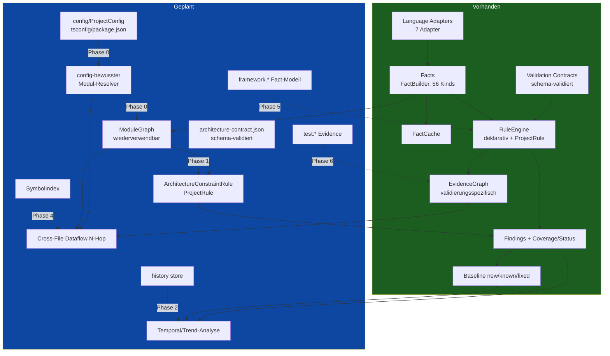

# Stoa – Technische Architekturprüfung: Analysefähigkeiten & Weiterentwicklung

> **Status dieses Dokuments:** reine Ist-Analyse und Entscheidungsgrundlage.
> **Keine Implementierung** — das ist der ausdrücklich geforderte erste Schritt
> (Spec §10). Jede Aussage zum Ist-Zustand ist mit konkreten Dateien belegt;
> wo etwas fehlt, steht „fehlt", nicht „vorhanden".
>
> **Drei Begriffsebenen, konsequent getrennt** (Spec §10, Schlussabsatz):
> - **[VORHANDEN]** — im Code nachweisbar, mit Datei/Funktion belegt.
> - **[GEPLANT]** — konkret genug für eine überprüfbare Implementierungsphase.
> - **[IDEE]** — Architekturvorschlag, noch nicht entscheidungsreif.
>
> Erstellt: 2026-11-01. Betrifft [[../en/architecture-evolution-assessment]] (en-Übersetzung
> folgt bei Bedarf — dies ist ein Arbeits-/Entscheidungsdokument, kein Teil des
> 1:1-übersetzten Kern-Specs).

---

## 0. Kurzfassung (für die Eilige)

Stoa besitzt bereits **mehr Fundament als ein klassischer Linter**: ein
sprachneutrales Fakten-Modell, einen Evidence Graph mit
`verified`/`heuristic`/`unresolved`-Vokabular, eine schema-validierte
deklarative Vertragskonfiguration (Validation Contracts), symbolbasierte
(nicht textbasierte) Datenflussverfolgung, einen Memory-bounded-Pipeline mit
zentralem `complete`/`partial`/`failed`-Status und einen Baseline-Mechanismus.

Die sechs vorgeschlagenen Themen stehen **sehr unterschiedlich** da:

| Thema | Reifegrad heute |
|---|---|
| 1. Interprocedural Dataflow | **teilweise** — same-file, 1 Hop, nur TS |
| 2. Architecture & Dependency Constraints | **teilweise** — Zyklen/Deep-Import vorhanden, aber **nicht deklarativ**, kein wiederverwendbarer Graph |
| 3. Temporal / Quality Evolution | **teilweise** — Baseline (new/known/fixed), aber keine Historie/Trends |
| 4. Configuration-Aware Analysis | **fehlt fast vollständig** — `Config.ts` liest keine tsconfig/package.json |
| 5. Test-to-Code Evidence | **fehlt vollständig** |
| 6. Framework- & Runtime-Semantik | **teilweise, aber als verstreute Einzelregeln** (genau das vom Spec kritisierte Muster) |

**Wichtigste Einzelerkenntnis für die Priorisierung:** Die heutige
Import-Auflösung (`resolveRelativeImport`) versteht **nur relative Pfade**.
Jedes reale Projekt mit `@/`-Path-Aliasen, `tsconfig.json`-`paths` oder
package-`exports` erzeugt heute **null dateiübergreifende Kanten** für diese
Importe. Ein Modul-/Call-Graph, der JETZT ohne Config-Auflösung gebaut würde,
wäre auf den meisten echten Repos **schlicht falsch**. Deshalb weicht die
empfohlene Reihenfolge (§9) von der Arbeitshypothese ab: ein **minimaler
config-bewusster Modul-Resolver ist die eigentliche Grundlage**, nicht ein
großes Unified Program Model vorab.

---

## 1. Ist-Analyse der bestehenden Architektur (Spec §8)

### 1.1 Datenfluss der Pipeline

```
collectFiles (FileMeta[])  →  pro Datei: readFileContent → adapter.parse → adapter.extractFacts → release
                           →  facts: Fact[]  (vollständig akkumuliert)
                           →  RuleEngine.evaluate(facts)  (ein atomarer Durchlauf)
                           →  AnalysisReport { coverage, findings, baseline? }
```

Belegt in `src/Pipeline.ts`. Kernpunkte:

- **Metadaten-first Discovery** [VORHANDEN]: `collectFiles()` liefert `FileMeta[]`
  (Pfad+Größe); Inhalt wird lazy via `readFileContent()` gelesen, erst nachdem
  ein Adapter per Pfad gewählt ist (`src/Ingestion.ts`, `src/analysis/LanguageAdapter.ts`).
- **Per-Datei-Release** [VORHANDEN]: `ParseResult.release()` gibt ts-morph-
  `SourceFile`s / tree-sitter-`Tree`s direkt nach `extractFacts` frei.
- **Memory Guard** [VORHANDEN]: `src/MemoryGuard.ts`, `heapUsed` vs. V8-`heap_size_limit`.
- **Zentraler Status** [VORHANDEN, neu]: `coverage.status: complete|partial|failed`,
  `excludedByReason`, Exitcodes 0/1/2 (`src/Types.ts`, `src/Cli.ts`).
- **Harte Grenze** [LÜCKE]: `facts: Fact[]` wird für das **gesamte Repository**
  akkumuliert, bevor `RuleEngine.evaluate()` **einmal** läuft. Das ist die
  bekannte, dokumentierte offene Speicher-Baustelle — relevant für jede
  projektweite Erweiterung (Themen 1, 2).

### 1.2 Facts & FactCache

- **Fakten-Modell** [VORHANDEN]: `src/Types.ts` `Fact` = `{id, kind, subject, value,
  evidence[], certainty, producedBy}`. `subject` = `{file, symbol?, kindOf, range}`.
  **56 verschiedene Fact-Kinds** werden heute emittiert (gezählt über
  `src/analysis/**`): `metric.*`, `ast.*`, `deps.*`, `orm.*`, `migration.*`,
  `ui.*`, `validation.*`, `external.*`, `file.lineCount`.
- **Kritische Beobachtung** [LÜCKE]: `subject.symbol` ist ein **String**
  (`FactSubject.symbol?: string`, `src/Types.ts`), **keine aufgelöste
  Symbol-Identität**. Es gibt also heute **kein projektweites Symbol-Modell** —
  ein Symbol ist ein Name im Kontext einer Datei, nicht ein Knoten in einem
  dateiübergreifenden Graphen.
- **FactBuilder** [VORHANDEN]: `src/analysis/FactBuilder.ts` — eine
  sprachneutrale Fabrik, die alle Adapter teilen. Der richtige, bereits
  existierende Erweiterungspunkt für neue Fact-Familien.
- **FactCache** [VORHANDEN]: `src/FactCache.ts`, per Datei,
  `(engineFingerprint, adapterId, Pfad, Inhalts-Hash)`. **Setzt explizit
  voraus, dass Fact-Extraktion dateiunabhängig ist** — diese Annahme ist eine
  direkte Spannung mit jeder dateiübergreifenden Analyse (Themen 1, 2, 7).

### 1.3 Rule Engine

- **Zwei Regelarten** [VORHANDEN]: (a) **deklarative Regeln** (`rules/default/*.json`,
  `src/rules/RuleTypes.ts`, `src/rules/Evaluation.ts`) — ein Bedingungsbaum
  **pro Subjekt**, gruppiert per `(file, symbol, range, kindOf)`; (b)
  **ProjectRule-Klassen** (`src/rules/ProjectRule.ts`) — sehen den vollen
  Fact-Satz, handcodiert.
- **Entscheidende Grenze für Thema 2** [LÜCKE]: Die deklarative `Rule`
  (`RuleTypes.ts`) kann **nur Pro-Subjekt-Faktbedingungen** ausdrücken
  (`trigger: {all|any: Condition[]}`, `Condition = {fact, op, value}`). Sie kann
  **keine graph-/dateiübergreifenden Constraints** ausdrücken. Architekturregeln
  existieren heute ausschließlich als **handcodierte** `ProjectRule`-Klassen
  (`DependencyCycleRule`, `DeadExportRule`) — **nicht deklarativ konfigurierbar**.
- **requiredFactKinds** [VORHANDEN, neu]: Jede ProjectRule deklariert jetzt ihre
  benötigten Fact-Kinds (`src/rules/ProjectRule.ts`) + `analyzedFiles` separat —
  Grundlage für eine künftige gebündelte Auswertung, heute reine Metadaten.

### 1.4 EvidenceGraph

- **Vorhanden, aber domänenspezifisch** [VORHANDEN, aber begrenzt]:
  `src/evidence/EvidenceGraph.ts` hat exakt das vom Spec geforderte
  Status-Vokabular `verified|heuristic|unresolved|missing` und
  per-Kante-`basis`/`producedBy`/`limits`. **Aber**: die `EvidenceNodeKind`/
  `EvidenceEdgeKind`-Aufzählungen sind **validierungsspezifisch**
  (`request-source`, `validator-invocation`, `persistence-sink`, `validates`,
  `persists`, …). Der Graph wird als **Fact-Value** transportiert
  (`kind: 'validation.dataflowGraph'`, `src/analysis/typescript/ValidationDataflow.ts`),
  nicht als projektweite Struktur. Für ein allgemeines Program Model (Thema 7)
  müssten Knoten-/Kantenarten **verallgemeinert** werden — die Mechanik
  (Status, Evidenz, Invarianten) ist aber wiederverwendbar.

### 1.5 Validation Contracts — der einzige deklarative-Config-Präzedenzfall

- [VORHANDEN]: `schemas/validation-contract.schema.json` +
  `src/contracts/ValidationContract.ts` (ajv2020, fail-fast bei Fehlern,
  Duplikat-ID-Prüfung) + `src/rules/project/ValidationContractRule.ts`.
- **Wichtig für Thema 2**: Das ist das **bereits etablierte Muster** für
  „deklarative, extern konfigurierte, schema-validierte Analyseregeln". Eine
  Architektur-Constraint-Konfiguration sollte **exakt diesem Muster folgen**
  (eigenes JSON-Schema + Loader + ProjectRule), kein neues Format erfinden.

### 1.6 Symbol- & Scope-Auflösung

- **TS/JS** [VORHANDEN, aber in-memory, same-file in der Praxis]:
  `src/analysis/typescript/SymbolResolution.ts` nutzt den ts-morph-Binder
  (`.getSymbol()`-Identität, nicht Text) — `isSameBinding`, `tracksBinding`,
  `resolveSimpleAlias`, `destructuredProperty`. **Kein `tsconfig.json`** wird
  geladen (in-memory-Project), d.h. Path-Aliase werden nicht aufgelöst.
- **C/C++** [VORHANDEN, eigene Mechanik]: handgeschriebener Scope-Walk in
  `src/analysis/cpp/CppExtraction.ts` (`resolveBindingSite`, Block-Traversierung,
  `#ifdef`-bewusst) — tree-sitter hat keine Symboltabelle.
- **PHP / Dart** [LÜCKE]: keine Symbol-/Scope-Auflösung über Namenstext hinaus.
- **Fazit**: Es gibt **kein einheitliches Symbol-Modell** — drei verschiedene,
  sprachgebundene Ansätze (ts-morph, C++-Scope-Walk, sonst nichts).

### 1.7 Dataflow (Thema 1, Ist)

- [VORHANDEN]: `src/analysis/typescript/ValidationDataflow.ts` +
  `OneHopResolution.ts` + `SymbolResolution.ts` + `SafeParseGuard.ts`.
  - Source-to-Sink: ja, aber **nur innerhalb einer Funktion** plus **genau ein**
    Funktions-Hop (`resolveOneHop`), und **nur same-file**
    (`decl.getSourceFile().getFilePath() !== outer...` → `continue`).
  - Symbolidentität statt Text: ja (`SymbolResolution.ts`).
  - Objektfelder/Destrukturierung: teilweise (`destructuredProperty`, `.data`-Zugriff).
  - Guard-/Kontrollfluss: ja für `safeParse` (`SafeParseGuard.ts`), aber **kein
    allgemeiner CFG** — `isReassignedAnywhere` ist bewusst ein textueller
    Scope-Scan ohne Kontrollflussordnung.
  - `verified`/`heuristic`/`unresolved`: ja, sauber durchgezogen.
- [LÜCKE]: N-Hop, dateiübergreifend, Rückgabewert-Ketten über mehrere Ebenen,
  echter CFG, nicht-TS-Sprachen.

### 1.8 Baseline & Temporal (Thema 3, Ist)

- [VORHANDEN]: `src/Baseline.ts` — **ein** gespeicherter Snapshot, Findings als
  `new|known|fixed`, Identität `(datei, regel, symbol)` (`src/FindingIdentity.ts`),
  Integritätssperre bei `status !== complete`.
- [LÜCKE]: **keine Historie** (nur 1 Baseline-Datei, kein Zeitreihen-Store),
  keine Trends pro Qualitätsdimension, keine „wieder aufgetreten"-Klasse, keine
  Regressionserkennung, keine Abdeckungs-Vergleichbarkeitsprüfung.

### 1.9 Coverage & Analysis Status

- [VORHANDEN, neu]: `coverage.status`, `excludedByReason` (strukturierte
  `ExclusionReason`), `filesCancelled`, `excludedSample` (`src/Types.ts`,
  `src/Pipeline.ts`). **Direkt nutzbar für Thema 3**: „zeitlicher Vergleich nur
  belastbar bei vergleichbarer Abdeckung" lässt sich auf `status` + Abdeckungs-
  Kennzahlen stützen.

### 1.10 Sprachadapter

- [VORHANDEN]: 7 Adapter (`TypeScriptAdapter`, `PhpAdapter`, `DartAdapter`,
  `CppAdapter`, `AngularAdapter`, `HtmlAdapter`, `VueAdapter`), alle emittieren
  dieselben sprachneutralen Facts über `FactBuilder`.
- [LÜCKE]: **kein Call-Graph, kein Return-Value-Modell, keine Framework-
  Kontextfacts** — Adapter liefern Metriken/Deps/AST-Merkmale, keine
  Programm-Struktur-Beziehungen über Funktionsgrenzen.

### 1.11 Golden-Corpus-Evaluator & Testarchitektur

- [VORHANDEN]: `src/evaluation/Evaluator.ts` (Precision/Recall pro Regel/Sprache,
  Identität `(datei, regel, symbol)`), `stoa eval`. Tests: `node:test` + `tsx`,
  289 Tests, pro-Sprache-Fixtures, kuratierte Golden-Corpora (100/100). **Jede
  neue Fähigkeit muss diesem Muster folgen**: Fixture + erwartete Findings +
  eval bleibt 100%.

### 1.12 Configuration-Aware (Thema 4, Ist)

- [LÜCKE, fast total]: `src/Config.ts` ist ein **Shallow-Merge** von
  `stoa.config.json` über Defaults — **liest weder `tsconfig.json`,
  `package.json`, `composer.json`, `pubspec.yaml` noch ESLint/Build-Config**.
  Es gibt keine Umwandlung von Projektkonfiguration in Facts oder Kontext.

### 1.13 Framework- & Runtime-Semantik (Thema 6, Ist)

- [VORHANDEN, aber verstreut]: TypeORM/Doctrine-Regeln (`orm.*`, `migration.*`),
  Backend-Validierung inkl. Fastify-Route-Schema-Erkennung
  (`src/analysis/typescript/BackendValidation.ts`), React/Vue/Angular/Flutter-
  a11y. **Das ist genau das vom Spec kritisierte Muster**: eine Sammlung
  **unabhängiger Sonderregeln**, kein **gemeinsames Framework-Faktenmodell**.
  Es gibt keine Abstraktion „Framework X hat Konzept Middleware/Route/Hook/Entity".

---

## 2. Fähigkeiten-Matrix (Spec §8, alle sechs Themen)

Pro Thema: (1) implementiert · (2) teilweise · (3) fehlt · (4) erweiterbare
Komponente · (5) Architekturrisiko · (6) betroffene Dateien.

### Thema 1 — Interprocedural Dataflow
1. **Implementiert:** Same-file-1-Hop-Tracking, Symbolidentität, safeParse-Guard,
   Evidence-Status-Vokabular.
2. **Teilweise:** Objektfeld-/Destrukturierungs-Fluss (nur `.data`-Fälle).
3. **Fehlt:** N-Hop, dateiübergreifend, Rückgabewert-Ketten, echter CFG, nicht-TS.
4. **Erweiterbar:** `OneHopResolution.ts` → N-Hop; `EvidenceGraph` als Träger;
   `ValidationDataflow.ts` als Vorlage.
5. **Risiko:** bricht die FactCache-Dateiunabhängigkeit; Speicher (voller
   Fact-Satz); Determinismus bei Multi-Hop; **Gefahr falscher `verified`**.
6. **Dateien:** `OneHopResolution.ts`, `SymbolResolution.ts`,
   `ValidationDataflow.ts`, `EvidenceGraph.ts`, `FactCache.ts`, `Pipeline.ts`.

### Thema 2 — Architecture & Dependency Constraints
1. **Implementiert:** Zyklenerkennung (`DependencyCycleRule`, Tarjan),
   Deep-Import (`R-DEEP-IMPORT`), Dead-Export, breite Public-Surface.
2. **Teilweise:** Modul-Graph existiert **nur intern** in `DependencyCycleRule`,
   nicht wiederverwendbar.
3. **Fehlt:** **deklarative** Layer-/Richtungs-/Zugriffsregeln,
   Layer-Detection, config-bewusste Importauflösung, Framework-Dependency-Regeln.
4. **Erweiterbar:** `deps.*`-Facts (vorhanden) → wiederverwendbarer `ModuleGraph`;
   `ValidationContract`-Muster als Vorlage für deklarative Config.
5. **Risiko:** gering — Import existiert/existiert nicht ist **syntaktisch,
   hohe Certainty, niedrige FP-Gefahr**; Hauptrisiko ist **falsche
   Kantenauflösung** ohne Config (Path-Aliase → siehe Thema 4).
6. **Dateien:** `DependencyCycleRule.ts`, `ImportPath.ts`, `ProjectRule.ts`,
   neu: `schemas/architecture-contract.schema.json`, `ModuleGraph.ts`.

### Thema 3 — Temporal / Quality Evolution
1. **Implementiert:** Baseline new/known/fixed, Identität, Integritätssperre.
2. **Teilweise:** `coverage.status` liefert die Vergleichbarkeits-Grundlage.
3. **Fehlt:** Historie (>1 Lauf), Trends pro Dimension, Regression/„wieder
   aufgetreten", Abdeckungs-Vergleichbarkeitsregel.
4. **Erweiterbar:** `Baseline.ts` + `FindingIdentity.ts` + `coverage`.
5. **Risiko:** **sehr gering** — rein additiv, kein Cross-File, kein Speicher.
6. **Dateien:** `Baseline.ts`, `FindingIdentity.ts`, `Types.ts`, `Cli.ts`,
   neu: ein Verlaufs-Store (`history.json`).

### Thema 4 — Configuration-Aware Analysis
1. **Implementiert:** nichts außer `stoa.config.json`-Shallow-Merge.
2. **Teilweise:** —
3. **Fehlt:** tsconfig/package.json/composer/pubspec-Einlesen, Path-Alias-/
   `exports`-Auflösung, Config-als-Fact vs. Config-als-Kontext.
4. **Erweiterbar:** `Config.ts`, `ImportPath.ts` (Resolver), `FactBuilder`
   (neue `config.*`-Facts).
5. **Risiko:** gering–mittel; **Nutzen hoch** (reduziert falsche FN/FP durch
   korrekte Modulauflösung). Determinismus: Config-Lesen muss reproduzierbar sein.
6. **Dateien:** `Config.ts`, `ImportPath.ts`, neu: `config/ProjectConfig.ts`.

### Thema 5 — Test-to-Code Evidence
1. **Implementiert:** nichts.
2. **Teilweise:** —
3. **Fehlt:** Testdatei-Erkennung, Test→Code-Referenz, Coverage-Ingestion,
   Pfad-Ausführungs-Beleg, Abstufung „existiert/referenziert/führt aus/prüft".
4. **Erweiterbar:** `EvidenceGraph` (Test-Evidenz-Kanten), `FactBuilder`
   (`test.*`-Facts), Ingestion (Coverage-Report-Pfade).
5. **Risiko:** mittel — Gefahr der Überinterpretation („getestet = korrekt"),
   die der Spec ausdrücklich verbietet; braucht externe Coverage-Formate.
6. **Dateien:** neu: `analysis/TestEvidence.ts`, `evidence/EvidenceGraph.ts`
   (Knoten-/Kantenarten), Ingestion.

### Thema 6 — Framework- & Runtime-Semantik
1. **Implementiert:** TypeORM/Doctrine, Fastify-Route-Schema, a11y-Frameworks —
   **als Einzelregeln**.
2. **Teilweise:** kein gemeinsames Modell.
3. **Fehlt:** ein **einheitliches Framework-Faktenmodell** (Middleware, Route,
   Hook, Entity-Relation, Lifecycle als `framework.*`-Facts).
4. **Erweiterbar:** `FactBuilder`, adapterseitige Extraktion, Rule Engine.
5. **Risiko:** mittel–hoch — Framework-Erkennung ist versionsabhängig und
   FP-anfällig; **Gefahr des Wildwuchses** (genau die Spec-Warnung).
6. **Dateien:** `BackendValidation.ts`, `TsExtraction.ts`, `PhpExtraction.ts`,
   `DartExtraction.ts`, neu: `analysis/framework/*`.

---

## 3. Konkrete technische Lücken (verdichtet)

- **L1 — Keine config-bewusste Modulauflösung.** `resolveRelativeImport`
  (`ImportPath.ts`) kennt nur relative Specifier → Path-Aliase/`exports`/
  Monorepo-Pakete erzeugen **keine** Kanten. **Blockiert Thema 2 und 1 für
  reale Repos.** (Höchste Hebelwirkung.)
- **L2 — Kein wiederverwendbarer Modul-/Symbol-Graph.** Graph lebt nur in
  `DependencyCycleRule`. **Blockiert Thema 2, 7.**
- **L3 — Kein projektweites Symbol-Modell.** `subject.symbol` ist ein String.
  **Blockiert dateiübergreifenden Dataflow (Thema 1) und ein echtes UPM (7).**
- **L4 — Deklarative Regeln können keine Graph-Constraints ausdrücken.**
  **Blockiert deklarative Architekturregeln (Thema 2).**
- **L5 — EvidenceGraph ist validierungsspezifisch.** Generalisierung nötig für
  Thema 5, 7.
- **L6 — Kein Verlaufs-Store.** Baseline ist ein Einzel-Snapshot. **Blockiert
  Thema 3.**
- **L7 — Voller Fact-Satz im Speicher + FactCache-Dateiunabhängigkeit.**
  Spannung mit jedem dateiübergreifenden Feature (Thema 1, 2, 7).
- **L8 — Kein Framework-Faktenmodell.** Thema 6 droht Einzelregel-Wildwuchs.
- **L9 — Keinerlei Test-/Coverage-Ingestion.** Thema 5 ist Grüne Wiese.

---

## 4. Vorschlag Unified Program Model (Spec §7) — [IDEE/GEPLANT, inkrementell]

**Leitsatz:** Das UPM **nicht vorab als großes Framework** bauen (verstößt gegen
§10 „keine großen abstrakten Frameworks ohne konkreten Nutzen"). Stattdessen:
**Stoa besitzt bereits ein partielles UPM** — das Fact-Modell + EvidenceGraph.
Was fehlt, ist eine **dünne projektweite Beziehungsschicht** zwischen Adaptern
und Regeln. Diese wächst organisch pro Roadmap-Phase.

Was vom Zielbild **schon existiert** vs. **fehlt**:

| UPM-Schicht | Status |
|---|---|
| Files | [VORHANDEN] `FileMeta`, `Ingestion` |
| Symbols | [TEILWEISE] nur ts-morph/C++-Scope, kein projektweites Modell (L3) |
| Scopes | [TEILWEISE] TS + C++, sonst keine |
| Functions / Calls / Params / Return | [LÜCKE] kein Call-Graph |
| Types | [TEILWEISE] nur via opt-in `--typecheck` (ts-morph) |
| Control Flow | [LÜCKE] nur punktuell (safeParse) |
| Data Flow | [TEILWEISE] same-file 1-Hop (Thema 1) |
| Dependencies | [VORHANDEN] `deps.*`-Facts, aber nur relativ aufgelöst (L1) |
| Framework Context | [TEILWEISE] verstreut (Thema 6) |
| Configuration Context | [LÜCKE] (Thema 4) |
| Facts & Evidence | [VORHANDEN] `Fact`, `EvidenceGraph` (validierungsspezifisch) |
| Analysis Engine (Rules/Contracts/Evidence/Confidence) | [VORHANDEN] |
| Results (Findings/Coverage/Baseline/SARIF) | [VORHANDEN]; Temporal [LÜCKE] |

**Konkreter, minimaler UPM-Kern den ich vorschlage** [GEPLANT]: eine neue,
projektweite, **aus bereits emittierten Facts aufgebaute** Struktur
`ProjectModel` (`src/model/ProjectModel.ts`), zunächst nur mit:
- `ModuleGraph` — Knoten = Dateien/Module, Kanten = aufgelöste Importe (aus
  `deps.import`-Facts + config-bewusstem Resolver). Löst L2.
- `SymbolIndex` — optional, erst wenn dateiübergreifender Dataflow drankommt;
  baut auf exportierten/importierten Symbolnamen auf (`deps.export`/`deps.importName`).

Wichtig: `ProjectModel` wird **nach** der Fact-Extraktion, **vor** den
ProjectRules gebaut und über `ProjectRuleInput` (bereits vorhandene Struktur)
den Regeln bereitgestellt — **keine neue Analysewelt**, keine Parallelpipeline.

---

## 5. Abhängigkeitsdiagramm der geplanten Komponenten (Spec §10.5)



Lesart: Grün = heute vorhanden, Blau = geplant. Jede blaue Kante ist einer
Roadmap-Phase zugeordnet. `ModuleGraph` (Phase 0) ist der zentrale neue Knoten,
von dem sowohl Thema 2 als auch Thema 1 abhängen — deshalb zuerst.

---

## 6. Priorisierte Roadmap (Spec §9) — mit begründeter Abweichung von der Hypothese

**Arbeitshypothese des Specs:** 1) UPM+Symbol/Call-Graph, 2) Dataflow, 3)
Architektur, 4) Config, 5) Framework, 6) Test, 7) Temporal.

**Begründete Abweichung** (Spec §9 erlaubt sie ausdrücklich bei besserer
Analyse):

- **Kein großes UPM vorab** (§10-Verbot). Stattdessen wächst das UPM aus den
  Phasen heraus.
- **Config-bewusste Modulauflösung muss VOR allem Graph-/Dataflow-Bezogenen
  kommen** (L1): ohne sie sind Modul-Graph und dateiübergreifender Dataflow auf
  realen Repos schlicht falsch. Das Spec stellt Config auf Platz 4 — die Analyse
  zeigt, dass ein **Minimal-Teil davon Platz 0** sein muss.
- **Architektur-Constraints vor Interprocedural Dataflow**: höhere
  Differenzierung ggü. Lintern, deutlich **geringeres Risiko** (syntaktisch,
  hohe Certainty), **kein** Eingriff in die Speicher-/Cache-Baustelle, und baut
  direkt auf dem günstigen `deps.*`-Fundament + dem ModuleGraph aus Phase 0.
- **Temporal früh**: additiv, risikolos, nutzt die gerade gebaute
  Status-Infrastruktur, sofort sichtbarer Nutzen.
- **Interprocedural Dataflow (Cross-File/N-Hop) spät**: höchstes Risiko (falsche
  `verified`, Speicher, Cache-Invariante) — erst wenn ModuleGraph + SymbolIndex
  + Config-Resolver als Fundament stehen.

**Empfohlene Reihenfolge:**

| Phase | Inhalt | Differenzierung | Aufwand | Risiko |
|---|---|---|---|---|
| **0** | Config-bewusster Modul-Resolver + wiederverwendbarer `ModuleGraph` (aus `deps.*`); `DependencyCycleRule` darauf refaktorieren (0 Verhaltensänderung) | Fundament | **S** | niedrig |
| **1** | **Architecture & Dependency Constraints** — deklarativ, schema-validiert (Contract-Muster), auf ModuleGraph | **hoch** | M | niedrig |
| **2** | **Temporal / Quality Evolution** — Verlaufs-Store auf Baseline, Abdeckungs-Vergleichbarkeit via `status` | mittel | **S–M** | sehr niedrig |
| **3** | **Configuration-Aware** erweitern — Compiler-Optionen/Feature-Flags als Kontext für bestehende Regeln | mittel | M | niedrig |
| **4** | **Interprocedural Dataflow** Cross-File/N-Hop auf ModuleGraph+SymbolIndex | hoch | **L** | **hoch** |
| **5** | **Framework-Faktenmodell** (`framework.*`) statt Einzelregeln | hoch | L | mittel |
| **6** | **Test-to-Code Evidence** | mittel | M–L | mittel |

---

## 7. Vorschlag erste kleine Implementierungsphase (Spec §10.7) — [GEPLANT]

**Phase 0, kleinster überprüfbarer Schnitt** (bewusst noch OHNE neues
Feature-Finding, rein Fundament + Beweis der Wiederverwendung):

1. `src/model/ModuleGraph.ts` — extrahiere den heute in `DependencyCycleRule`
   eingebetteten Graphaufbau in eine wiederverwendbare, getestete Struktur
   (Knoten = analysierte Dateien, Kanten = aufgelöste `deps.import`).
2. `src/analysis/ModuleResolution.ts` — erweitere `resolveRelativeImport` um
   **tsconfig-`paths` und `package.json`** (nur Lesen, deterministisch,
   fail-safe: nicht auflösbar → `unresolved`, nie geraten). Beginnt L1 zu
   schließen.
3. `DependencyCycleRule` konsumiert `ModuleGraph` → **byte-identische Findings**
   (bewiesen durch die bestehenden `test/Dependency*.test.ts` + Golden Corpus,
   die 100% bleiben müssen).
4. `ProjectRuleInput` erhält optional `moduleGraph` (additive, kompatible
   API-Erweiterung — bestehende Verträge bleiben).

**Warum dieser Schnitt:** erzeugt **null neue Findings** und damit **null
FP-Risiko**, beweist aber die tragende Wiederverwendung, schließt den Anfang von
L1/L2, und ist vollständig testbar gegen den bestehenden Corpus. Danach ist
Phase 1 (Architektur-Constraints) ein reiner Aufsatz.

Alternativ, falls sofort **sichtbarer** Nutzen gewünscht ist: **Phase 2
(Temporal) zuerst** — ebenfalls klein, risikolos, additiv, und liefert sofort
ein Feature (Findings-Verlauf/Regression) ohne jede Cross-File-Problematik.

---

## 8. Risiken & offene Architekturentscheidungen (Spec §10.8)

- **R1 — Speicher vs. Cross-File (L7).** Jedes dateiübergreifende Feature
  (Themen 1, 2, 7) steht in direkter Spannung mit (a) dem vollständig
  akkumulierten Fact-Satz und (b) der FactCache-Dateiunabhängigkeits-Annahme.
  **Offene Entscheidung:** ModuleGraph aus Facts bauen (billig, dateilokal
  cachebar) vs. ein persistenter projektweiter Symbol-Store (mächtiger, bricht
  die Cache-Invariante). **Empfehlung:** zuerst der Fact-basierte Graph.
- **R2 — Determinismus bei Config-Lesen.** tsconfig/package.json müssen
  reproduzierbar und ohne Netz/Zufall einfließen; Versionsabhängigkeiten
  (Thema 6) dürfen die Kernanalyse nicht nicht-deterministisch machen.
- **R3 — Falsche `verified` bei Multi-Hop (Thema 1).** Das oberste Prinzip
  („korrektes `unresolved` > falsches `verified`") wird mit jedem zusätzlichen
  Hop schwerer zu halten. **Entscheidung:** klare Hop-Tiefen-Grenze + Status-
  Degradierung pro Grenzüberschreitung.
- **R4 — EvidenceGraph verallgemeinern vs. duplizieren (L5).** Für Thema 5/7:
  die validierungsspezifischen Knoten-/Kantenarten generalisieren (Risiko:
  bestehende Validierungslogik) oder einen zweiten Graphtyp einführen (Risiko:
  zwei Graphmodelle). **Offen.**
- **R5 — Framework-Wildwuchs (Thema 6).** Ohne vorab definiertes
  `framework.*`-Faktenmodell droht genau die vom Spec verbotene Sammlung von
  Sonderregeln. **Entscheidung:** Modell zuerst, Regeln danach.
- **R6 — Deklaratives Architektur-Config-Format.** Reichweite: nur Layer/
  Richtung, oder auch Paket-/Framework-Verbote? **Empfehlung:** klein starten
  (Layer + erlaubte Richtung), exakt dem ValidationContract-Loader-Muster
  folgend.
- **R7 — Test-Evidence-Überinterpretation (Thema 5).** Die vom Spec geforderte
  Abstufung (existiert/referenziert/führt aus/prüft) muss hart im Status-
  Vokabular verankert sein, sonst entsteht ein trügerisches „getestet = sicher".

---

## 9. Klartrennung (Spec §10, Schlussanforderung)

- **Tatsächlich vorhanden:** Fact-Modell, 7 Adapter, FactCache, RuleEngine
  (deklarativ + ProjectRule), EvidenceGraph (validierungsspezifisch), Validation
  Contracts, ts-morph-/C++-Symbolauflösung (same-file), same-file-1-Hop-Dataflow,
  Baseline (Einzel-Snapshot), Coverage/Status, MemoryGuard, Golden-Corpus-Evaluator.
- **Geplant (entscheidungsreif):** ModuleGraph + config-bewusster Resolver
  (Phase 0), deklarative Architektur-Constraints (Phase 1), Temporal-Verlauf
  (Phase 2).
- **Architekturidee (noch nicht entscheidungsreif):** vollständiges Unified
  Program Model, generalisierter EvidenceGraph, Cross-File-N-Hop-Dataflow,
  Framework-Faktenmodell, Test-to-Code-Evidence.

Keine der „geplanten"/„Idee"-Fähigkeiten ist heute implementiert; dieses
Dokument nimmt nichts vorweg.
