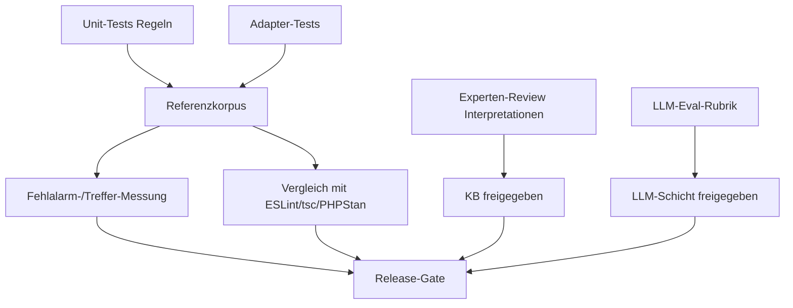

# Validierung & Qualitätsmessung

> Status: Konzeptphase. Legt fest, **wie** die Qualität der Engine geprüft wird –
> deterministischer Kern zuerst, LLM nachgelagert.

## 1. Ziele der Validierung

1. **Korrektheit** der Regeln (richtige Befunde, keine Fehlalarme).
2. **Reproduzierbarkeit** (byte-stabile Ergebnisse ohne LLM).
3. **Tragfähigkeit** der philosophischen Interpretationen (Experten-Review).
4. **Nutzen** gegenüber bestehenden Werkzeugen (Mehrwert, nicht Dopplung).
5. **Vertrauen** in LLM-Ausgaben (messbar, nicht „klingt gut").

## 2. Teststrategie (Überblick)

## 3. Tests und Referenzkorpus

### 3.1 Unit-Tests je Regel (Pflicht)
Jede Regel hat einen Testkatalog (siehe [rule-model.md §7](./rule-model.md#7-testbarkeit-pflicht-je-regel)):
- **positive Fixtures** (Befund korrekt ausgelöst),
- **negative Fixtures** (korrekt **kein** Befund — testen `suppressWhen`/Gegenbeispiele),
- **Finding-Snapshots** (Felder, Schwere, Konfidenz stabil).

### 3.2 Adapter-Tests
- Parser-Adapter: AST-/Fact-Extraktion gegen bekannte Eingaben.
- Externe-Tool-Adapter: Mock der Tool-Ausgabe → erwartete Facts.
- Degradation: fehlendes Tool / Parsefehler → definierter, nicht stiller Zustand.

### 3.3 Referenzkorpus (Golden Projects)
- Kleine, versionierte Beispielprojekte mit **bekannten** Problemen und
  **bekannten Nicht-Problemen** (annotierte Erwartung je Datei/Zeile).
- Pro Regel mindestens ein realistisches Positiv- und Negativszenario.
- Reproduzierbarer Gesamtlauf: Snapshot des kompletten Berichts; Diff = Regression.

## 4. Fehlalarme messen

- Annotierter Korpus liefert Ground Truth → **Precision/Recall pro Regel** und
  pro Dimension.
- Die **Identität** eines Findings beim Abgleich ist `(projektrelativer
  Dateipfad, Regel-ID, Symbol)` — der Pfad wird gegen die Analysewurzel
  relativiert, sodass gleichnamige Dateien in verschiedenen Verzeichnissen nicht
  kollidieren; Zeile/Spalte bleiben außen vor (das Symbol unterscheidet innerhalb
  einer Datei, Zeilen verschieben sich bei Änderungen). Precision/Recall werden
  über die Menge eindeutiger Schlüssel berechnet; doppelte erzeugte Findings
  werden berichtet, nicht still verworfen. Doppelte **erwartete** Einträge im
  Manifest sind ein Korpus-Integritätsfehler (werden berichtet und lassen die
  Evaluierung scheitern); ein fehlerhaftes/unlesbares Manifest ist ein expliziter
  Evaluierungsfehler, kein Bestehen.
- **Kennzahl-Definition.** Über eindeutige Schlüssel: TP = erzeugt ∩ erwartet,
  FP = erzeugt \ erwartet, FN = erwartet \ erzeugt;
  `precision = TP / (TP + FP)`, `recall = TP / (TP + FN)`. Undefinierte Fälle
  (keine Vorhersagen bzw. keine Erwartungen) werden als vakuöse `1.0` berichtet;
  dieser Wert ist nur zusammen mit der Erzeugt-Anzahl aussagekräftig (Precision
  `1.0` bei 0 Erzeugten bedeutet „nichts erzeugt", nicht „alles korrekt").
- **False Positives** (gemeldet, aber kein echtes Problem) und **False Negatives**
  (echtes Problem übersehen) werden getrennt berichtet. `stoa eval` endet mit
  Fehlercode, sobald eines von beiden auftritt.
- **Sprachbezogene Aufschlüsselung.** Das Ergebnis trägt einen `byLanguage`-Teil
  (aus der Dateiendung je Finding: TypeScript/JavaScript, PHP, Dart, C/C++),
  sodass die unterstützten Sprachen *innerhalb eines Korpus* vergleichbar sind.
  Zahlen aus getrennten Korpora werden nicht zusammengeführt. `stoa eval` lädt
  alle Grammatiken, ein gemischter Korpus wird also über alle vier Sprachen
  ausgewertet. Der aktuelle Golden-Korpus deckt nur TypeScript und PHP ab; Dart
  und C/C++ werden durch Adaptertests geprüft, noch nicht durch den Korpus.
- **Externe Projekte.** `stoa eval <pfad> --expected <manifest>` funktioniert
  bereits für beliebige Projekte — Identitäten sind projektrelativ. Ein separater
  Mechanismus ist nicht nötig. **Vorbehalt:** Findings eines externen Projekts
  erst als Ground Truth verwenden, wenn jeder erwartete Eintrag manuell (oder
  anderweitig nachvollziehbar) validiert wurde; ein unvalidiertes Manifest misst
  Übereinstimmung, nicht Korrektheit.
- **Release-Gate (Vorschlag):** je Regel Mindest-Precision; Regeln, die das
  verfehlen, starten als „experimental" (niedrige Default-Konfidenz, abschaltbar).
- Fehlalarmquote ist Teil des Bericht-Vertrauens (siehe
  [finding-model.md §5](./finding-model.md#5-schutz-vor-fehlanreizen-anti-goodhart)).

## 5. LLM-Evaluierung

Die LLM-Schicht wird **erst nach** einem belastbaren deterministischen Kern bewertet.

- **Festgelegte Rubrik** je LLM-Aufgabe (z. B. „Abstraktion überflüssig?"):
  Belegt die Antwort sich an bereitgestellten Code/Facts? Erfindet sie Tatsachen?
  Ist das Urteil konsistent?
- **Groundedness-Check:** Jede LLM-Aussage muss auf Input-Evidenz verweisen
  (`citations`); nicht belegte Aussagen werden verworfen.
- **Stabilität:** gleiche Eingabe mehrfach → Varianz messen; hohe Varianz ⇒
  Aufgabe ist für LLM ungeeignet.
- **Vergleich** gegen von Menschen gelabelte Beispiele (Agreement-Rate).
- LLM darf **nie** die deterministische Beobachtung überschreiben, nur deuten.

## 6. Experten-Review

- Jede philosophische Interpretation (KB) wird von einer sachkundigen Person
  gegen die Belegstelle geprüft: Stimmt die Zuordnung? Ist die Konfidenz ehrlich?
- Besonderes Augenmerk auf **unsichere Zuordnungen** (z. B. `marcus.control`,
  niedrige Attribution zu Marc Aurel).
- Review-Ergebnis wird in der KB-Änderungshistorie dokumentiert.

## 7. Vergleich mit etablierten Werkzeugen

- Dieselben Golden Projects durch ESLint / `tsc` / (später) PHPStan / Psalm laufen
  lassen und Befunde gegenüberstellen.
- Ziel: zeigen, **wo *stoa* Mehrwert** liefert (Priorisierung, Deutung,
  dimensionales Profil) und wo es nur dupliziert (→ dann lieber das Tool als
  Fact-Quelle integrieren statt eigene Regel).

## 8. Reproduzierbarkeit als Testartefakt

- CI führt denselben Analyse­lauf zweimal aus → Ergebnisse müssen identisch sein
  (ohne LLM). Abweichung = Fehler (versteckter Nichtdeterminismus).
- Versionsstempel (Engine/Regelsatz/KB/Adapter) sind Teil des Snapshots.

## 9. Abnahmebezug

Die konkreten, zählbaren Abnahmekriterien des MVP stehen in
[roadmap.md §2 Abnahmekriterien](./roadmap.md#2-abnahmekriterien) und referenzieren
die hier definierten Messgrößen (Precision/Recall, Reproduzierbarkeit, Coverage).
