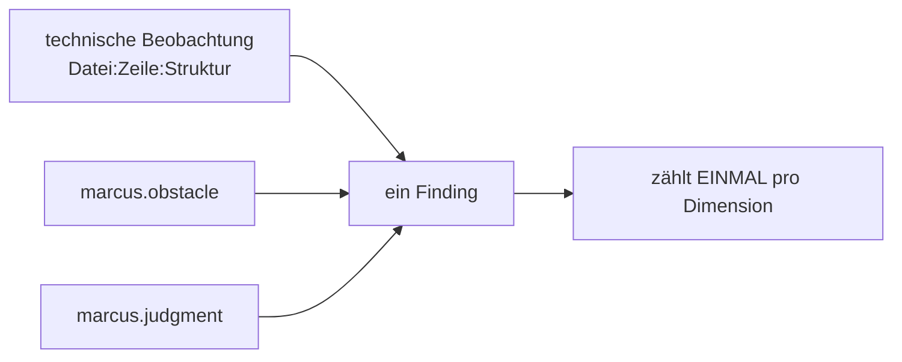

# Befund- & Bewertungsmodell

> Status: Konzeptphase. Definiert die Struktur eines Befunds, die
> Qualitätsdimensionen und das (bewusst zurückhaltende) Bewertungsmodell.

## 1. Das Befundobjekt (Finding)

Enthält alle vom Auftrag (§4E) geforderten Angaben. Zentrale Idee:
**Beobachtung und Urteil sind getrennt**, **Schwere und Konfidenz sind getrennt**,
und die **philosophische Deutung ist als Deutung markiert** (Leitprinzipien L2, L3, L5).

```jsonc
{
  "id": "finding:7f3a…",                 // stabil aus Inhalt gehasht (reproduzierbar)
  "rule": { "id": "R-ERR-SWALLOWED", "version": "1.0.0" },
  "ruleSet": "default@1",

  "location": {
    "file": "src/import/parser.ts",
    "range": { "startLine": 42, "startCol": 5, "endLine": 44, "endCol": 6 },
    "symbol": "parseRecord",
    "structure": "catch-clause"            // betroffene Code-Struktur
  },

  "observation": {                         // TATSACHE (überprüfbar, kein Urteil)
    "statement": "catch-Block ohne Behandlung, Logging oder Re-Throw.",
    "evidence": [
      { "fact": "ast.emptyCatch", "value": true, "certainty": "syntactic" },
      { "fact": "ast.catchHasRethrow", "value": false, "certainty": "syntactic" }
    ]
  },

  "interpretation": {                      // DEUTUNG (markiert, nicht als Fakt)
    "principles": [
      { "id": "marcus.obstacle", "name": "Hindernis wird zur Förderung",
        "passages": ["marcus-meditations:5.20"],
        "attributionConfidence": 0.9,
        "rationale": "Ein verschluckter Fehler macht das Hindernis unsichtbar statt nutzbar." }
    ],
    "dimensions": ["error-handling", "robustness"]
  },

  "severity": "high",                      // Auswirkung, falls real
  "confidence": 0.95,                      // Sicherheit, dass Beobachtung zutrifft
  "certaintyBasis": "syntactic",

  "remediation": {
    "suggestion": "Fehler protokollieren, gezielt behandeln oder erneut werfen; erwarteten Leerfall kommentieren.",
    "drawbacks": "Zusätzliche Logging-Pfade; bei wirklich erwartetem Leerfall nur Kommentar nötig.",
    "patch": null                          // optionaler Patch NUR zur manuellen Prüfung
  },

  "missingContext": [                      // ehrlicher Hinweis auf Grenzen
    "Unbekannt, ob der Leerfall fachlich erwartet ist (kein Kommentar vorhanden)."
  ],

  "source": "deterministic",              // deterministic | semantic(LLM)
  "suppressed": false,
  "baselineStatus": "new"                 // new | known | fixed
}
```

### Pflicht- vs. Optionalfelder
- **Pflicht:** `location`, `observation(+evidence)`, `interpretation.principles`,
  `severity`, `confidence`, `certaintyBasis`, `remediation.suggestion`, `source`.
- **Optional:** `remediation.patch` (immer nur Vorschlag), `missingContext`
  (empfohlen), `baselineStatus`.

### Regeln für die Darstellung
- Die `interpretation` wird in Berichten **sprachlich als Deutung** ausgegeben
  („mögliche Deutung im Sinne von …"), nie als objektive Tatsache.
- `observation` darf **keine** Wertung enthalten (keine Adjektive wie „schlecht").
- LLM-Befunde (`source: "semantic"`) sind im Bericht sichtbar gekennzeichnet.

## 2. Qualitätsdimensionen

Getrennte Achsen (Auftrag §6). Ein Befund kann mehrere betreffen.

| Dimension-ID | Deutsch | Beispielhafte Facts/Regeln |
|--------------|---------|-----------------------------|
| `complexity` | Komplexität | kognitive/zyklomat. Komplexität, Nesting |
| `understandability` | Verständlichkeit | Komplexität, Benennung (nur belegbar), Länge+Dichte |
| `responsibility-boundaries` | Verantwortungsgrenzen | Kohäsion, Schichtmischung |
| `dependencies` | Abhängigkeiten | Zyklen, Fan-in/out, ungenutzte Importe |
| `error-handling` | Fehlerbehandlung | verschluckte Fehler, fehlende Behandlung |
| `side-effect-control` | Kontrollierbarkeit von Seiteneffekten | I/O/Global/Uhr in „rein" wirkenden Einheiten |
| `decision-evidence` | Belegbarkeit von Entscheidungen | Deklaration ↔ Verhalten, Architekturregeln |
| `robustness` | Robustheit | Null-/Fehlerpfade (u. a. aus `tsc`/PHPStan) |

## 3. Bewertungsmodell (transparent & zurückhaltend)

### 3.1 Grundsatz
Kein undurchsichtiger Gesamtscore. Primärausgabe ist ein **Dimensionen-Profil**
(ein Wert je Dimension), nicht eine Zahl. Ein aggregierter „Stoic Code Index"
ist **optional** und erscheint nie ohne sein Profil und seine Unsicherheit.

### 3.2 Herleitung eines Dimensionswerts
Pro Dimension *d*:

```
weightedIssues(d) = Σ_findings∈d  severityWeight(sev) × confidence
exposure(d)       = analysierbare Einheiten/LOC, die Regeln dieser Dimension betreffen
rawPenalty(d)     = weightedIssues(d) / normalize(exposure(d))
score(d)          = clamp(100 − scale × rawPenalty(d), 0..100)
```

- `severityWeight`: z. B. low=1, medium=3, high=9 (dokumentiert, nicht „gefühlt").
- **Normierung auf Exposure** macht Projekte/Sprachen vergleichbarer (Befunde pro
  betroffener Einheit, nicht absolut).
- Jeder Dimensionswert trägt ein **Unsicherheitsband** aus der durchschnittlichen
  Konfidenz und der Abdeckung (z. B. `score(error-handling) = 72 ± 8`).

### 3.3 Optionaler Gesamtindex
Falls aktiviert: gewichtetes Mittel der Dimensionswerte mit **offengelegten
Gewichten**. Immer zusammen mit (a) dem Profil, (b) der Abdeckung, (c) der
mittleren Konfidenz dargestellt. Er wird **nie** allein als „die Note" gezeigt.

### 3.4 Vergleichbarkeit über Sprachen
- Werte sind relativ zur **Exposure in derselben Sprache** zu lesen; der
  Cross-Language-Vergleich ist explizit mit Vorbehalt versehen (verschiedene
  Adapter-Reife). Berichte weisen pro Sprache Abdeckung und Adapterversion aus.

## 4. De-Duplizierung und Mehrfachdeutung

Ein technisches Problem = **ein** Finding, auch wenn mehrere Prinzipien es deuten.



- **Dedup-Schlüssel:** `(file, normalizedRange, problemKind)`. Mehrere Regeln auf
  denselben Schlüssel ⇒ ein Finding mit **Liste** von Prinzip-Deutungen.
- **Scoring zählt einmal** pro Dimension – kein Mehrfachgewicht nur, weil ein
  Problem unter mehreren Perspektiven sichtbar ist (Auftrag §8).
- Betrifft ein Problem mehrere Dimensionen, wirkt es in jeder **einmal** (bewusst,
  da es dort real unterschiedliche Qualität betrifft).

## 5. Schutz vor Fehlanreizen (Anti-Goodhart)

- Kein Single-Score als Default; Profil + Unsicherheit stehen im Vordergrund.
- Scores sind **nicht** über die Baseline rückwirkend „grün" erzwingbar
  (Suppression wird protokolliert und ist im Bericht sichtbar).
- Berichte zeigen **Beispiele** statt nur Zahlen (Evidenz vor Wertung).
- Fehlalarm-/Trefferquoten sind selbst Teil des Berichts-Vertrauens
  (siehe [evaluation.md](./evaluation.md#4-fehlalarme-messen)).

## 6. Berichtformate

| Format | Zweck |
|--------|-------|
| **CLI** (Mensch) | Zusammenfassung, Top-Befunde mit Evidenz + Deutung + Vorschlag |
| **Markdown** | Teilbarer Bericht (z. B. PR-Kommentar) |
| **JSON** | Maschinenlesbar, vollständiges Finding-Schema, stabil sortiert |
| **SARIF** | Integration in CI / Code-Hosting (GitHub Code Scanning etc.) |

Alle Formate stempeln Engine-, Regelsatz-, KB- und Adapterversionen sowie die
Analyse-Abdeckung.

## 7. Grenzen

- Scores sind **technische Operationalisierungen**, keine Messung
  „philosophischer Qualität" (Auftrag §6). Berichte sagen das explizit.
- Bei geringer Abdeckung (viele nicht-analysierbare Dateien) sind Werte
  schwach belegt; das Unsicherheitsband und ein Abdeckungs-Hinweis machen das sichtbar.
