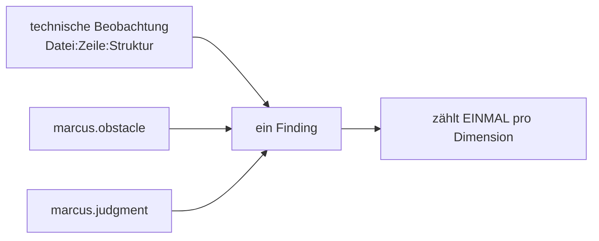

# Befund- & Bewertungsmodell

> Status: Konzeptphase. Definiert die Struktur eines Befunds, die
> Qualitätsdimensionen und das (bewusst zurückhaltende) Bewertungsmodell.

## 1. Das Befundobjekt (Finding)

Enthält alle vom Auftrag (§4E) geforderten Angaben. Zentrale Idee:
**Beobachtung und Urteil sind getrennt**, **Schwere und Konfidenz sind getrennt**,
und die **philosophische Deutung ist als Deutung markiert** (Leitprinzipien L2, L3, L5).

```jsonc
{
  "id": "finding:7f3a…",                 // stabil aus Inhalt gehasht (reproduzierbar)
  "rule": { "id": "R-ERR-SWALLOWED", "version": "1.0.0" },
  "ruleSet": "default@1",

  "location": {
    "file": "src/import/parser.ts",
    "range": { "startLine": 42, "startCol": 5, "endLine": 44, "endCol": 6 },
    "symbol": "parseRecord",
    "structure": "catch-clause"            // betroffene Code-Struktur
  },

  "observation": {                         // TATSACHE (überprüfbar, kein Urteil)
    "statement": "catch-Block ohne Behandlung, Logging oder Re-Throw.",
    "evidence": [
      { "fact": "ast.emptyCatch", "value": true, "certainty": "syntactic" },
      { "fact": "ast.catchHasRethrow", "value": false, "certainty": "syntactic" }
    ]
  },

  "interpretation": {                      // DEUTUNG (markiert, nicht als Fakt)
    "principles": [
      { "id": "marcus.obstacle", "name": "Hindernis wird zur Förderung",
        "passages": ["marcus-meditations:5.20"],
        "attributionConfidence": 0.9,
        "rationale": "Ein verschluckter Fehler macht das Hindernis unsichtbar statt nutzbar." }
    ],
    "dimensions": ["error-handling", "robustness"]
  },

  "severity": "high",                      // Auswirkung, falls real
  "confidence": 0.95,                      // Sicherheit, dass Beobachtung zutrifft
  "certaintyBasis": "syntactic",

  "remediation": {
    "suggestion": "Fehler protokollieren, gezielt behandeln oder erneut werfen; erwarteten Leerfall kommentieren.",
    "drawbacks": "Zusätzliche Logging-Pfade; bei wirklich erwartetem Leerfall nur Kommentar nötig.",
    "patch": null                          // optionaler Patch NUR zur manuellen Prüfung
  },

  "missingContext": [                      // ehrlicher Hinweis auf Grenzen
    "Unbekannt, ob der Leerfall fachlich erwartet ist (kein Kommentar vorhanden)."
  ],

  "source": "deterministic",              // deterministic | semantic(LLM)
  "suppressed": false,
  "baselineStatus": "new"                 // new | known | fixed
}
```

### Pflicht- vs. Optionalfelder
- **Pflicht:** `location`, `observation(+evidence)`, `interpretation.principles`,
  `severity`, `confidence`, `certaintyBasis`, `remediation.suggestion`, `source`.
- **Optional:** `remediation.patch` (immer nur Vorschlag), `missingContext`
  (empfohlen), `baselineStatus`, `ruleMaturity` (nur der Wert
  `"experimental"`; fehlt = stabile Regel).
- **Konfidenz-Deckel:** `confidence` überschreitet nie den Deckel ihrer
  `certaintyBasis` (`syntactic` 1,0, `external-tool` 0,9, `semantic-heuristic`
  0,6). Deklarative Regeln wendeten ihn schon immer an; seit Flutter-Qualitätsstrang
  E1b wendet die Regel-Engine denselben Deckel zentral auf Project-Rule-Befunde an.

### Regeln für die Darstellung
- Die `interpretation` wird in Berichten **sprachlich als Deutung** ausgegeben
  („mögliche Deutung im Sinne von …"), nie als objektive Tatsache.
- `observation` darf **keine** Wertung enthalten (keine Adjektive wie „schlecht").
- LLM-Befunde (`source: "semantic"`) sind im Bericht sichtbar gekennzeichnet.

## 2. Qualitätsdimensionen

Getrennte Achsen (Auftrag §6). Ein Befund kann mehrere betreffen.

| Dimension-ID | Deutsch | Beispielhafte Facts/Regeln |
|--------------|---------|-----------------------------|
| `complexity` | Komplexität | kognitive/zyklomat. Komplexität, Nesting |
| `understandability` | Verständlichkeit | Komplexität, Benennung (nur belegbar), Länge+Dichte |
| `responsibility-boundaries` | Verantwortungsgrenzen | Kohäsion, Schichtmischung |
| `dependencies` | Abhängigkeiten | Zyklen, Fan-in/out, ungenutzte Importe |
| `error-handling` | Fehlerbehandlung | verschluckte Fehler, fehlende Behandlung |
| `side-effect-control` | Kontrollierbarkeit von Seiteneffekten | I/O/Global/Uhr in „rein" wirkenden Einheiten |
| `decision-evidence` | Belegbarkeit von Entscheidungen | Deklaration ↔ Verhalten, Architekturregeln |
| `robustness` | Robustheit | Null-/Fehlerpfade (u. a. aus `tsc`/PHPStan) |

## 3. Bewertungsmodell (transparent & zurückhaltend)

### 3.1 Grundsatz
Kein undurchsichtiger Gesamtscore. Primärausgabe ist ein **Dimensionen-Profil**
(ein Wert je Dimension), nicht eine Zahl. Ein aggregierter „Stoic Code Index"
ist **optional** und erscheint nie ohne sein Profil und seine Unsicherheit.

### 3.2 Herleitung eines Dimensionswerts
Pro Dimension *d*:

```
weightedIssues(d) = Σ_findings∈d  severityWeight(sev) × confidence
exposure(d)       = analysierbare Einheiten/LOC, die Regeln dieser Dimension betreffen
rawPenalty(d)     = weightedIssues(d) / normalize(exposure(d))
score(d)          = clamp(100 − scale × rawPenalty(d), 0..100)
```

- `severityWeight`: z. B. low=1, medium=3, high=9 (dokumentiert, nicht „gefühlt").
- **Normierung auf Exposure** macht Projekte/Sprachen vergleichbarer (Befunde pro
  betroffener Einheit, nicht absolut).
- Jeder Dimensionswert trägt ein **Unsicherheitsband** aus der durchschnittlichen
  Konfidenz und der Abdeckung (z. B. `score(error-handling) = 72 ± 8`).

### 3.3 Optionaler Gesamtindex
Falls aktiviert: gewichtetes Mittel der Dimensionswerte mit **offengelegten
Gewichten**. Immer zusammen mit (a) dem Profil, (b) der Abdeckung, (c) der
mittleren Konfidenz dargestellt. Er wird **nie** allein als „die Note" gezeigt.

### 3.4 Vergleichbarkeit über Sprachen
- Werte sind relativ zur **Exposure in derselben Sprache** zu lesen; der
  Cross-Language-Vergleich ist explizit mit Vorbehalt versehen (verschiedene
  Adapter-Reife). Berichte weisen pro Sprache Abdeckung und Adapterversion aus.

## 4. De-Duplizierung und Mehrfachdeutung

Ein technisches Problem = **ein** Finding, auch wenn mehrere Prinzipien es deuten.



- **Dedup-Schlüssel:** `(file, normalizedRange, symbol, problemKind)`. Mehrere
  deklarative Regeln auf denselben Schlüssel ⇒ ein Finding mit **Liste** von
  Prinzip-Deutungen (die erste Regel in Regelsatz-Reihenfolge behält ihre
  Identität; stabil gewinnt gegen experimentell). Zwei Subjekte an einer
  Position mit verschiedenen Symbolen sind zwei Findings. Findings von
  Projektregeln werden nie zusammengeführt: zwei davon mit einer Identität sind
  ein Regelfehler, den Evaluator und Baseline berichten, nicht verbergen.
- **Scoring zählt einmal** pro Dimension – kein Mehrfachgewicht nur, weil ein
  Problem unter mehreren Perspektiven sichtbar ist (Auftrag §8).
- Betrifft ein Problem mehrere Dimensionen, wirkt es in jeder **einmal** (bewusst,
  da es dort real unterschiedliche Qualität betrifft).

## 5. Schutz vor Fehlanreizen (Anti-Goodhart)

- Kein Single-Score als Default; Profil + Unsicherheit stehen im Vordergrund.
- Scores sind **nicht** über die Baseline rückwirkend „grün" erzwingbar
  (Suppression wird protokolliert und ist im Bericht sichtbar).
- Berichte zeigen **Beispiele** statt nur Zahlen (Evidenz vor Wertung).
- Fehlalarm-/Trefferquoten sind selbst Teil des Berichts-Vertrauens
  (siehe [evaluation.md](./evaluation.md#4-fehlalarme-messen)).

## 6. Berichtformate

| Format | Zweck |
|--------|-------|
| **CLI** (Mensch) | Zusammenfassung, Top-Befunde mit Evidenz + Deutung + Vorschlag |
| **Markdown** | Teilbarer Bericht (z. B. PR-Kommentar) |
| **JSON** | Maschinenlesbar, vollständiges Finding-Schema, stabil sortiert |
| **SARIF** | Integration in CI / Code-Hosting (GitHub Code Scanning etc.) |

Alle Formate stempeln Engine-, Regelsatz-, KB- und Adapterversionen sowie die
Analyse-Abdeckung.

**Ausgabefilter** (`--min-confidence <0..1>`, `--certainty <liste>`,
`--no-experimental`) wirken nur auf den gerenderten Bericht, nach einem etwaigen
Baseline-Vergleich: Eine im selben Lauf geschriebene Baseline enthält weiterhin
alle Befunde, und ein Filter lässt nie einen Befund `fixed` erscheinen. Ein
gefilterter Bericht hält die aktiven Kriterien und die Zahl der ausgeblendeten
Befunde in `AnalysisReport.filter` fest (`{minConfidence?, certainty?,
excludeExperimental?, hiddenCount}`); Markdown zeigt das im Kopf, SARIF in
`invocations[0].properties.filter`. Befunde experimenteller Regeln sind mit
`[experimental]` (Markdown) bzw. `properties.maturity` (SARIF) markiert.

**Deklarierte Architektur** (`--architecture <datei>`, E5b): der Bericht erhält
`AnalysisReport.architecture` — `{path, version, layers: [{name, files}],
unassignedFiles, warnings: {multipleMatchCount, multipleMatchSample,
emptyLayers, unknownLayerReferences}}`; Markdown zeigt das im Kopf, SARIF in
`invocations[0].properties.architecture`. Ohne Konfiguration fehlt das Feld.

**Identität:** die Identität eines Befunds für Baseline und Korpusbewertung ist
(projektrelative Datei, Regel-ID, `location.symbol`). Regeln, die mehrere Ziele
von einer Stelle melden, tragen das Ziel ins Symbol ein (SOLID: `Klasse:Ziel`,
`Klasse:Vertrag`, der Pfad der importierten Datei oder `package:<name>`), sodass
zwei Befunde nie dieselbe Identität teilen. Regeln, die mehrere STELLEN unter
einem Namen melden, nummerieren sie in Quelltextreihenfolge nach der
`#n`-Konvention (Flutter-Lifecycle: `Klasse.feld`, `Klasse.signIn#1`,
`Klasse.initState:Theme.of#0`; Flutter-Layout: `Page.build>Expanded#2`, je
Datei nummeriert). Funktionen und Methoden (das Subjekt der deklarativen
Komplexitäts-, Größen- und Seiteneffekt-Regeln) benennen die Adapter mit
allen umschließenden benannten Bereichen: `Service.run`, `outer.inner`,
`api.run` (ein an `api` gebundenes Objektliteral) in TS, `A.run` für eine
Dart-Klasse/-Mixin/-Extension und eine PHP-Klasse/-Trait/-Interface/-Enum,
`Buffer::reset` in C++. Namespaces gehören zum Namen (Identitätsschema 2):
`App\Svc\Repo.find` in PHP (auch bei Symbolen auf Klassenebene wie
`App\Entity\Order.customer`), `app::io::Buffer::reset` in C++ (ein anonymer
Namespace heißt `(anonymous)`; Definitionen innerhalb und außerhalb der
Klasse heißen gleich), `A.B.run` für TS `namespace A.B`; eine unbenannte
Dart-Extension heißt `(extension on T)`. Eine Basis, die in einer Datei
dennoch mehrfach vorkommt, wird zuerst nach dem unterschieden, was die
Deklarationen unterscheidet — ein TS-Accessor-Paar heißt
`A.size:get`/`A.size:set`, C++-Überladungen `f(int)`/`f(double)` — und erst
danach mit `#n`. Eine Funktion ohne Namen
übernimmt den Namen, an den sie gebunden ist (`const handler = () => …` →
`handler`, eine Objekt-Property, ein Klassenfeld, PHP `$handler = function
…`); ein Callback heißt `<Bereich>.(anonymous)#n`, nummeriert innerhalb
seines Bereichs (`C.go.(anonymous)#1`, `pair.(anonymous)#0` für einen
Callback in `const pair = list.map(…)`) — nie nach seiner Zeile, eine
Änderung darüber oder in einem anderen Bereich benennt ihn also nicht um.
Eine Befund-STELLE innerhalb einer Deklaration (ein catch, eine
DDL-Anweisung, ein a11y-Element, ein Validierungs-Handler …) heißt relativ zur
innersten umschließenden Funktion oder zum innersten Typ und wird je
(Bereich, Art) nummeriert: `Service.load>catch#0`, `Widgets>img#1`,
`Version20260101.up>loss#0` — ein neues catch in einer anderen Funktion
nummeriert sie nicht mehr um. Ein Import-Befund heißt nach seinem Modul
(`import:node:fs`, `#n` nur für dasselbe Modul, das zweimal importiert wird).
Eine Stelle außerhalb jeder Funktion und jedes Typs (statisches HTML,
Vue-/Angular-Templates, eine annotierte Konstante auf oberster Ebene) behält die Ordnungszahl je Datei (`img#3`).
Eine Kollision ist ein
Regelfehler: `stoa eval` scheitert daran, und `--update-baseline` verweigert
eine Baseline, die eine Identität wiederholt (`loadBaseline` könnte sie nicht
wieder lesen) — Exit 1, die bestehende Datei bleibt unverändert. `R-ORM-EAGER-RELATION` benennt einen
Befund `Entity.property`; Befunde auf Klassenebene benennen eine anonyme Klasse
`(anonymous)`, nummeriert als `(anonymous)#n`, wenn eine PHP-Datei mehrere
enthält (`new class extends AbstractMigration`). Keine Regel erzeugt bekannt
eine kollidierende Identität.

**Identitätsschema (Version):** die obigen Benennungsregeln sind Schema 2
(`IDENTITY_SCHEME` in `src/FindingIdentity.ts`); Schema 1 ist die frühere
Benennung (keine Namespaces, `#n` für Überladungen und Accessor-Paare,
Ordnungszahlen je Datei für Stellen). Eine Baseline hält ihr Schema fest
(`"identity": 2`; eine Datei ohne das Feld ist Schema 1). Eine Baseline eines
anderen Schemas wird nie verglichen — Schlüssel zweier Schemata würden
bekannte Befunde als neu und andere als behoben melden, stillschweigend —,
die CLI endet mit Exit 1 und nennt den Ausweg: `--migrate-baseline`
analysiert denselben Code unter dem Schema der Baseline und dem aktuellen,
paart jeden Befund über seine Position mit sich selbst (`Finding.id`, in
beiden Läufen gleich) und schreibt die Baseline an Ort und Stelle neu;
Einträge, die kein aktueller Befund reproduziert, entfallen und werden
aufgelistet. Eine unvollständige Analyse und eine Identitätskollision lehnt
sie ab. Eine stille Migration gibt es nicht. Korpus-Manifeste
(`expected.json`) und Findings-Snapshots (`scripts/compare-findings.ts`)
halten das Schema genauso fest (fehlt = 1): ein Manifest eines anderen
Schemas lehnt `stoa eval` ab; zwei Snapshots verschiedener Schemata werden
über die Position verglichen, jede geänderte Identität wird aufgelistet.

## 7. Grenzen

- Scores sind **technische Operationalisierungen**, keine Messung
  „philosophischer Qualität" (Auftrag §6). Berichte sagen das explizit.
- Bei geringer Abdeckung (viele nicht-analysierbare Dateien) sind Werte
  schwach belegt; das Unsicherheitsband und ein Abdeckungs-Hinweis machen das sichtbar.
