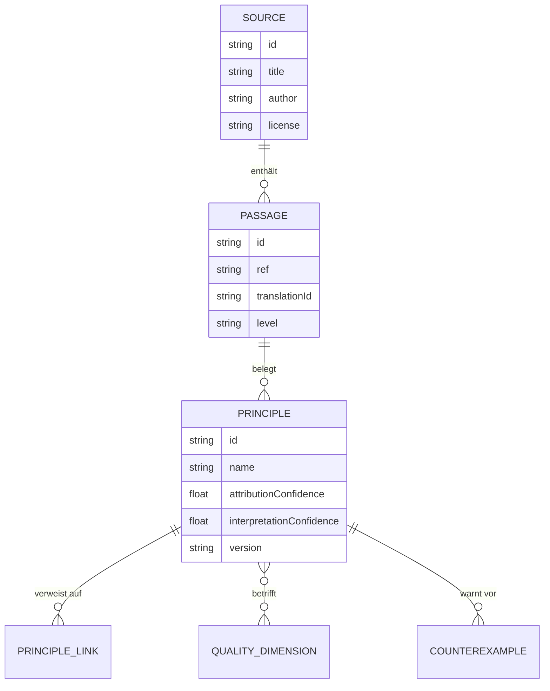
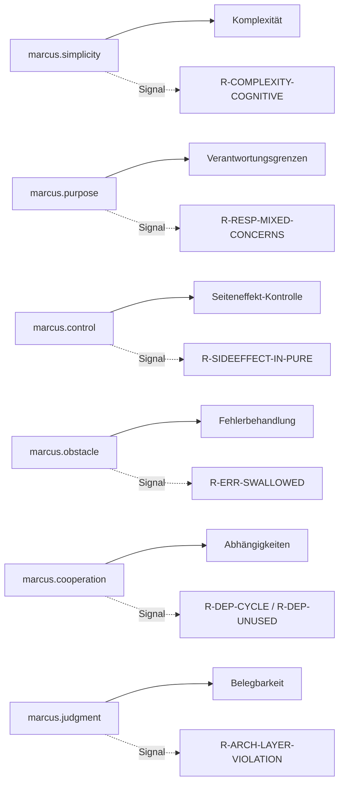

# Wissensmodell – Philosophische Wissensbasis (KB)

> Status: Konzeptphase. Definiert das Datenmodell der Wissensbasis und arbeitet
> sechs Beispielprinzipien vollständig aus. Quellenmethodik:
> [philosophical-foundation.md](./philosophical-foundation.md).

## 1. Entwurfsziele

- **Zitierfähig statt Volltext.** Einzelne Fundstellen + Interpretationen, kein
  undifferenzierter Buchtext (Leitprinzip L6, Nichtziel N1).
- **Strikte Trennung** (Erweiterbarkeit, siehe [§6](#6-erweiterbarkeit-mehrere-werke)):
  `Source` (Werk) → `Passage` (Fundstelle) → `Principle` (Interpretation) →
  *(getrennt in [rule-model.md](./rule-model.md))* `Rule`.
- **Zwei getrennte Konfidenzen**: Attribution (stammt der Gedanke belegt von der
  Quelle?) und Interpretation (trägt die technische Übertragung?).
- **Versioniert** mit Änderungshistorie; die KB ist read-only für Regel-/LLM-Schicht.

## 2. Entitäten (Überblick)



> `Rule` ist bewusst **nicht** Teil der KB (siehe [architecture.md](./architecture.md#5-schichten--und-abhängigkeitsregeln)).
> Regeln referenzieren Prinzipien über deren ID, nicht umgekehrt.

## 3. Datenmodell (Felder)

### 3.1 `Source` (Werk)
| Feld | Typ | Bedeutung |
|------|-----|-----------|
| `id` | string | z. B. `marcus-meditations` |
| `title` / `author` | string | „Selbstbetrachtungen" / „Marc Aurel" |
| `translations[]` | Translation[] | je: `id`, `translator`, `year`, `language`, `license`, `isPublicDomain` |

### 3.2 `Passage` (Fundstelle)
| Feld | Typ | Bedeutung |
|------|-----|-----------|
| `id` | string | z. B. `marcus-meditations:4.24` |
| `ref` | string | kanonisch `Buch.Abschnitt` |
| `quotes[]` | Quote[] | je: `translationId`, `text`, `level` (`QUELLE`/`ÜBERSETZUNG`/`INTERPRETATION`) |
| `verification` | enum | `CONFIRMED` / `PARTIAL` / `UNVERIFIED` |
| `verificationNote` | string | Prüfquelle/Unsicherheit |

### 3.3 `Principle` (die eigentliche Interpretation) — **Pflichtfelder laut Auftrag**
| Feld | Typ | Bedeutung |
|------|-----|-----------|
| `id` | string | eindeutig, z. B. `marcus.simplicity` |
| `name` | string | Kurzbezeichnung |
| `passages[]` | ref[] | Belegstellen (→ `Passage.id`) |
| `originalThought` | string | belegter Originalgedanke / belegte Zusammenfassung (Ebene markiert) |
| `softwareInterpretation` | string | Deutung im Softwarekontext (`INTERPRETATION`) |
| `qualityDimensions[]` | enum[] | betroffene Dimensionen (siehe [finding-model.md](./finding-model.md#2-qualitätsdimensionen)) |
| `applicableAnalyses[]` | enum[] | `ast` / `cfg` / `dfg` / `deps` / `metric` / `external-tool` / `semantic` |
| `preconditions` | string | Voraussetzungen für sinnvolle Anwendung |
| `limits` | string | Grenzen der automatischen Erkennung |
| `counterexamples[]` | string[] | wann ein Befund **nicht** gerechtfertigt wäre |
| `attributionConfidence` | 0..1 | Belegstärke zur Quelle |
| `interpretationConfidence` | 0..1 | Tragfähigkeit der Übertragung |
| `version` | semver | Prinzip-Version |
| `changelog[]` | Change[] | `version`, `note` (ohne Datum im Kern; Zeit gehört in Berichts-Metadaten) |
| `relatedPrinciples[]` | ref[] | z. B. „verwandt", „in Spannung mit" |

### 3.4 JSON-Beispiel (eine vollständige Prinzip-Instanz)

```json
{
  "id": "marcus.simplicity",
  "name": "Maßhalten – das Notwendige tun",
  "passages": ["marcus-meditations:4.24"],
  "originalThought": "QUELLE (Long 1862, 4.24): 'Occupy thyself with few things ... Do what is necessary.' Marc Aurel rät, sich auf das Notwendige zu beschränken, um Ruhe zu gewinnen – der Zusatz verschiebt den Fokus von 'wenig' zu 'das Notwendige'.",
  "softwareInterpretation": "INTERPRETATION: Code soll nur die Komplexität tragen, die seine Aufgabe erfordert. Nicht 'kurz um jeden Preis', sondern 'so komplex wie nötig, nicht komplexer'.",
  "qualityDimensions": ["complexity", "understandability"],
  "applicableAnalyses": ["ast", "cfg", "metric", "semantic"],
  "preconditions": "Funktion/Methode mit messbarer Kontrollfluss- und kognitiver Komplexität; Aufgabe der Einheit grob bekannt.",
  "limits": "Hohe Komplexität kann sachlich notwendig sein (Parser, Zustandsautomat). Metrik ist Signal, nicht Urteil.",
  "counterexamples": [
    "Lange, aber lineare Switch-Tabelle (hohe Länge, geringe kognitive Last).",
    "Inhärent komplexer Algorithmus mit Tests und klarer Dokumentation.",
    "Generierter Code."
  ],
  "attributionConfidence": 0.9,
  "interpretationConfidence": 0.7,
  "version": "1.0.0",
  "changelog": [{ "version": "1.0.0", "note": "Erstfassung (MVP)." }],
  "relatedPrinciples": ["marcus.purpose"]
}
```

## 4. Mapping-Übersicht



## 5. Beispielprinzipien (vollständig ausgearbeitet)

Jedes Prinzip folgt den **acht** vom Auftrag geforderten Punkten. Belege:
[philosophical-foundation.md §2](./philosophical-foundation.md#2-geprüfte-textstellen-belegregister).

---

### 5.1 `marcus.simplicity` — Maßhalten / das Notwendige tun

1. **Quelle & belegte Bedeutung.** 4.24 (Long): „Occupy thyself with few things …
   Do what is necessary." Attribution: hoch (Long schreibt „the philosopher",
   d. h. der Gedanke ist bei Marc Aurel referiert; die Kernaussage „das
   Notwendige tun" ist seine Ergänzung).
2. **Übertragung.** Komplexität soll der Aufgabe angemessen sein – nicht minimal,
   sondern notwendig. Überflüssige Verzweigung, Verschachtelung, Indirektion
   sind Kandidaten für Reduktion.
3. **Technische Hypothese.** Einheiten mit **hoher kognitiver Komplexität**
   *und* geringer sachlicher Notwendigkeit sind schwerer verständlich/wartbar.
4. **Analyse.** Statisch: kognitive Komplexität (Verschachtelung, Negationen,
   Flow-Brüche), zyklomatische Komplexität, Nesting-Tiefe (AST/CFG, `metric`).
   Semantisch (optional): „ist die Komplexität sachlich erforderlich?".
5. **Gerechtfertigter Befund.** Funktion mit kognitiver Komplexität 25, 5 Ebenen
   Verschachtelung, gemischten Negationen, keine Tests, Aufgabe laut Name
   „format address".
6. **Nicht gerechtfertigter Befund.** Zustandsautomat/Parser mit inhärent hoher,
   dokumentierter Komplexität und Testabdeckung; oder langer, aber flacher,
   linearer `switch`. → **kein** Befund bzw. unterdrückt.
7. **Bewertungskriterien.** Schwere ∝ kognitive Komplexität × (Code-Churn/
   Nutzungsgrad); Konfidenz sinkt bei Hinweisen auf sachliche Notwendigkeit
   (Tests, Doku, generiert).
8. **Grenzen.** „Notwendig" ist nicht rein statisch bestimmbar → bei Unsicherheit
   niedrige Konfidenz, ggf. an `semantic` delegieren. **Gefahr:** „lange Funktion
   = schlecht" ist ausdrücklich unzulässig (Auftrag §5).

---

### 5.2 `marcus.purpose` — Zweck & Aufgabe

1. **Quelle & belegte Bedeutung.** 8.19 „Everything exists for some end"; 5.1
   „I am rising to the work of a human being". Attribution: mittel–hoch.
2. **Übertragung.** Jede Einheit (Funktion/Klasse/Modul) sollte **einen**
   erkennbaren Zweck erfüllen (Kohäsion, Single Responsibility).
3. **Technische Hypothese.** Einheiten, die **mehrere unzusammenhängende
   Verantwortungen** bündeln (z. B. HTTP + Persistenz + Formatierung in einer
   Funktion), sind schwerer zu ändern und zu testen.
4. **Analyse.** Statisch: Kohäsionsheuristiken (LCOM-artig), Vielfalt der
   benutzten Fremd-Namespaces/Imports innerhalb einer Einheit, Mischung von
   Schichten (I/O-Call + reine Logik + Präsentation). Semantisch: „erfüllt die
   Funktion ihre benannte fachliche Verantwortung?".
5. **Gerechtfertigter Befund.** Methode `saveUser()`, die zusätzlich E-Mails
   formatiert, HTTP aufruft und Logging-Policy setzt – drei Namespaces/Schichten.
6. **Nicht gerechtfertigter Befund.** Eine Fassade/`Orchestrator`-Funktion, deren
   *Zweck* gerade Koordination ist; oder ein DTO mit vielen Feldern (viele
   Member ≠ viele Verantwortungen). → kein Befund.
7. **Bewertungskriterien.** Schwere ∝ Anzahl getrennter Schichten/Concerns ×
   Größe; Konfidenz hoch bei klaren Schichtmischungen, niedrig bei
   Koordinationsrollen.
8. **Grenzen.** „Verantwortung" ist fachlich, nicht syntaktisch → ohne Kontext
   nur Heuristik; Benennungskonventionen nötig. Semantik verbessert Trefferqualität.

---

### 5.3 `marcus.control` — Das Eigene / die Urteilskraft

1. **Quelle & belegte Bedeutung.** ⚠ **Primär Epiktet, *Encheiridion* 1**
   (Dichotomie der Kontrolle). Marc Aurel verwandt: 12.22 „everything is opinion,
   and opinion is in thy power"; 6.8; 5.19. **Attribution zu Marc Aurel: niedrig**
   – ausdrücklich gekennzeichnet (siehe
   [foundation §4](./philosophical-foundation.md#wichtiger-ehrlichkeitsvermerk-zu-marcuscontrol)).
2. **Übertragung.** Code sollte seinen **kontrollierbaren** Zustand von
   unkontrollierbaren Außeneinflüssen (I/O, Zeit, Zufall, globaler Zustand)
   klar trennen; Seiteneffekte sollen sichtbar und begrenzt sein.
3. **Technische Hypothese.** **Versteckte Seiteneffekte** in scheinbar reinen
   Einheiten (nach Name/Signatur) erhöhen Fehlerrisiko und erschweren Tests.
4. **Analyse.** Statisch (DFG/`ast`): Zugriffe auf globalen/statischen Zustand,
   I/O-Aufrufe, Uhr/Zufall in Funktionen, deren Signatur Reinheit nahelegt;
   Mutation von Eingabeparametern. Semantisch: Einordnung im Projektkontext.
5. **Gerechtfertigter Befund.** `calculateTotal(items)` liest zusätzlich
   `Date.now()` und schreibt in eine globale Variable – Ergebnis nicht
   reproduzierbar, Signatur suggeriert Reinheit.
6. **Nicht gerechtfertigter Befund.** Eine klar benannte `main()`/`Repository`/
   `Service`-Methode, deren Zweck I/O ist; bewusst gekapselter Zustand in einer
   Klasse. → kein Befund.
7. **Bewertungskriterien.** Schwere ∝ Diskrepanz zwischen erwarteter Reinheit und
   tatsächlichem Seiteneffekt; Konfidenz hoch bei Uhr/Zufall/globaler Mutation.
8. **Grenzen.** „Erwartete Reinheit" wird aus Name/Signatur geschätzt →
   Fehlalarmrisiko; Sprachidiome unterschiedlich. Niedrige Attribution zu Marc
   Aurel bleibt im Befund sichtbar.

---

### 5.4 `marcus.obstacle` — Hindernis wird zur Förderung

1. **Quelle & belegte Bedeutung.** 5.20 (Long): „the mind … changes every
   hindrance … into an aid …". Attribution hoch. ⚠ **Nicht** die Hays-Fassung
   („what stands in the way becomes the way", urheberrechtlich geschützt) zitieren.
2. **Übertragung.** Fehler/Ausnahmen sind **Information**, kein Störfaktor, den
   man unterdrückt. Angemessene Fehlerbehandlung macht das Hindernis nutzbar.
3. **Technische Hypothese.** **Unterdrückte Fehler** (leerer `catch`, verschluckte
   Rejections, ignorierte Rückgabe-Fehlercodes) verbergen Defekte und
   verschlechtern Robustheit.
4. **Analyse.** Statisch (`ast`/`cfg`): leere/triviale `catch`-Blöcke,
   `catch` ohne Re-Throw/Logging/Behandlung, verschluckte Promises (fehlendes
   `await`/`.catch`), `catch (…) {}` als Kontrollfluss, generisches Fangen von
   `Throwable`/`Exception` ohne Differenzierung. Externe Facts: `tsc`/PHPStan.
5. **Gerechtfertigter Befund.** `try { parse() } catch (e) {}` – leerer catch,
   kein Logging, kein Re-Throw; Parsefehler verschwindet lautlos.
6. **Nicht gerechtfertigter Befund.** `catch` mit bewusster, kommentierter
   Behandlung („optionaler Cache-Miss ist erwartet, bewusst ignoriert") oder mit
   Logging/Fallback. → kein Befund (Konfidenz sinkt bei Kommentar/Behandlung).
7. **Bewertungskriterien.** Schwere ∝ Reichweite des verschluckten Fehlers
   (öffentliche API vs. lokal); Konfidenz hoch bei wirklich leerem Block.
8. **Grenzen.** Legitime „leere" Behandlung existiert → Kommentar-/Heuristik-Signale
   nötig; nicht jede Sprache kennt geprüfte Ausnahmen.

---

### 5.5 `marcus.cooperation` — Dem Ganzen dienen

1. **Quelle & belegte Bedeutung.** 6.54 „That which is not good for the swarm,
   neither is it good for the bee"; 2.1 „we are made for co-operation …".
   Attribution hoch.
2. **Übertragung.** Ein Modul soll sich ins Ganze fügen: klare, **gerichtete**,
   nötige Abhängigkeiten – keine Zyklen, keine überflüssige Kopplung, keine
   Verletzung der Architekturrichtung.
3. **Technische Hypothese.** **Zyklische** oder **überflüssige** Abhängigkeiten
   (ungenutzte Importe, Kopplung gegen die Schichtenrichtung) schaden dem Ganzen
   mehr als dem einzelnen Modul.
4. **Analyse.** Statisch (`deps`): Import-/Modulgraph, Zyklenerkennung, ungenutzte
   Importe, Fan-in/Fan-out, Richtung gegen deklarierte Schichten. Externe Facts
   möglich (Bundler/`madge`-artig).
5. **Gerechtfertigter Befund.** Zyklus `a → b → c → a`; oder `domain/`-Modul
   importiert `infrastructure/` (gegen die Richtung).
6. **Nicht gerechtfertigter Befund.** Hohe, aber **gerichtete** Fan-in auf ein
   bewusst zentrales Utility; erlaubte Abhängigkeit laut Architektur. → kein Befund.
7. **Bewertungskriterien.** Schwere: Zyklus > Richtungsverletzung > ungenutzter
   Import; Konfidenz hoch (rein strukturell, gut belegbar).
8. **Grenzen.** „Überflüssig" braucht teils fachliche Einordnung; dynamische
   Importe/DI können statisch unsichtbar sein.

---

### 5.6 `marcus.judgment` — Prüfung der Urteile (Meta-Prinzip)

1. **Quelle & belegte Bedeutung.** 4.7 „Take away thy opinion …"; 8.47 „… not this
   thing … but thy own judgement …"; 12.17 „if it is not true, do not say it".
   Attribution hoch.
2. **Übertragung (zwei Rollen).**
   (a) **Für Befunde (meta):** Trenne *Beobachtung* (Tatsache) von *Urteil*
   (Wertung); mache die eigene Unsicherheit explizit → begründet die Trennung
   Schwere/Konfidenz und das Verbot, Stil als Mangel auszugeben.
   (b) **Für Code:** „Sag nichts Unwahres" ⇒ **Deklaration soll dem Verhalten
   entsprechen**. Widersprüche zwischen behaupteter Architektur/Signatur und
   tatsächlichem Verhalten sind Befunde.
3. **Technische Hypothese.** **Deklaration ≠ Verhalten** (z. B. Schichtregel
   deklariert, aber verletzt; `@readonly`/`const`-Versprechen gebrochen;
   Rückgabetyp behauptet Nicht-Null, liefert aber Null) untergräbt Vertrauen.
4. **Analyse.** Statisch: Abgleich deklarierter Schicht-/Sichtbarkeits-/Typ-
   Verträge mit tatsächlichen Facts (`deps`, `dfg`, `external-tool` wie Psalm/
   PHPStan/`tsc`). Meta-Rolle: in Reporting/Scoring verankert, nicht als Code-Regel.
5. **Gerechtfertigter Befund.** Modul in `domain/` deklariert „keine
   Infrastruktur", importiert aber `fs`; oder Funktion mit Rückgabetyp `User`
   (non-null), die nachweislich `null` zurückgeben kann (per `tsc`-Fact).
6. **Nicht gerechtfertigter Befund.** Bewusst dokumentierte Ausnahme von der
   Schichtregel mit Begründung; oder vom Typsystem bereits abgedeckter Fall
   (dann kein eigener *stoa*-Befund – **Doppelzählung vermeiden**).
7. **Bewertungskriterien.** Schwere ∝ Reichweite des Widerspruchs; Konfidenz hoch,
   wenn aus zwei unabhängigen Facts belegt (Deklaration + Verhalten).
8. **Grenzen.** Nicht jede Architektur ist deklariert → ohne explizite Regeln
   keine Verletzung feststellbar; Meta-Rolle ist eine Produkt-Eigenschaft, keine
   automatische Code-Erkennung.

## 6. Erweiterbarkeit (mehrere Werke)

Die Trennung `Source`/`Passage`/`Principle` erlaubt weitere Werke **ohne**
Änderung von Regel-/Analyse-Schicht:

- **Epiktet** (*Encheiridion*) wird eine eigene `Source`; `marcus.control` kann
  dann eine Passage aus Epiktet als **Primärbeleg** referenzieren und seine
  Attributions-Konfidenz erhöhen (→ ggf. Umbenennung in `stoic.control`).
- Mehrere Prinzipien dürfen **dieselbe** Regel/denselben Befund deuten; die
  **De-Duplizierung** erfolgt im Finding-Modell (ein technischer Befund =
  ein Finding, mehrere Prinzip-Deutungen als Liste – siehe
  [finding-model.md §4](./finding-model.md#4-de-duplizierung-und-mehrfachdeutung)).

## 7. Validierung der KB

- JSON-Schema-Validierung aller Prinzipien (Pflichtfelder, Wertebereiche).
- Konsistenzprüfung: jede `passage`-Referenz existiert und ist `CONFIRMED` oder
  trägt sichtbar niedrigere Konfidenz.
- Jedes Prinzip besitzt ≥ 1 Gegenbeispiel (sonst CI-Fehler).
- Experten-Review der Interpretationen (siehe [evaluation.md](./evaluation.md)).
