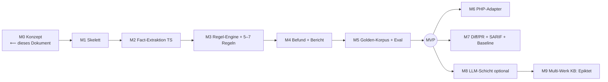

# Roadmap – MVP, Ausbaustufen, Meilensteine

> Status: Konzeptphase. Definiert einen realistischen MVP mit zählbaren
> Abnahmekriterien und die nachfolgenden Stufen.
>
> **Umsetzungsstand:** MVP und mehrere Ausbaustufen sind inzwischen implementiert
> (vier Sprachen + HTML, 23 Regeln, drei Ausgabeformate, i18n, optionale Schichten) —
> der aktuelle Ist-Stand steht in [implementation-status.md](./implementation-status.md).

## 1. MVP-Leitidee

Der MVP deckt **nicht** alle Prinzipien oder Sprachen ab. Er beweist die
**Kette**: Quellcode → Facts → deterministische Regeln → Befund mit Evidenz +
begründeter (markierter) Deutung → verständlicher Bericht – **ohne LLM**.

### MVP-Umfang

| Bereich | MVP-Inhalt |
|---------|-----------|
| Sprache | **TypeScript/JavaScript** (ein Adapter), via TS Compiler API / `ts-morph` |
| Wissensbasis | **6 quellengeprüfte Prinzipien** (`marcus.*`), je mit Gegenbeispiel |
| Regeln | **5–7 deterministische Regeln** (siehe [rule-model.md §5](./rule-model.md#5-beispiel-regelsatz-mvp)) |
| Analyse | AST, Kontrollfluss (lokal), Abhängigkeitsgraph, Komplexitätsmetriken, Fehlerbehandlungsmuster |
| Externe Facts | mindestens **eine** Integration (`tsc`-Diagnose) als Fact-Quelle |
| Befundmodell | vollständiges Finding (Beobachtung/Deutung/Schwere/Konfidenz getrennt) |
| Bewertung | **Dimensionen-Profil** (kein Default-Single-Score) |
| Schnittstelle | **CLI** `stoa analyze <path>` + JSON- und Markdown-Bericht |
| Tests | Unit-Tests je Regel (pos/neg), Golden-Project-Snapshot, Reproduzierbarkeitstest |
| LLM | **aus** (No-Op-Adapter vorhanden, aber inaktiv) |

### Bewusst **nicht** im MVP
PHP-Adapter, Diff/PR-Modus, Baseline/Suppression-Workflow, SARIF, Trendanalyse,
LLM-Anreicherung, eigener Regel-Editor, Multi-Werk-KB (Epiktet).

## 2. Abnahmekriterien

Prüfbare Kriterien, an denen „funktioniert der MVP?" entschieden wird. Messgrößen
stammen aus [evaluation.md](./evaluation.md).

| # | Kriterium | Messung / Schwelle |
|---|-----------|--------------------|
| AC-1 | **Lauffähigkeit** | `stoa analyze ./fixtures/project-a` erzeugt JSON+Markdown ohne Fehler. |
| AC-2 | **Reproduzierbarkeit** | Zwei Läufe auf gleichem Commit ⇒ **byte-identische** Findings (ohne LLM). |
| AC-3 | **Kette vollständig** | Jeder Befund trägt: Fundstelle, Beobachtung+Evidenz, ≥1 Prinzip-Deutung (markiert), getrennte Schwere/Konfidenz, Vorschlag. |
| AC-4 | **Positiv/Negativ je Regel** | Jede Regel hat ≥1 bestandenen Positiv- **und** Negativtest. |
| AC-5 | **Fehlalarm-Schwelle** | Precision je Regel auf dem Golden-Korpus ≥ definierter Wert (z. B. ≥ 0,8); sonst „experimental". |
| AC-6 | **Quellentreue** | Jedes Prinzip hat belegte Fundstelle + getrennte Konfidenzen; unsichere Zuordnungen (z. B. `marcus.control`) sind im Bericht sichtbar. |
| AC-7 | **Kein Stil-als-Mangel** | Kein MVP-Regelbefund beruht auf reiner Stilpräferenz (Review-Checkliste). |
| AC-8 | **Kontext schlägt Schwelle** | Mind. ein Negativtest zeigt, dass eine Metrikschwelle durch Kontext (`suppressWhen`) korrekt unterdrückt wird. |
| AC-9 | **Determinismus-Trennung** | Mit aktiviertem (Mock-)LLM sind semantische Befunde als `source: "semantic"` markiert und abschaltbar. |
| AC-10 | **Selbstanalyse (Dogfooding)** | *stoa* analysiert seinen eigenen Code und erzeugt einen plausiblen Bericht. |

## 3. Meilensteine

| Meilenstein | Inhalt | Abhängigkeit |
|-------------|--------|--------------|
| **M0** | Konzept & Spezifikation (dieses docs/-Set) | — |
| **M1** | Projektskelett, Schemata (Fact/Rule/Finding als JSON-Schema), CLI-Gerüst | M0 + Freigabe |
| **M2** | TS-Adapter: Parse + Fact-Extraktion (Komplexität, Deps, Fehlerbehandlung), `tsc`-Fact-Adapter | M1 |
| **M3** | Deterministische Regel-Engine + 5–7 Regeln + Prinzip-Kopplung | M2 |
| **M4** | Finding-Erzeugung, De-Dup, Dimensionen-Profil, JSON/Markdown-Reporter | M3 |
| **M5** | Golden-Korpus, Unit/Snapshot-Tests, Precision/Recall, Reproduzierbarkeitstest | M4 |
| **M6** | PHP-Adapter (`nikic/php-parser`-Bridge) → Validierung Sprachunabhängigkeit | MVP |
| **M7** | Diff/PR-Modus, SARIF, Baseline/Suppression | MVP |
| **M8** | LLM-Adapter (lokal/extern), Groundedness-Eval, markierte Anreicherung | MVP |
| **M9** | Zweites Werk (Epiktet) → `marcus.control` erhält Primärbeleg | M8 |

## 4. Ausbaustufen (nach MVP, Priorisierung vorläufig)

1. **Breite der Sprachen** (PHP zuerst — passt zum Projektumfeld).
2. **Workflow-Integration** (CI/PR, SARIF, Editor).
3. **Optionale Semantik** (LLM) — erst mit belastbarem Eval-Rahmen.
4. **Wissensbasis-Breite** (weitere Werke/Prinzipien, Experten-Review-Pipeline).
5. **Trend/History** (Qualitätsprofil über Zeit, ohne Single-Score-Fehlanreiz).

## 5. Risiken auf der Roadmap

Siehe [open-questions.md](./open-questions.md). Für die Roadmap kritisch:
Fehlalarm-Qualität der Heuristik-Regeln (M3/M5), Sprachunabhängigkeit des
Fact-Schemas (erst bei M6 real getestet), Aufwand interprozeduraler Analyse.
