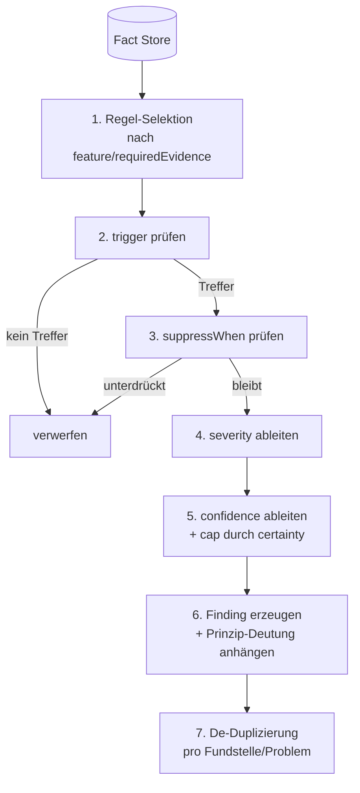

# Regelmodell – Definition & Ausführung der Regel-Engine

> Status: Konzeptphase. Definiert, wie Regeln aufgebaut sind, wie sie
> deterministisch ausgeführt werden und wie sie an Prinzipien gekoppelt sind.
> Datenbasis: Facts aus [architecture.md](./architecture.md#a-source-analysis).

## 1. Grundsätze

- **Regeln prüfen technisch, nicht philosophisch.** Eine Regel wertet Facts aus.
  Die philosophische Deutung kommt über die referenzierten Prinzipien hinzu
  (Trennung aus [knowledge-model.md](./knowledge-model.md)).
- **Determinismus.** Gleiche Facts + gleiche Regelversion + gleiche Config ⇒
  identische Findings. Keine Uhr, kein Zufall, keine Netzabhängigkeit.
- **Facts statt AST.** Regeln sehen nur das neutrale Fact-Schema, nie den
  rohen sprach­spezifischen AST → Sprachunabhängigkeit, leichte Testbarkeit.
- **Kontext vor Schwelle.** Eine Regel darf eine Metrik nie allein als Mangel
  werten; sie muss Kontext-/Ausnahmesignale berücksichtigen (Leitprinzip L4).
- **Kein Stil als Mangel.** Regeln, die nur subjektive Stilpräferenz abbilden,
  sind unzulässig (Nichtziel N4).

## 2. Fact-Schema (Eingang der Regeln)

Facts sind normalisierte, sprach­neutrale Beobachtungen. Minimalform:

```jsonc
{
  "id": "fact:...",
  "kind": "metric.cognitiveComplexity", // stabile Fact-Art
  "subject": {                           // worauf bezieht sich der Fact
    "file": "src/user.ts",
    "symbol": "formatAddress",
    "kindOf": "function",
    "range": { "startLine": 10, "startCol": 1, "endLine": 48, "endCol": 2 }
  },
  "value": 25,                           // je nach kind: number | bool | string | struct
  "evidence": [                          // woraus abgeleitet
    { "source": "ast", "detail": "nesting depth 5" }
  ],
  "certainty": "syntactic",              // syntactic | semantic-heuristic | external-tool
  "producedBy": { "adapter": "typescript", "version": "0.1.0" }
}
```

`certainty` ist entscheidend: sie begrenzt die maximale Finding-Konfidenz
(ein rein heuristischer Fact kann keine Hochkonfidenz-Regel auslösen).

## 3. Regeldefinition

Eine Regel muss laut Auftrag angeben: *welches Merkmal*, *welche Bedingung*,
*welche Prinzipien*, *welche Evidenz*, *wann kein Befund*, *welche Schwere/
Sicherheit*. Modell:

```jsonc
{
  "id": "R-COMPLEXITY-COGNITIVE",
  "version": "1.0.0",
  "title": "Übermäßige kognitive Komplexität",
  "feature": "metric.cognitiveComplexity",   // untersuchtes Merkmal (Fact kind)
  "appliesTo": ["function", "method"],
  "principles": ["marcus.simplicity"],         // Prinzip-Referenzen (KB)
  "dimensions": ["complexity", "understandability"],

  "trigger": {                                 // wann ein Befund ausgelöst wird
    "all": [
      { "fact": "metric.cognitiveComplexity", "op": ">=", "value": 15 }
    ]
  },

  "requiredEvidence": [                         // ohne diese Facts kein Befund
    "metric.cognitiveComplexity", "metric.nestingDepth"
  ],

  "suppressWhen": {                             // wann KEIN Befund gerechtfertigt ist
    "any": [
      { "fact": "flag.generatedCode", "op": "==", "value": true },
      { "fact": "flag.hasTests", "op": "==", "value": true,
        "and": [{ "fact": "metric.cognitiveComplexity", "op": "<", "value": 30 }] },
      { "fact": "shape.isFlatSwitch", "op": "==", "value": true }
    ]
  },

  "severity": {                                 // abgeleitet, nicht fix
    "base": "medium",
    "escalateWhen": [
      { "fact": "metric.cognitiveComplexity", "op": ">=", "value": 30, "to": "high" },
      { "fact": "metric.churn", "op": ">=", "value": 10, "to": "high" }
    ]
  },

  "confidence": {
    "base": 0.7,
    "capBy": "certainty",                       // syntactic→1.0, heuristic→0.6, extern→0.9
    "reduceWhen": [
      { "fact": "doc.hasComplexityRationale", "op": "==", "value": true, "by": 0.3 }
    ]
  },

  "message": "Kognitive Komplexität {value} in {symbol} erschwert Verständnis.",
  "remediationRef": "fix:reduce-cognitive-complexity",
  "tests": "tests/rules/R-COMPLEXITY-COGNITIVE/"   // Pflicht: Testkatalog
}
```

### Feldbedeutung (Kurz)
| Feld | Zweck |
|------|-------|
| `feature` / `requiredEvidence` | welches Merkmal; ohne die genannten Facts **kein** Lauf (vermeidet Raten) |
| `trigger` | Bedingungen, die einen Kandidaten erzeugen |
| `suppressWhen` | explizite Nicht-Befund-Bedingungen (Kontext!) |
| `severity` / `confidence` | **getrennt** abgeleitet; Konfidenz durch `certainty` gedeckelt |
| `principles` / `dimensions` | Kopplung an KB & Bewertungsmodell |
| `tests` | verpflichtender Testkatalog je Regel |

## 4. Ausführungsmodell



**Eigenschaften:**
- **Reihenfolge-unabhängig**: Regeln lesen nur den Fact Store; keine
  Reihenfolgenabhängigkeit zwischen Regeln (reine Funktion `facts → findings`).
- **Stabile Sortierung** der Findings (Datei, Zeile, Regel-ID) für byte-stabile
  Ausgabe.
- **Keine Regel darf Facts erzeugen** – nur lesen (Schichtregel).

## 5. Beispiel-Regelsatz (MVP)

| Regel-ID | Feature (Facts) | Prinzip | Dimension | Konfidenz-Charakter |
|----------|-----------------|---------|-----------|---------------------|
| `R-COMPLEXITY-COGNITIVE` | kognitive/zyklomat. Komplexität, Nesting | `marcus.simplicity` | Komplexität | syntaktisch, hoch |
| `R-RESP-MIXED-CONCERNS` | Schicht-/Namespace-Mischung je Einheit | `marcus.purpose` | Verantwortungsgrenzen | heuristisch, mittel |
| `R-SIDEEFFECT-IN-PURE` | I/O/Global/Uhr/Zufall in „rein" wirkender Einheit | `marcus.control` | Seiteneffekt-Kontrolle | heuristisch, mittel |
| `R-ERR-SWALLOWED` | leerer/trivialer catch, verschluckte Promise | `marcus.obstacle` | Fehlerbehandlung | syntaktisch, hoch |
| `R-DEP-CYCLE` | Zyklus im Modulgraph | `marcus.cooperation` | Abhängigkeiten | syntaktisch, hoch |
| `R-DEP-UNUSED` | ungenutzter Import | `marcus.cooperation` | Abhängigkeiten | syntaktisch, hoch |
| `R-ARCH-LAYER-VIOLATION` | Import gegen deklarierte Schichtregel | `marcus.judgment` | Belegbarkeit | syntaktisch, hoch (nur mit Schichtregeln) |

> Reine Stilregeln (Einrückung, Anführungszeichen, Namenslänge) sind
> **ausgeschlossen**. Solche Prüfungen bleiben bei ESLint/CS-Fixer.

## 6. Versionierung & Determinismus-Garantien

- **Regel-Version (semver)** je Regel; **Regelsatz-Version** (`default@1`) bündelt
  Regeln + Schwellen. Berichte stempeln beide (Reproduzierbarkeit).
- Schwellen (`value`-Grenzen) sind **Teil der Regelversion** – eine
  Schwellenänderung ist eine Versionsänderung, nicht eine stille Config-Drift.
- **Config-Overrides** sind erlaubt, werden aber im Bericht ausgewiesen (damit
  „warum weicht mein Ergebnis ab?" beantwortbar bleibt).

## 7. Testbarkeit (Pflicht je Regel)

Jede Regel besitzt einen Testkatalog mit mindestens:
- **≥ 1 positiver Fixture** (löst Befund korrekt aus),
- **≥ 1 negativer Fixture** (löst korrekt *keinen* Befund aus — prüft
  `suppressWhen`/Gegenbeispiele),
- **Snapshot** des erzeugten Findings (Felder, Schwere, Konfidenz).

Siehe [evaluation.md](./evaluation.md#3-tests-und-referenzkorpus).

## 8. Grenzen des Regelmodells

- Regeln sind nur so gut wie die Facts. Fehlende interprozedurale Datenflüsse
  begrenzen z. B. `R-SIDEEFFECT-IN-PURE`.
- Kontextregeln (`suppressWhen`) brauchen zuverlässige Kontext-Facts
  (Tests vorhanden? generiert? dokumentiert?) — deren Qualität ist selbst zu testen.
- Semantische Urteile („Abstraktion wirklich überflüssig?") gehören **nicht** in
  deterministische Regeln, sondern in die optionale LLM-Schicht (als separat
  markierte, belegpflichtige Ergänzung).
