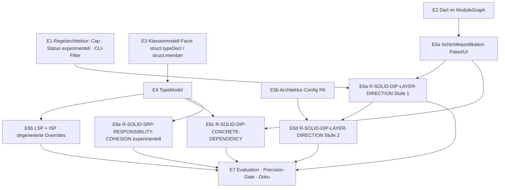

# SOLID – Implementierungsplan (Flutter-Qualitätsstrang, Phase E)

> Status: **Plan, keine Implementierung.** Grundlage ist die Machbarkeitsanalyse
> [solid-feasibility.md](./solid-feasibility.md) (Phase D). Englische Fassung:
> [../en/solid-implementation-plan.md](../en/solid-implementation-plan.md).
>
> **Entscheidungen des Nutzers (Phase E):**
>
> | Thema | Entscheidung |
> |---|---|
> | DIP-Schichtregel | gestuft: zuerst Hinweis per Paketklassifikation, später sichere Verstöße gegen eine deklarierte Architektur-Config (R6) |
> | Aktivierung | alle SOLID-Regeln nur per Opt-in `--solid` |
> | Querschnitt | die Regelarchitektur-Grundlagen (Konfidenz-Cap für Projektregeln, Regelstatus „experimentell“, CLI-Filter) kommen **vor** SOLID |

## 0. Grundsätze für die Umsetzung

- **Jeder Schritt E1–E7 ist eine eigene Phase.**
  - Jede Phase wird einzeln freigegeben und berichtet: Änderungen, Dateien, Tests, Befunde, offene Punkte, Git-Status.
  - Es gibt keine Commits ohne Auftrag.
- **APIs werden nur additiv erweitert**, nach dem Muster von `symbolGraph`, `flutterWidgetGraph` und `dartLibraryIndex`:
  - neue Felder sind optional;
  - neue Facts bekommen neue Kinds;
  - bestehende Fact-Werte bleiben unverändert.
- **Ohne `--solid` bleibt jede Ausgabe byte-identisch.** Golden Corpus und echte Apps
  werden in jedem Schritt gegen den Vorstand verglichen. Einzige geplante Ausnahme ist
  E1b (Konfidenz-Cap). Sie ist als genehmigungspflichtige Korrektur ausgewiesen.
- **Unbekannt bleibt unbekannt.** Mehrdeutige Identität, unaufgelöste Typen,
  DI-Container und Parse-Fehler erzeugen nie einen Befund. Sie werden höchstens als
  Abdeckungsvermerk in `missingContext` ausgewiesen.
- **Keine Größen- und keine Namensheuristik als Befundgrundlage.** Klassengröße,
  Methodenzahl und Namensmuster wie „…Service“ dürfen nur Evidenz ergänzen, nie auslösen.
- **Neue Abhängigkeiten:** keine geplant.
  - ajv (Schema-Validierung), ts-morph und web-tree-sitter sind vorhanden.
  - Ein Update der Dart-Grammatik (Dart 3) ist **nicht** Teil dieses Plans.

## 1. Überblick und Reihenfolge



| Schritt | Inhalt | Aufwand | Ändert Befunde ohne `--solid`? |
|---|---|---|---|
| E1 | Regelarchitektur-Grundlagen | M | **ja, E1b** (zwei Konfidenzwerte), genehmigungspflichtig |
| E2 | Dart-Importkanten im ModuleGraph | M | nein (Zyklusregel bleibt auf ihren bisherigen Kanten) |
| E3 | Neutrale Klassenmodell-Facts (Dart, TS) | L | nein (neue Fact-Kinds, keine Regel liest sie) |
| E4 | TypeModel | M | nein |
| E5a | Schichtklassifikation (Pakete, UI-Identität) | S | nein |
| E5b | Architektur-Config R6 (`--architecture`) | M | nein (ohne Datei inaktiv) |
| E6a–e | SOLID-Regeln | je S–M | nein (nur mit `--solid`) |
| E7 | Corpus, Precision-Gate, Doku | M | nein |

Die Pfade E1, E2→E5a→E6a und E3→E4→E6b sind voneinander unabhängig.

**Empfohlene Abfolge:**

1. E1 → E2 → E5a → E6a: der erste nutzbare SOLID-Hinweis mit kleinstem Unterbau.
2. E3 → E4 → E6b → E6c.
3. E5b → E6d.
4. E6e erst nach E7-Kalibrierung.

## 2. E1 – Regelarchitektur-Grundlagen

**E1a – Regelstatus `maturity`**

- `src/rules/RuleTypes.ts`: optionales Feld `maturity?: 'stable' | 'experimental'`
  in `Rule` (JSON) und `ProjectRule`; fehlt es, gilt `stable`.
- `schemas/rule.schema.json`: das Feld als optionale Enum.
- `Finding`: additiv `ruleMaturity?: 'experimental'`, nur gesetzt, wenn
  experimentell. Dazu `schemas/finding.schema.json`.
- `src/reporting/Reporter.ts`: Markierung „experimentell“ (i18n de/en).
- `SarifReporter.ts`: `properties.maturity`.
- Tests: Schema-, Reporter- und SARIF-Tests; bestehende Ausgaben unverändert, weil das Feld fehlt.

**E1b – Zentrales Konfidenz-Cap auch für Projektregeln**

- `src/rules/RuleEngine.ts`: Nach `projectRule.evaluate()` gilt
  `confidence = min(confidence, certaintyCap(certaintyBasis))`. Das ist dieselbe Tabelle
  wie für deklarative Regeln (`semantic-heuristic` ≤ 0,6, `external-tool` ≤ 0,9).
- **Genehmigungspflichtige Korrektur:** `R-UNUSED-EXPORT` (0,7 → 0,6, nur mit
  `--dead-exports`) und `R-VALIDATION-CONTRACT-MISMATCH` (0,7 → 0,6, nur mit
  `--contracts`). Alle anderen Projektregeln liegen bereits unter ihrem Cap; das wurde
  am Code geprüft (Phase E).
- Tests: Cap-Test je Certainty; die betroffenen Regeltests werden angepasst und im Bericht ausgewiesen.

**E1c – CLI-Filter**

- `src/Cli.ts`: `--min-confidence <0..1>`, `--certainty <liste>`, `--no-experimental`.
- `src/Pipeline.ts`: Die Filter wirken **nach** der Auswertung und nur auf die
  Ausgabe. Die Baseline speichert weiter alle Befunde, damit ein Filterwechsel keine
  scheinbar „behobenen“ Befunde erzeugt.
- Report-Kopf: Anzahl der gefilterten Befunde und aktive Filter. Gefiltert wird nicht stillschweigend.
- Tests: CLI-Tests für alle drei Optionen, Kombination mit `--baseline`/`--only-new`.

**Abnahme E1:** Ohne neue Optionen ist die Ausgabe identisch, ausgenommen die zwei
E1b-Werte. Typecheck, ESLint, Build und alle Tests sind grün.

## 3. E2 – Dart im ModuleGraph

- `src/model/ModuleGraph.ts`: additive Option `buildModuleGraph(facts, analyzed,
  resolver, dartIndex?)`.
  - Für jeden `dart.importSpec` vom Typ `import`/`export` mit einer URI, die der
    `DartLibraryIndex` auf eine Projektdatei auflöst, entsteht eine Kante.
  - `part` und `part of` erzeugen keine Kante: Sie bilden eine Bibliothek, keine Abhängigkeit.
- `ModuleEdge` erhält additiv `origin?: 'deps.import' | 'dart.importSpec'`. Fehlt das Feld, gilt `deps.import`.
- **`R-DEP-CYCLE` wertet weiter nur `deps.import`-Kanten aus.** Zyklische Imports
  sind in Dart legal und verbreitet. Würde man sie einbeziehen, entstünden ungefragt
  neue Befunde. Ob Dart-Zyklen gemeldet werden sollen, ist eine eigene spätere
  Entscheidung. E2 misst ihre Zahl an den echten Apps und berichtet sie.
- Externe Ziele (`package:flutter/…`, Fremdpakete) erscheinen als unaufgelöste
  Importe mit URI. Dort setzt die Paketklassifikation in E5a an.
- Tests (`test/ModuleGraph.test.ts`):
  - relative, `package:` und `export`-Kanten;
  - keine Kante für `part`;
  - Determinismus;
  - `R-DEP-CYCLE` auf einem Dart-Zyklus-Fixture: kein Befund.

## 4. E3 – Klassenmodell-Facts

Es gibt zwei neue, neutrale Fact-Kinds je Typdeklaration bzw. Mitglied. Sie sind
dateilokal und cachebar und enthalten keine Wertung.

```ts
// struct.typeDecl  (kindOf 'class', symbol = Typname)
{ v: 1, declKind: 'class' | 'abstract-class' | 'interface' | 'mixin' | 'enum',
  supertypes: { kind: 'extends' | 'implements' | 'with', prefix: string | null, name: string }[],
  hasParseError: boolean }

// struct.member  (kindOf 'method' | 'field' | 'constructor', symbol = Typ.mitglied)
{ v: 1, owner: string, memberKind: 'method' | 'getter' | 'setter' | 'field' | 'constructor',
  isStatic: boolean, isAbstract: boolean, isOverride: boolean,          // @override / TS `override`
  body: 'abstract' | 'empty' | 'throws-unsupported' | 'normal' | null,   // nur Methoden
  throwsType: string | null,                                             // bei throws-unsupported
  declaredType: { prefix: string | null, name: string } | null,          // Feld/Rückgabe
  params: { name: string, type: { prefix: string | null, name: string } | null, isFieldFormal: boolean }[],
  refsMembers: string[],   // eigene Mitglieder, die der Rumpf referenziert (this.x / x), sortiert
  refsImports: string[],   // Präfixe bzw. importierte Bezeichner, die der Rumpf referenziert, sortiert
  instantiates: { prefix: string | null, name: string }[],  // Konstruktoraufrufe im Rumpf
  staticAccess: { prefix: string | null, name: string, member: string }[] } // X.instance u. ä.
```

- **Dart:** neues Modul `src/analysis/dart/DartMembers.ts`, aufgerufen aus `DartExtraction.ts`.
  - Es nutzt `DartCallSite` (Konstruktoraufrufe) und die vorhandene Klassenerkennung.
  - `@override` wird aus der Annotation vor der Methode gelesen. Die Prototyp-Messung
    in Phase D hat gezeigt, dass das eigens getestet werden muss.
  - `throws-unsupported`: der Rumpf ist nur `throw UnsupportedError(…)` bzw.
    `UnimplementedError(…)` (Block oder `=>`).
- **TypeScript:** neues Modul `src/analysis/typescript/TsMembers.ts` mit ts-morph.
  - Es wertet Klassen und Interfaces aus, `override`/`implements`/`extends` und
    `throw new Error(...)`, wenn die Meldung „not implemented/supported“ enthält.
  - Parameter-Properties zählen als Felder.
- **PHP und C++:** nicht in diesem Plan. Das Fact-Format ist so gewählt, dass die
  Adapter es später liefern können.
- **Kosten:** Wie in Phase A wird an den vier Apps und an stoa/flyingfish gemessen,
  wie stark Facts und Cache wachsen. Ein deutliches Wachstum (> 10 % aller Facts) wird
  vor der Freigabe berichtet. Der Memory-Test (`MemoryPipelineScaling`) muss grün bleiben.
- Tests: neue Fixtures je Sprache für alle Rumpfformen, `@override`, Field-Formals,
  Präfix-Typen, Parse-Fehler (`hasParseError`), Determinismus und FactCache-Roundtrip.

## 5. E4 – TypeModel

- Neu ist `src/model/TypeModel.ts`. Es wird einmal pro Analyse nach der Extraktion
  gebaut, nur aus Facts, wie ModuleGraph und SymbolGraph. Es enthält Strings und Fact-IDs, kein AST.
- **Auflösung der Supertypen:**
  - Dart über `DartLibraryIndex.resolve(file, name, prefix)`;
  - TS über SymbolGraph-Bindungen bzw. Deklarationen in derselben Datei.
  - Ergebnis je Supertyp: `project` (mit Ziel-Deklaration), `framework`/`external`
    (Ursprung bekannt, Mitglieder unbekannt), `ambiguous` oder `unresolved`.
- **Geerbte Mitglieder** nur aus aufgelösten Projekt-Supertypen, transitiv und zyklensicher.
  - Framework-Supertypen liefern einen kleinen, deklarierten Katalog bekannter Mitglieder:
    Flutter `State` (`widget`, `context`, `mounted`, `setState`, Lifecycle-Hooks).
    Dieselbe Herkunft wie `FlutterCatalog` (SDK 3.29.2), als eigener Eintrag.
  - Damit fallen die LCOM-Artefakte aus Phase D weg.
- `ProjectRuleInput.typeModel?` ist additiv und optional; der Fallback baut das Modell aus `facts`.
- Tests:
  - Hierarchie über Dateien, Barrels und Präfixe;
  - mehrdeutige und unaufgelöste Supertypen;
  - geerbte Mitglieder;
  - Determinismus bei umgekehrter Fact-Reihenfolge.

## 6. E5 – Schichten

**E5a – Klassifikation ohne Config (Stufe 1 der DIP-Schichtregel)**

- Neu ist `src/model/LayerClassification.ts`. Es arbeitet nur mit Facts und Graphen.
- **UI-Einheit:**
  - Dart: eine Klasse, deren Supertyp über das TypeModel zu `State`/`StatelessWidget`/
    `StatefulWidget` aus `package:flutter/` aufgelöst ist.
  - TS: zunächst **nicht** einbezogen. JSX-, Angular- und Vue-Komponenten liefern andere
    Adapter, und Netz-I/O im Frontend läuft oft über das globale `fetch` ohne Import.
    Das wird als Grenze dokumentiert; ein Ausbau ist ein eigener Folgeschritt.
- **Datenzugriff bzw. I/O:** statischer, versionierter Paketkatalog
  `DATA_ACCESS_PACKAGES`, zunächst nur Dart: `http`, `dio`, `shared_preferences`,
  `sqflite`, `cloud_firestore`, `firebase_database`, `firebase_storage`, `hive`,
  `isar`, `drift`, `supabase_flutter`, `graphql_flutter`, `dart:io` (nur Datei- und
  Socket-Zugriff, nicht Platform).
  - Ein Projektmodul gilt als Datenzugriffsmodul, wenn es selbst ein solches Paket importiert.
    Das ist eine Ebene tief, nicht transitiv: transitiv würde fast alles zur Datenschicht.
- Tests: Klassifikation je Fall; ein Paket außerhalb des Katalogs bleibt `unknown`.

**E5b – Architektur-Config R6 (Stufe 2)**

- Neue Datei `stoa.architecture.json` mit Schema `schemas/architecture.schema.json`
  und einem Loader nach dem Muster von `src/contracts/ValidationContract.ts` (ajv,
  Fehler führen zum Abbruch mit klarer Meldung). CLI: `--architecture <file>`.

  ```json
  { "version": "1.0.0",
    "layers": [ { "name": "ui",   "include": ["lib/Pages/**", "lib/Widgets/**"] },
                { "name": "data", "include": ["lib/Service/**", "lib/Db/**"] } ],
    "allow":  [ { "from": "ui", "to": "domain" }, { "from": "data", "to": "domain" } ],
    "forbidPackages": [ { "layer": "ui", "packages": ["http", "dio", "sqflite"] } ] }
  ```

- Semantik:
  - Eine Datei gehört zur **ersten** passenden Schicht; Mehrfachtreffer werden als Konfigurationswarnung gemeldet.
  - Kanten zwischen Schichten, die nicht in `allow` stehen, sind Verstöße.
  - Kanten innerhalb einer Schicht sind immer erlaubt.
  - Eine Datei ohne Schicht gilt als unbekannt (kein Befund).
- Tests: Schema-Validierung, Glob-Zuordnung, erlaubte, verbotene und unbekannte Kanten, Paketverbote.

## 7. E6 – Regeln (alle nur mit `--solid`)

Gemeinsam für alle Regeln:

- Es sind Projektregeln in `src/rules/project/SolidRules.ts`, registriert in
  `Pipeline.ts`, nur wenn `options.solid === true`.
- `requiredFactKinds` ist deklariert, und `ProjectRuleCategorization.test.ts` wird erweitert.
- Die Evidence nennt immer die konkreten Bausteine (Kante, Import, Mitglied, Ursprung).
  `missingContext` nennt die Erkennungsgrenzen.

| Regel | Was | Prinzip / Dimension | Certainty · Severity · Confidence · Status |
|---|---|---|---|
| **E6a `R-SOLID-DIP-LAYER-DIRECTION`** (Stufe 1) | Eine UI-Klasse (E5a) liegt in einer Datei, die ein Datenzugriffspaket bzw. -modul importiert **und** einen daraus stammenden Bezeichner im Rumpf der UI-Klasse benutzt (`refsImports`; vor E3 nur auf Dateiebene) | `marcus.cooperation` + `marcus.control` / `dependencies` | `semantic-heuristic` · `low` · 0,5 · experimentell |
| **E6b `R-SOLID-LSP-CONTRACT-COMPATIBILITY`** | Ein Override (`isOverride`) mit `throws-unsupported` gegen eine **konkrete** Methode eines aufgelösten **Projekt**-Supertyps | `marcus.judgment` / `responsibility-boundaries` | `syntactic` · `low` · 0,8 · stable |
| **E6b `R-SOLID-ISP-INTERFACE-COHESION`** | Eine Implementierung eines aufgelösten Projekt-Interfaces bzw. einer abstrakten Projektklasse erfüllt **≥ 2** Mitglieder mit `throws-unsupported` oder `empty` | `marcus.purpose` / `responsibility-boundaries` | `syntactic` · `info` · 0,7 · stable |
| **E6c `R-SOLID-DIP-CONCRETE-DEPENDENCY`** | Eine UI-Klasse erzeugt eine **konkrete Projektklasse** (`instantiates`, Identität aufgelöst, nicht abstrakt), deren Modul ein **Datenzugriffsmodul** ist (E5a), oder greift statisch auf deren `instance` zu. Ohne Namensmuster: Das Datenmodell `Provider` aus Phase D fällt heraus, weil sein Modul keinen Datenzugriff hat | `marcus.cooperation` / `dependencies` | `semantic-heuristic` · `low` · 0,5 · experimentell |
| **E6d `R-SOLID-DIP-LAYER-DIRECTION`** (Stufe 2) | Mit `--architecture`: eine ModuleGraph-Kante (inkl. Dart aus E2) zwischen Schichten, die nicht erlaubt ist, oder ein verbotenes Paket | `marcus.cooperation` / `dependencies` | `syntactic` · `medium` · 0,9 · stable |
| **E6e `R-SOLID-SRP-RESPONSIBILITY-COHESION`** | Die Mitglieder einer Klasse zerfallen (über das TypeModel inkl. geerbter und Framework-Mitglieder) in ≥ 2 Gruppen, die **sowohl** disjunkte Felder **als auch** disjunkte Importgruppen nutzen | `marcus.purpose` / `responsibility-boundaries` | `semantic-heuristic` · `info` · 0,4 · experimentell; **standardmäßig aus, auch mit `--solid`**, bis E7 das Precision-Gate bestätigt |

Ausschlüsse, die die Regeln einbauen und testen:

- **E6b:**
  - Framework-Basen (`State.dispose` u. a.) sind ausgeschlossen, weil nur Projekt-Supertypen zählen.
  - Ein leerer Override einer *abstrakten* Methode ist kein LSP-Befund.
  - Klassen in `test/`-Pfaden und Klassen mit `Mock`/`Fake`/`Stub` im Typnamen sind
    ausgeschlossen. Das ist eine dokumentierte Namensausnahme, die nur **ausschließt**.
- **E6c:**
  - Selbst-Singletons (die Klasse erzeugt sich selbst) sind ausgeschlossen.
  - Erzeugung über DI (`GetIt.I`, `context.read`, `Provider.of`) ist unbekannt, also kein Befund.
- **E6a/E6c:** Mehrdeutige oder unaufgelöste Identität führt nie zu einem Befund.
- **E6d:** Dateien ohne Schicht führen nie zu einem Befund.

**Nicht geplant** (Begründung in Phase D):

- `R-SOLID-OCP-EXTENSION-COUPLING`: Dart-3-`sealed` ist idiomatisch und nicht parsbar;
  der einzige gemessene Treffer war legitim.
- DIP über konkrete Konstruktortypen: pauschal, weil die Apps praktisch keine Abstraktionen haben.

**Testfälle:** Die 21 entworfenen Fälle aus Phase D (§8) werden Fixtures:
`test/fixtures/solid/{dip-layer,dip-concrete,lsp,isp,srp,ocp}/`, jeweils mit
Positiv-, Negativ- und Unbekannt-Fällen, und zusätzlich mit einem Lauf ohne `--solid`
(kein einziger SOLID-Befund).

## 8. E7 – Evaluation, Precision-Gate, Doku

- **Golden Corpus:** `test/corpus` erhält SOLID-Fälle mit erwarteten Befunden. Bewertet
  wird mit dem vorhandenen `eval`-Kommando (Precision/Recall).
- **Precision-Gate:**
  - Eine Regel bekommt `stable` erst bei Precision ≥ 0,9 auf dem Corpus **und**
    höchstens einem manuell bestätigten Fehlalarm je 10 Befunde an den vier Apps sowie stoa/flyingfish.
  - Für E6e (SRP) gilt zusätzlich: Die gelabelten Klassen der Apps werden manuell
    eingestuft (offene Frage OQ-6), bevor die Regel überhaupt per `--solid` erscheint.
- **Doku (de/en synchron):**
  - `rule-model.md`: neue Regeln, `maturity`;
  - `finding-model.md`: `ruleMaturity`, Cap für Projektregeln;
  - `implementation-status.md`: je Schritt;
  - CLI-Hilfe bzw. README: `--solid`, `--architecture`, Filter;
  - `open-questions.md`: OQ-6 aktualisieren.

## 9. Risiken

| Risiko | Gegenmaßnahme |
|---|---|
| Fact-Wachstum durch `struct.member` (E3) | Messung vor der Freigabe; schlanke Kodierung wie `ui.flutterWidgetTree`; `refsMembers`/`refsImports` nur als Namen |
| Dart-3-Code nicht parsbar (2–5 % der Klassen) | `hasParseError` → Klasse wird nie bewertet, Abdeckungsvermerk; Grammatik-Update separat entscheiden |
| Dart-Zyklen im ModuleGraph könnten `R-DEP-CYCLE` verändern | Kanten-`origin`; die Zyklusregel bleibt auf `deps.import` (E2-Test) |
| Paketkatalog veraltet | versioniert und getestet, wie `FlutterCatalog`; Pakete außerhalb des Katalogs bleiben `unknown` |
| SOLID-Hinweise vermischen sich mit sicheren Befunden | Opt-in `--solid`, `maturity`, Cap, Filter (E1) |
| SRP-Fehlalarme | Precision-Gate, standardmäßig aus, Evidenz in Gruppen statt Kennzahl |

## 10. Abnahmekriterien je Schritt

- Typecheck, ESLint, Build und alle Tests sind grün; neue Regressionstests für jedes neue Verhalten.
- Ohne `--solid`, `--architecture` und die Filter ist die Ausgabe am Golden Corpus und
  an den vier Apps byte-identisch. Ausnahme: E1b, ausdrücklich ausgewiesen.
- Die Auswertung ist deterministisch, geprüft mit umgekehrter Fact-Reihenfolge.
- AST-Lifecycle: Bäume werden nach der Extraktion freigegeben; Modelle halten kein AST.
- Der FactCache bleibt dateilokal. Neue Modelle werden nach der Extraktion gebaut und nie gecacht.
