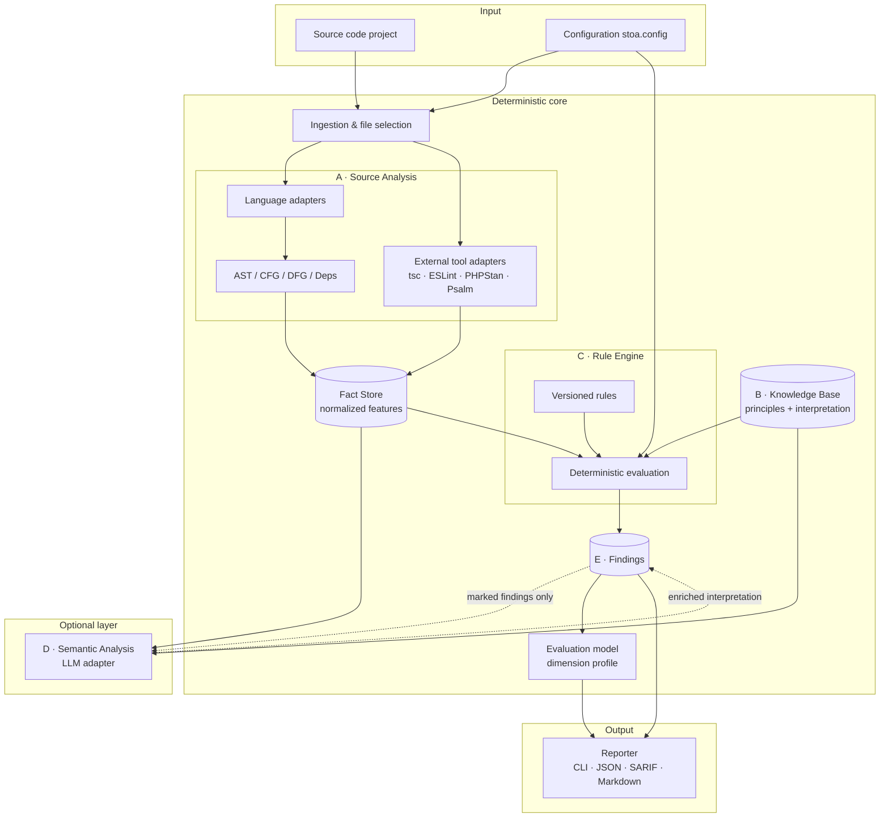
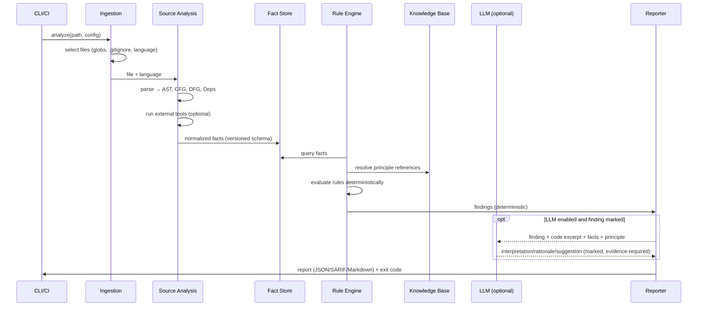
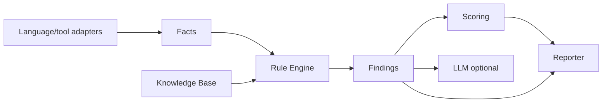

# Architecture – Stoic Code Analysis Engine

> Status: Concept phase. Describes components, interfaces, and data flows.
> The technology choice (language/runtime) is justified in
> [technology-decision.md](./technology-decision.md).

## 1. Architecture Goals and Principles

Derived from the product guiding principles (see [vision.md](./vision.md#4-guiding-principles-of-the-product)):

- **Separation of responsibilities**: source → interpretation → rule →
  analysis → finding → evaluation are standalone layers with clear contracts.
- **Deterministic core**: No nondeterminism (clock, randomness, network) in
  the analysis core. Reproducibility is testable.
- **Adapters instead of a monolith**: Programming languages and external tools
  (compilers, linters) are connected via adapters, not hard-wired.
- **LLM as a switchable plug-in**: The engine is fully functional without an LLM.
- **Intermediate results are data**: Each layer produces serializable,
  versioned artifacts (JSON) that can be inspected and cached independently.

## 2. Component Overview



The nodes shown with `(…)` are **persistable/cacheable artifacts**.
The LLM path is dashed: it is optional and does not change the technical
observation, only its interpretation/prioritization.

## 3. Pipeline (Data Flow)



## 4. Components in Detail

### A. Source Analysis
Reads source code and produces **normalized features** ("facts"). Two sources:

1. **Own structural analysis** via language adapters: AST, control flow (CFG),
   data flow (DFG, where sensible), dependencies (imports/calls/modules),
   complexity measures, side-effect heuristics, error handling patterns.
2. **External tool adapters**: diagnostics from established tools are read in
   and transformed into the same fact schema (e.g. `tsc`, ESLint, PHPStan, Psalm).

Important distinction (guiding principle L2):
- **Syntactic facts** – directly readable from the AST, high certainty
  (e.g. "empty `catch` block", "function has 7 parameters").
- **Semantic inferences** – require interpretation, lower
  certainty (e.g. "this abstraction is superfluous"). These are either
  heuristic (with low confidence) or delegated to the LLM layer.

The adapter contract (conceptual):

```ts
interface LanguageAdapter {
  readonly id: string;            // z.B. "typescript", "php"
  readonly version: string;       // Adapter-Version (semver)
  supports(file: FileRef): boolean;
  parse(file: FileRef): ParseResult;          // AST + Diagnostik
  extractFacts(parsed: ParseResult, ctx: ProjectContext): Fact[];
}
```

### B. Philosophical Knowledge Base
Manages principles and their technical interpretation as versioned,
citable data. Data model: see [knowledge-model.md](./knowledge-model.md).
The KB is **read-only** for the rule and LLM layers; it contains **no**
execution logic.

### C. Rule Engine
Consumes exclusively **facts** (not the raw AST) and produces findings.
Deterministic, versioned, configurable. A rule references one or
more principles from the KB, but checks **technically**. Model & execution:
see [rule-model.md](./rule-model.md).

### D. Semantic Analysis (optional)
An **adapter interface** for LLMs, with implementations for
"no LLM" (no-op), local models, and external APIs. No provider is
assumed. The layer receives only what the engine provides
(code excerpt, facts, principle, project context), and must substantiate its
statement. It must **not** invent missing facts; outputs are
validated (see [evaluation.md](./evaluation.md#5-llm-evaluation)).

**Grounding** is by **stable fact id**: the runner keeps a verdict only if its
confidence is in range and every `citation` is the id of a fact from this
request (which is scoped to the finding's code unit). A single invented or
out-of-context id rejects the verdict; mentioning a fact kind or symbol name in
prose is not evidence. The model response is validated against the verdict shape
before use; a malformed response is a failed assessment and leaves the finding
untouched. **Limitation:** a valid id reference proves only that the citation
points at real, in-context evidence — not that the conclusion drawn from it is
correct. Grounding bounds hallucinated *references*, not flawed *reasoning*.

**Data sent externally (only when semantic analysis is explicitly enabled, i.e.
`--semantic anthropic` / a non-noop adapter):** for each selected finding, the
request transmits the **code snippet** of the finding's lines, each fact's
**kind, value and certainty** under a request-local label (`e1`, `e2`, …), the
**principle id/name**, the deterministic **observation** text and the
caller-supplied **project context** (empty by default). Deliberately **not**
transmitted: file paths, the stable fact id (which embeds the path and symbol),
or any other file metadata — facts are referenced by local label, not id. The
deterministic `analyze`/`eval` paths never construct or call an external adapter
(the default is the no-op adapter; an unknown `--semantic` value falls back to
no-op). Missing credentials surface inside `assess()` and are caught by the
runner, leaving the finding unchanged — a failed call never aborts the run.

```ts
interface SemanticAdapter {
  readonly id: string;             // "noop" | "local-llm" | "api-xyz"
  readonly deterministic: boolean; // No-Op = true
  assess(input: SemanticRequest): Promise<SemanticVerdict>;
}
// SemanticRequest trägt NUR: codeSnippet, facts, principleRef, projectContext
// SemanticVerdict MUSS tragen: verdict, rationale, citations(zu Input), confidence
```

### E. Findings & Reporting
Produces the transparent finding object and the reports. Formats: human
(Markdown/CLI) and machine (JSON, SARIF for CI/code hosting). Model:
see [finding-model.md](./finding-model.md).

## 5. Layer and Dependency Rules



The permitted dependency direction is strictly **left → right**. Forbidden:

- Rules must **not** parse directly (only consume facts).
- The Knowledge Base knows **no** concrete rules or adapters.
- Scoring knows **no** language details (only findings + dimensions).
- The LLM path may **read** facts/findings, but not produce any that are not
  marked as "semantic/uncertain".

> These rules are at the same time a good **dogfooding** goal: *stoa* should
> be able to check its own layer separation.

## 6. Determinism & Caching

- **Stable facts**: Fact objects are derivable purely from file content + adapter version +
  config. Cache key = Hash(content, adapter version, relevant config).
- **No clock/no randomness** in the core. Timestamps/environment belong in the
  report metadata, not in facts/findings.
- **Reproducibility guarantee**: `analyze` twice on the same commit +
  same engine/rule/KB version ⇒ byte-identical findings (without LLM).
- **Version stamp** in every report: engine, adapter, rule set, and
  KB version (see versioning in the respective model documents).

## 7. Configuration (conceptual)

```jsonc
// stoa.config.json
{
  "include": ["src/**/*.ts"],
  "exclude": ["**/*.test.ts", "dist/**"],
  "adapters": { "typescript": { "project": "tsconfig.json" } },
  "externalTools": { "eslint": true, "tsc": true },
  "ruleSet": "default@1",          // versionierter Regelsatz
  "knowledgeBase": "marcus@1",     // versionierte KB
  "thresholds": { "overrides": {} },
  "semantic": { "adapter": "noop" }, // LLM standardmäßig aus
  "baseline": ".stoa/baseline.json"
}
```

## 8. Error and Degradation Behavior

- **Parse error** in a file ⇒ mark the file as "not analyzable",
  finding-neutral, the report lists it (no silent loss – cf. L2).
- **External tool missing/fails** ⇒ affected facts drop out, the report
  notes reduced coverage; exit code separate from "findings found".
- **LLM not available** ⇒ the engine continues deterministically; marked
  findings remain without semantic enrichment.

## 9. Open Architecture Points

See [open-questions.md](./open-questions.md). Core points: incremental
analysis/caching granularity, project-wide (interprocedural) data flow analysis
vs. effort, unified fact schema across very different languages.
