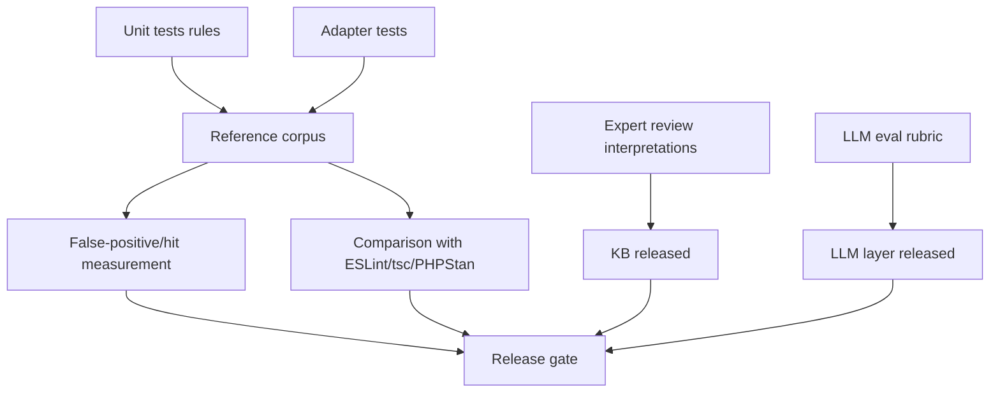

# Validation & Quality Measurement

> Status: Concept phase. Defines **how** the quality of the engine is tested –
> deterministic core first, LLM downstream.

## 1. Goals of Validation

1. **Correctness** of the rules (correct findings, no false positives).
2. **Reproducibility** (byte-stable results without LLM).
3. **Soundness** of the philosophical interpretations (expert review).
4. **Benefit** compared to existing tools (added value, not duplication).
5. **Trust** in LLM outputs (measurable, not "sounds good").

## 2. Test Strategy (Overview)

## 3. Tests and Reference Corpus

### 3.1 Unit Tests per Rule (Mandatory)
Each rule has a test catalog (see [rule-model.md §7](./rule-model.md#7-testbarkeit-pflicht-je-regel)):
- **positive fixtures** (finding correctly triggered),
- **negative fixtures** (correctly **no** finding — test `suppressWhen`/counterexamples),
- **finding snapshots** (fields, severity, confidence stable).

### 3.2 Adapter Tests
- Parser adapter: AST/fact extraction against known inputs.
- External tool adapter: mock of the tool output → expected facts.
- Degradation: missing tool / parse error → defined, not silent state.

### 3.3 Reference Corpus (Golden Projects)
- Small, versioned example projects with **known** problems and
  **known non-problems** (annotated expectation per file/line).
- At least one realistic positive and negative scenario per rule.
- Reproducible overall run: snapshot of the complete report; diff = regression.

## 4. Measuring False Positives

- Annotated corpus provides ground truth → **precision/recall per rule** and
  per dimension.
- A finding's **identity** for matching is `(project-relative file path, rule
  id, symbol)` — the path is relativized against the analysis root, so
  same-named files in different directories do not collide; line/column are
  excluded (the symbol disambiguates within a file, lines shift under edits).
  Precision/recall are computed over the set of distinct keys; duplicate
  produced findings are reported, not silently dropped. Duplicate **expected**
  entries in the manifest are a corpus-integrity error (reported and failing),
  and a malformed/unreadable manifest is an explicit evaluation error, not a
  pass.
- **Metric definitions.** Over distinct keys: TP = produced ∩ expected,
  FP = produced \ expected, FN = expected \ produced;
  `precision = TP / (TP + FP)`, `recall = TP / (TP + FN)`. Undefined cases
  (no predictions, or no expectations) are reported as the vacuous `1.0`; such a
  value is only meaningful read together with the produced count (precision
  `1.0` with 0 produced means "nothing was produced", not "all correct").
- **False positives** (reported, but no real problem) and **false negatives**
  (real problem overlooked) are reported separately. `stoa eval` exits non-zero
  when either is present.
- **Per-language breakdown.** The result carries a `byLanguage` section (derived
  from each finding's file extension: TypeScript/JavaScript, PHP, Dart, C/C++) so
  the supported languages can be compared *within one corpus*. Numbers from
  separate corpora are not merged. `stoa eval` loads every grammar, so a mixed
  corpus is evaluated across all four languages. The current golden corpus covers
  TypeScript and PHP only; Dart and C/C++ are exercised by adapter tests, not yet
  by the golden corpus.
- **External projects.** `stoa eval <path> --expected <manifest>` already works
  on any project — identities are project-relative. No separate mechanism is
  needed. **Caveat:** do not treat an external project's findings as ground truth
  until each expected entry has been validated manually (or otherwise
  traceably); an unvalidated manifest measures agreement, not correctness.
- **Release gate (proposal):** minimum precision per rule; rules that
  miss this start as "experimental" (low default confidence, can be disabled).
- The false-positive rate is part of the report's trustworthiness (see
  [finding-model.md §5](./finding-model.md#5-schutz-vor-fehlanreizen-anti-goodhart)).

## 5. LLM Evaluation

The LLM layer is evaluated **only after** a robust deterministic core exists.

- **Fixed rubric** per LLM task (e.g. "abstraction unnecessary?"):
  Does the answer cite the provided code/facts? Does it invent facts?
  Is the judgment consistent?
- **Groundedness check:** every LLM statement must refer to input evidence
  (`citations`); unsupported statements are discarded.
- **Stability:** same input multiple times → measure variance; high variance ⇒
  task is unsuitable for an LLM.
- **Comparison** against human-labeled examples (agreement rate).
- The LLM must **never** override the deterministic observation, only interpret it.

## 6. Expert Review

- Each philosophical interpretation (KB) is reviewed by a knowledgeable person
  against the cited passage: Is the assignment correct? Is the confidence honest?
- Special attention to **uncertain assignments** (e.g. `marcus.control`,
  low attribution to Marcus Aurelius).
- The review result is documented in the KB change history.

## 7. Comparison with Established Tools

- Run the same golden projects through ESLint / `tsc` / (later) PHPStan / Psalm
  and compare findings.
- Goal: show **where *stoa* delivers added value** (prioritization, interpretation,
  dimensional profile) and where it merely duplicates (→ then better integrate the
  tool as a fact source instead of a custom rule).

## 8. Reproducibility as a Test Artifact

- CI runs the same analysis run twice → results must be identical
  (without LLM). Deviation = error (hidden nondeterminism).
- Version stamps (engine/rule set/KB/adapter) are part of the snapshot.

## 9. Acceptance Reference

The concrete, countable acceptance criteria of the MVP are in
[roadmap.md §2 Acceptance Criteria](./roadmap.md#2-abnahmekriterien) and reference
the measures defined here (precision/recall, reproducibility, coverage).
