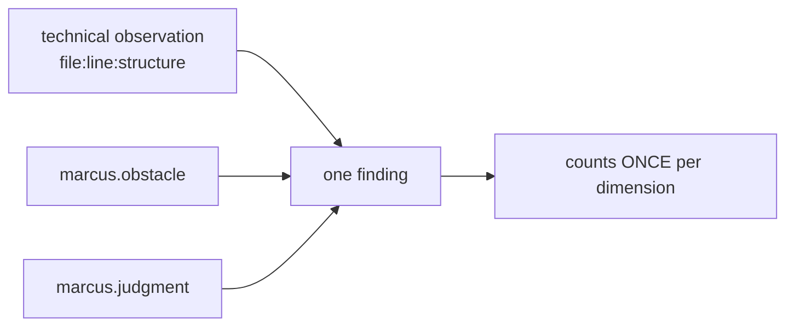

# Finding & Scoring Model

> Status: Concept phase. Defines the structure of a finding, the
> quality dimensions and the (deliberately restrained) scoring model.

## 1. The Finding Object (Finding)

Contains all the information required by the assignment (§4E). Core idea:
**observation and judgment are separated**, **severity and confidence are separated**,
and the **philosophical interpretation is marked as an interpretation** (guiding principles L2, L3, L5).

```jsonc
{
  "id": "finding:7f3a…",                 // stably hashed from content (reproducible)
  "rule": { "id": "R-ERR-SWALLOWED", "version": "1.0.0" },
  "ruleSet": "default@1",

  "location": {
    "file": "src/import/parser.ts",
    "range": { "startLine": 42, "startCol": 5, "endLine": 44, "endCol": 6 },
    "symbol": "parseRecord",
    "structure": "catch-clause"            // affected code structure
  },

  "observation": {                         // FACT (verifiable, not a judgment)
    "statement": "catch block without handling, logging or re-throw.",
    "evidence": [
      { "fact": "ast.emptyCatch", "value": true, "certainty": "syntactic" },
      { "fact": "ast.catchHasRethrow", "value": false, "certainty": "syntactic" }
    ]
  },

  "interpretation": {                      // INTERPRETATION (marked, not as fact)
    "principles": [
      { "id": "marcus.obstacle", "name": "The impediment becomes the advancement",
        "passages": ["marcus-meditations:5.20"],
        "attributionConfidence": 0.9,
        "rationale": "A swallowed error makes the impediment invisible instead of usable." }
    ],
    "dimensions": ["error-handling", "robustness"]
  },

  "severity": "high",                      // impact, if real
  "confidence": 0.95,                      // certainty that the observation holds
  "certaintyBasis": "syntactic",

  "remediation": {
    "suggestion": "Log the error, handle it deliberately or re-throw it; comment the expected empty case.",
    "drawbacks": "Additional logging paths; for a genuinely expected empty case only a comment is needed.",
    "patch": null                          // optional patch ONLY for manual review
  },

  "missingContext": [                      // honest note on limits
    "Unknown whether the empty case is expected from a domain perspective (no comment present)."
  ],

  "source": "deterministic",              // deterministic | semantic(LLM)
  "suppressed": false,
  "baselineStatus": "new"                 // new | known | fixed
}
```

### Required vs. Optional Fields
- **Required:** `location`, `observation(+evidence)`, `interpretation.principles`,
  `severity`, `confidence`, `certaintyBasis`, `remediation.suggestion`, `source`.
- **Optional:** `remediation.patch` (always only a suggestion), `missingContext`
  (recommended), `baselineStatus`.

### Rules for Presentation
- The `interpretation` is rendered in reports **linguistically as an interpretation**
  ("possible interpretation in the sense of …"), never as objective fact.
- `observation` must **not** contain any evaluation (no adjectives such as "bad").
- LLM findings (`source: "semantic"`) are visibly marked in the report.

## 2. Quality Dimensions

Separate axes (assignment §6). A finding can affect several.

| Dimension ID | English | Example facts/rules |
|--------------|---------|-----------------------------|
| `complexity` | Complexity | cognitive/cyclomatic complexity, nesting |
| `understandability` | Understandability | complexity, naming (only where evidenced), length+density |
| `responsibility-boundaries` | Responsibility boundaries | cohesion, layer mixing |
| `dependencies` | Dependencies | cycles, fan-in/out, unused imports |
| `error-handling` | Error handling | swallowed errors, missing handling |
| `side-effect-control` | Side-effect control | I/O/global/clock in units that appear "pure" |
| `decision-evidence` | Decision evidence | declaration ↔ behavior, architecture rules |
| `robustness` | Robustness | null/error paths (among others from `tsc`/PHPStan) |

## 3. Scoring Model (transparent & restrained)

### 3.1 Principle
No opaque aggregate score. The primary output is a **dimension profile**
(one value per dimension), not a single number. An aggregated "Stoic Code Index"
is **optional** and never appears without its profile and its uncertainty.

### 3.2 Derivation of a Dimension Value
Per dimension *d*:

```
weightedIssues(d) = Σ_findings∈d  severityWeight(sev) × confidence
exposure(d)       = analyzable units/LOC that rules of this dimension concern
rawPenalty(d)     = weightedIssues(d) / normalize(exposure(d))
score(d)          = clamp(100 − scale × rawPenalty(d), 0..100)
```

- `severityWeight`: e.g. low=1, medium=3, high=9 (documented, not "by feel").
- **Normalization to exposure** makes projects/languages more comparable (findings per
  affected unit, not absolute).
- Each dimension value carries an **uncertainty band** derived from the average
  confidence and the coverage (e.g. `score(error-handling) = 72 ± 8`).

### 3.3 Optional Aggregate Index
If enabled: weighted mean of the dimension values with **disclosed
weights**. Always shown together with (a) the profile, (b) the coverage, (c) the
mean confidence. It is **never** shown on its own as "the grade".

### 3.4 Comparability Across Languages
- Values are to be read relative to the **exposure in the same language**; the
  cross-language comparison is explicitly flagged with a caveat (differing
  adapter maturity). Reports disclose coverage and adapter version per language.

## 4. De-duplication and Multiple Interpretation

One technical problem = **one** finding, even if several principles interpret it.



- **Dedup key:** `(file, normalizedRange, problemKind)`. Several rules on
  the same key ⇒ one finding with a **list** of principle interpretations.
- **Scoring counts once** per dimension – no multiple weighting just because a
  problem is visible from several perspectives (assignment §8).
- If a problem affects several dimensions, it takes effect **once** in each (deliberately,
  since it genuinely concerns a different quality there).

## 5. Guarding Against Perverse Incentives (Anti-Goodhart)

- No single score as the default; profile + uncertainty are at the forefront.
- Scores can **not** be forced retroactively "green" via the baseline
  (suppression is logged and is visible in the report).
- Reports show **examples** instead of just numbers (evidence before evaluation).
- False-alarm/hit rates are themselves part of the report's trustworthiness
  (see [evaluation.md](./evaluation.md#4-measuring-false-alarms)).

## 6. Report Formats

| Format | Purpose |
|--------|-------|
| **CLI** (human) | Summary, top findings with evidence + interpretation + suggestion |
| **Markdown** | Shareable report (e.g. PR comment) |
| **JSON** | Machine-readable, complete finding schema, stably sorted |
| **SARIF** | Integration into CI / code hosting (GitHub Code Scanning etc.) |

All formats stamp engine, rule-set, KB and adapter versions as well as the
analysis coverage.

## 7. Limits

- Scores are **technical operationalizations**, not a measurement of
  "philosophical quality" (assignment §6). Reports state this explicitly.
- With low coverage (many non-analyzable files) values are
  weakly evidenced; the uncertainty band and a coverage note make this visible.
