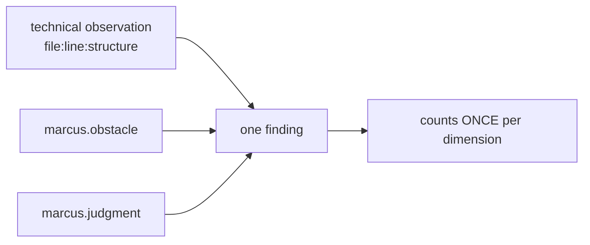

# Finding & Scoring Model

> Status: Concept phase. Defines the structure of a finding, the
> quality dimensions and the (deliberately restrained) scoring model.

## 1. The Finding Object (Finding)

Contains all the information required by the assignment (§4E). Core idea:
**observation and judgment are separated**, **severity and confidence are separated**,
and the **philosophical interpretation is marked as an interpretation** (guiding principles L2, L3, L5).

```jsonc
{
  "id": "finding:7f3a…",                 // stably hashed from content (reproducible)
  "rule": { "id": "R-ERR-SWALLOWED", "version": "1.0.0" },
  "ruleSet": "default@1",

  "location": {
    "file": "src/import/parser.ts",
    "range": { "startLine": 42, "startCol": 5, "endLine": 44, "endCol": 6 },
    "symbol": "parseRecord>catch#0",       // identity part, see §6 "Identity"
    "identityKind": "site",                // what the symbol is anchored to (metadata)
    "structure": "catch-clause"            // affected code structure
  },

  "observation": {                         // FACT (verifiable, not a judgment)
    "statement": "catch block without handling, logging or re-throw.",
    "evidence": [
      { "fact": "ast.emptyCatch", "value": true, "certainty": "syntactic" },
      { "fact": "ast.catchHasRethrow", "value": false, "certainty": "syntactic" }
    ]
  },

  "interpretation": {                      // INTERPRETATION (marked, not as fact)
    "principles": [
      { "id": "marcus.obstacle", "name": "The impediment becomes the advancement",
        "passages": ["marcus-meditations:5.20"],
        "attributionConfidence": 0.9,
        "rationale": "A swallowed error makes the impediment invisible instead of usable." }
    ],
    "dimensions": ["error-handling", "robustness"]
  },

  "severity": "high",                      // impact, if real
  "confidence": 0.95,                      // certainty that the observation holds
  "certaintyBasis": "syntactic",

  "remediation": {
    "suggestion": "Log the error, handle it deliberately or re-throw it; comment the expected empty case.",
    "drawbacks": "Additional logging paths; for a genuinely expected empty case only a comment is needed.",
    "patch": null                          // optional patch ONLY for manual review
  },

  "missingContext": [                      // honest note on limits
    "Unknown whether the empty case is expected from a domain perspective (no comment present)."
  ],

  "source": "deterministic",              // deterministic | semantic(LLM)
  "suppressed": false,
  "baselineStatus": "new"                 // new | known | fixed
}
```

### Required vs. Optional Fields
- **Required:** `location`, `observation(+evidence)`, `interpretation.principles`,
  `severity`, `confidence`, `certaintyBasis`, `remediation.suggestion`, `source`.
- **Optional:** `remediation.patch` (always only a suggestion), `missingContext`
  (recommended), `baselineStatus`, `ruleMaturity` (only the value
  `"experimental"`; absent = stable rule).
- **Confidence cap:** `confidence` never exceeds the cap of its `certaintyBasis`
  (`syntactic` 1.0, `external-tool` 0.9, `semantic-heuristic` 0.6). Declarative
  rules always applied it; since Flutter quality track E1b the rule engine
  applies the same cap to project-rule findings centrally.

### Rules for Presentation
- The `interpretation` is rendered in reports **linguistically as an interpretation**
  ("possible interpretation in the sense of …"), never as objective fact.
- `observation` must **not** contain any evaluation (no adjectives such as "bad").
- LLM findings (`source: "semantic"`) are visibly marked in the report.

## 2. Quality Dimensions

Separate axes (assignment §6). A finding can affect several.

| Dimension ID | English | Example facts/rules |
|--------------|---------|-----------------------------|
| `complexity` | Complexity | cognitive/cyclomatic complexity, nesting |
| `understandability` | Understandability | complexity, naming (only where evidenced), length+density |
| `responsibility-boundaries` | Responsibility boundaries | cohesion, layer mixing |
| `dependencies` | Dependencies | cycles, fan-in/out, unused imports |
| `error-handling` | Error handling | swallowed errors, missing handling |
| `side-effect-control` | Side-effect control | I/O/global/clock in units that appear "pure" |
| `decision-evidence` | Decision evidence | declaration ↔ behavior, architecture rules |
| `robustness` | Robustness | null/error paths (among others from `tsc`/PHPStan) |

## 3. Scoring Model (transparent & restrained)

### 3.1 Principle
No opaque aggregate score. The primary output is a **dimension profile**
(one value per dimension), not a single number. An aggregated "Stoic Code Index"
is **optional** and never appears without its profile and its uncertainty.

### 3.2 Derivation of a Dimension Value
Per dimension *d*:

```
weightedIssues(d) = Σ_findings∈d  severityWeight(sev) × confidence
exposure(d)       = analyzable units/LOC that rules of this dimension concern
rawPenalty(d)     = weightedIssues(d) / normalize(exposure(d))
score(d)          = clamp(100 − scale × rawPenalty(d), 0..100)
```

- `severityWeight`: e.g. low=1, medium=3, high=9 (documented, not "by feel").
- **Normalization to exposure** makes projects/languages more comparable (findings per
  affected unit, not absolute).
- Each dimension value carries an **uncertainty band** derived from the average
  confidence and the coverage (e.g. `score(error-handling) = 72 ± 8`).

### 3.3 Optional Aggregate Index
If enabled: weighted mean of the dimension values with **disclosed
weights**. Always shown together with (a) the profile, (b) the coverage, (c) the
mean confidence. It is **never** shown on its own as "the grade".

### 3.4 Comparability Across Languages
- Values are to be read relative to the **exposure in the same language**; the
  cross-language comparison is explicitly flagged with a caveat (differing
  adapter maturity). Reports disclose coverage and adapter version per language.

## 4. De-duplication and Multiple Interpretation

One technical problem = **one** finding, even if several principles interpret it.



- **Dedup key:** `(file, normalizedRange, symbol, problemKind)`. Several
  declarative rules on the same key ⇒ one finding with a **list** of principle
  interpretations (the first rule in rule-set order keeps its identity; stable
  wins over experimental). Two subjects at one position with different
  symbols are two findings. Project-rule findings are never merged: two of
  them with one identity are a rule defect, reported by the evaluator and the
  baseline, not hidden.
- **Scoring counts once** per dimension – no multiple weighting just because a
  problem is visible from several perspectives (assignment §8).
- If a problem affects several dimensions, it takes effect **once** in each (deliberately,
  since it genuinely concerns a different quality there).

## 5. Guarding Against Perverse Incentives (Anti-Goodhart)

- No single score as the default; profile + uncertainty are at the forefront.
- Scores can **not** be forced retroactively "green" via the baseline
  (suppression is logged and is visible in the report).
- Reports show **examples** instead of just numbers (evidence before evaluation).
- False-alarm/hit rates are themselves part of the report's trustworthiness
  (see [evaluation.md](./evaluation.md#4-measuring-false-alarms)).

## 6. Report Formats

| Format | Purpose |
|--------|-------|
| **CLI** (human) | Summary, top findings with evidence + interpretation + suggestion |
| **Markdown** | Shareable report (e.g. PR comment) |
| **JSON** | Machine-readable, complete finding schema, stably sorted |
| **SARIF** | Integration into CI / code hosting (GitHub Code Scanning etc.) |

All formats stamp engine, rule-set, KB and adapter versions as well as the
analysis coverage.

**Output filters** (`--min-confidence <0..1>`, `--certainty <list>`,
`--no-experimental`) act on the rendered report only, after any baseline
comparison: a baseline written in the same run still contains every finding,
and a filter never makes a finding look `fixed`. A filtered report records the
active criteria and the number of hidden findings in `AnalysisReport.filter`
(`{minConfidence?, certainty?, excludeExperimental?, hiddenCount}`); Markdown
shows it in the header, SARIF in `invocations[0].properties.filter`. Findings of
experimental rules are tagged `[experimental]` (Markdown) or
`properties.maturity` (SARIF).

**Declared architecture** (`--architecture <file>`, E5b): the report gains
`AnalysisReport.architecture` — `{path, version, layers: [{name, files}],
unassignedFiles, warnings: {multipleMatchCount, multipleMatchSample,
emptyLayers, unknownLayerReferences}}`; Markdown shows it in the header, SARIF in
`invocations[0].properties.architecture`. Absent without a config.

**Identity:** a finding's identity for the baseline and the corpus evaluation is
(project-relative file, rule id, `location.symbol`). Rules that report several
targets from one place put the target into the symbol (SOLID: `Class:Target`,
`Class:Contract`, the imported file's path or `package:<name>`), so two
findings never share one identity. Rules that report several SITES under one
name number them in source order with the `#n` convention (Flutter lifecycle:
`Class.field`, `Class.signIn>setState#1`, `Class.initState>Theme.of#0` —
numbered per method and call; Flutter layout: `Page.build>Expanded#2`,
numbered per file). Functions and methods
(the subject of the declarative complexity/size/side-effect rules) are named
by the adapters with every enclosing named scope: `Service.run`,
`outer.inner`, `api.run` (an object literal bound to `api`) in TS, `A.run`
for a Dart class/mixin/extension and a PHP class/trait/interface/enum,
`Buffer::reset` in C++. Namespaces belong to the name (since identity scheme 2):
`App\Svc\Repo.find` in PHP (also on class-level symbols such as
`App\Entity\Order.customer`), `app::io::Buffer::reset` in C++ (an anonymous
namespace is `(anonymous)`; in-class and out-of-class definitions name the
same), `A.B.run` for TS `namespace A.B`; an unnamed Dart extension is
`(extension on T)`. A base that still occurs twice in one file is told apart
first by what distinguishes the declarations — a TS accessor pair is
`A.size:get`/`A.size:set`, C++ overloads `f(int)`/`f(double)`, C++
definitions that share name and parameters in different preprocessor
branches by their condition, `load(int)[!HAVE_CUDA]`/`load(int)[HAVE_CUDA]`
(nested branches joined by `&&`, an `#else` as the negated condition, the
include guard is no condition) — and only then by `#n`. A function without a name takes the name it is bound to
(`const handler = () => …` → `handler`, an object property, a class field,
PHP `$handler = function …`); a callback is `<scope>.(anonymous)#n`,
numbered within its scope (`C.go.(anonymous)#1`, `pair.(anonymous)#0` for a
callback in `const pair = list.map(…)`) — never by its line, so an edit
above it or in another scope does not rename it. A finding SITE inside a
declaration (a catch, a DDL statement, an a11y element, a validation
handler …) is named relative to the innermost enclosing function or type and
numbered per (scope, kind): `Service.load>catch#0`, `Widgets>img#1`,
`Version20260101.up>loss#0` — a new catch in another function no longer
renumbers it. An import finding is named by its module (`import:node:fs`,
`#n` only for the same module imported twice). A site outside every
function or type is anchored to the innermost named thing around it: a
top-level binding (`const dataSource = {…}` → `dataSource>synchronize#0`,
also `export default {…}` → `default>…`, `module.exports = {…}` →
`module.exports>…`), in markup the nearest element with a static `id`
(`#login>field#0`; a bound `:id`/`[id]` names nothing). With no anchor at
all it is named after the file explicitly — `(module)>catch#0` in code,
`(document)>img#0` in HTML and Vue/Angular templates — and numbered among
the file-level sites only, so a site added inside any declaration no longer
renumbers it. Type-checker diagnostics (`--typecheck`) are anchored the same
way (`Service.load>tsc#0`, `(module)>promise#0`). A collision is a rule defect: `stoa eval` fails on it,
and `--update-baseline` refuses to write a baseline that repeats an identity
(`loadBaseline` could not read it back) — exit 1, the existing file
untouched. `R-ORM-EAGER-RELATION` names a finding `Entity.property`;
class-level findings name an anonymous class `(anonymous)`, numbered
`(anonymous)#n` when one PHP file holds several (`new class extends
AbstractMigration`). No rule is known to produce a colliding identity.

**Identity kind:** every finding carries `location.identityKind`, set where
its symbol is made (the extractor, the site pass, the project rule) — never
read back from the symbol text — and counted in the Markdown header
(`Finding identities: 18 declaration, 22 site, …`). It is metadata, not part
of the identity (file, rule, symbol). Facts carry it as
`subject.identityKind`.

| Kind | Anchored to | Example |
|---|---|---|
| `declaration` | a named function, method, type, member, or a relation between declarations | `Service.load`, `Repo:IRepo` |
| `anonymous` | a function without a name, numbered within its scope | `outer.(anonymous)#0` |
| `site` | a place inside a declaration, binding or element with an `id` | `Service.load>catch#0`, `#login>field#0` |
| `module` | a module or package | `import:./db`, a cycle `a.ts,b.ts`, an architecture edge |
| `external` | a diagnostic of an external tool, anchored like a site | `Service.load>tsc#0` |
| `fileOrdinal` | nothing but the file — the weakest identity: another file-level site of its kind inserted above shifts it | `(module)>catch#0`, `(document)>img#0` |
| `ambiguous` | declarations that share name, variant and condition, told apart only by order | `f(int)[X]#1` |
| `file` | the file itself (no symbol) | `R-WIDE-PUBLIC-SURFACE` |

**Identity scheme (version):** the naming rules above are scheme 3
(`IDENTITY_SCHEME` in `src/FindingIdentity.ts`). Scheme 2 left a site outside
every declaration at its per-file ordinal (`synchronize#0`, `img#3`,
`catch#6`, `tsc#1`), numbered Flutter lifecycle call sites per base
(`Class.signIn#1`, `Class.initState:Theme.of#0`) and C++ preprocessor twins
by order (`load(int)#1`); scheme 1 is the naming before that (no
namespaces, `#n` for overloads and accessor pairs, per-file site ordinals).
A baseline records its scheme (`"identity": 3`; a file without it is
scheme 1). A baseline of another scheme is never compared — keys of two
schemes would mark known findings new and report others fixed, silently —
the CLI exits 1 and names the way out: `--migrate-baseline` analyzes the same
code under the baseline's scheme and the current one, pairs each finding with
itself by position (`Finding.id`, equal in both runs) and rewrites the
baseline in place; entries no current finding reproduces are dropped and
listed. It refuses a partial analysis and an identity collision. There is no
silent migration. Corpus manifests (`expected.json`) and findings snapshots
(`scripts/compare-findings.ts`) record the scheme the same way (absent = 1): a
manifest of another scheme is refused by `stoa eval`; two snapshots of
different schemes are compared by position, each changed identity listed.

## 7. Limits

- Scores are **technical operationalizations**, not a measurement of
  "philosophical quality" (assignment §6). Reports state this explicitly.
- With low coverage (many non-analyzable files) values are
  weakly evidenced; the uncertainty band and a coverage note make this visible.
