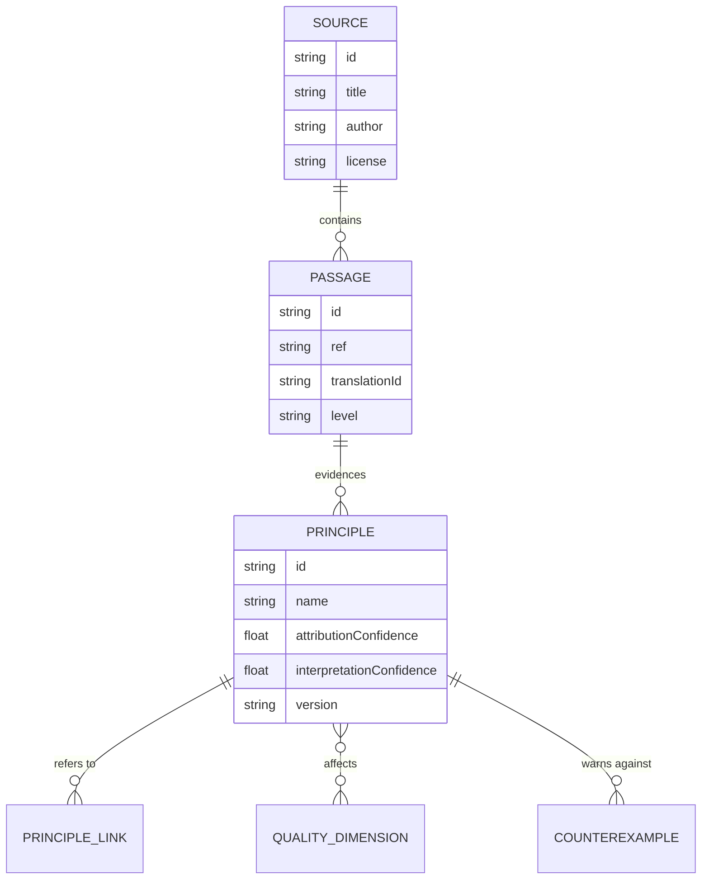
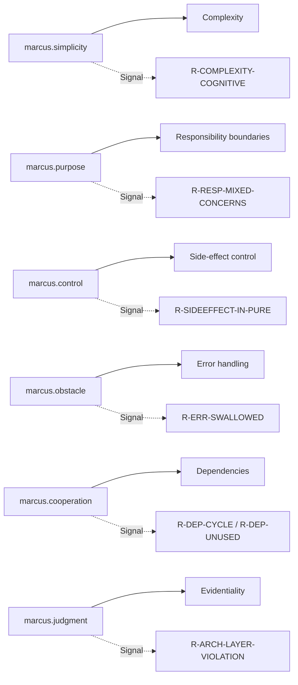

# Knowledge Model – Philosophical Knowledge Base (KB)

> Status: Concept phase. Defines the data model of the knowledge base and fully
> works out six example principles. Source methodology:
> [philosophical-foundation.md](./philosophical-foundation.md).

## 1. Design Goals

- **Citable instead of full text.** Individual passages + interpretations, no
  undifferentiated book text (guiding principle L6, non-goal N1).
- **Strict separation** (extensibility, see [§6](#6-extensibility-multiple-works)):
  `Source` (work) → `Passage` (passage) → `Principle` (interpretation) →
  *(separated out in [rule-model.md](./rule-model.md))* `Rule`.
- **Two separate confidences**: attribution (is the thought evidenced to come
  from the source?) and interpretation (does the technical transfer hold?).
- **Versioned** with a changelog; the KB is read-only for the rule/LLM layer.

## 2. Entities (Overview)



> `Rule` is deliberately **not** part of the KB (see [architecture.md](./architecture.md#5-schichten--und-abhängigkeitsregeln)).
> Rules reference principles via their ID, not the other way around.

## 3. Data Model (Fields)

### 3.1 `Source` (Work)
| Field | Type | Meaning |
|------|-----|-----------|
| `id` | string | e.g. `marcus-meditations` |
| `title` / `author` | string | "Meditations" / "Marcus Aurelius" |
| `translations[]` | Translation[] | each: `id`, `translator`, `year`, `language`, `license`, `isPublicDomain` |

### 3.2 `Passage` (Passage)
| Field | Type | Meaning |
|------|-----|-----------|
| `id` | string | e.g. `marcus-meditations:4.24` |
| `ref` | string | canonical `Book.Section` |
| `quotes[]` | Quote[] | each: `translationId`, `text`, `level` (`QUELLE`/`ÜBERSETZUNG`/`INTERPRETATION`) |
| `verification` | enum | `CONFIRMED` / `PARTIAL` / `UNVERIFIED` |
| `verificationNote` | string | verification source/uncertainty |

### 3.3 `Principle` (the actual interpretation) — **mandatory fields per the brief**
| Field | Type | Meaning |
|------|-----|-----------|
| `id` | string | unique, e.g. `marcus.simplicity` |
| `name` | string | short label |
| `passages[]` | ref[] | supporting passages (→ `Passage.id`) |
| `originalThought` | string | evidenced original thought / evidenced summary (level marked) |
| `softwareInterpretation` | string | interpretation in the software context (`INTERPRETATION`) |
| `qualityDimensions[]` | enum[] | affected dimensions (see [finding-model.md](./finding-model.md#2-qualitätsdimensionen)) |
| `applicableAnalyses[]` | enum[] | `ast` / `cfg` / `dfg` / `deps` / `metric` / `external-tool` / `semantic` |
| `preconditions` | string | preconditions for meaningful application |
| `limits` | string | limits of automatic detection |
| `counterexamples[]` | string[] | when a finding would **not** be justified |
| `attributionConfidence` | 0..1 | evidential strength relative to the source |
| `interpretationConfidence` | 0..1 | soundness of the transfer |
| `version` | semver | principle version |
| `changelog[]` | Change[] | `version`, `note` (no date in the core; time belongs in report metadata) |
| `relatedPrinciples[]` | ref[] | e.g. "related", "in tension with" |

### 3.4 JSON Example (one complete principle instance)

```json
{
  "id": "marcus.simplicity",
  "name": "Moderation – doing what is necessary",
  "passages": ["marcus-meditations:4.24"],
  "originalThought": "QUELLE (Long 1862, 4.24): 'Occupy thyself with few things ... Do what is necessary.' Marcus Aurelius advises limiting oneself to what is necessary in order to attain tranquility – the addition shifts the focus from 'few' to 'what is necessary'.",
  "softwareInterpretation": "INTERPRETATION: Code should only carry the complexity its task requires. Not 'short at any cost', but 'as complex as necessary, no more'.",
  "qualityDimensions": ["complexity", "understandability"],
  "applicableAnalyses": ["ast", "cfg", "metric", "semantic"],
  "preconditions": "Function/method with measurable control-flow and cognitive complexity; the unit's task roughly known.",
  "limits": "High complexity can be objectively necessary (parser, state machine). A metric is a signal, not a verdict.",
  "counterexamples": [
    "Long but linear switch table (high length, low cognitive load).",
    "Inherently complex algorithm with tests and clear documentation.",
    "Generated code."
  ],
  "attributionConfidence": 0.9,
  "interpretationConfidence": 0.7,
  "version": "1.0.0",
  "changelog": [{ "version": "1.0.0", "note": "First version (MVP)." }],
  "relatedPrinciples": ["marcus.purpose"]
}
```

## 4. Mapping Overview



## 5. Example Principles (Fully Worked)

Each principle follows the **eight** points required by the brief. Evidence:
[philosophical-foundation.md §2](./philosophical-foundation.md#2-geprüfte-textstellen-belegregister).

---

### 5.1 `marcus.simplicity` — Moderation / doing what is necessary

1. **Source & evidenced meaning.** 4.24 (Long): "Occupy thyself with few things …
   Do what is necessary." Attribution: high (Long writes "the philosopher",
   i.e. the thought is attributed to Marcus Aurelius; the core statement "do
   what is necessary" is his own addition).
2. **Transfer to software.** Complexity should be appropriate to the task – not
   minimal, but necessary. Superfluous branching, nesting, and indirection are
   candidates for reduction.
3. **Technical hypothesis.** Units with **high cognitive complexity** *and* low
   objective necessity are harder to understand/maintain.
4. **Required analysis.** Static: cognitive complexity (nesting, negations,
   flow breaks), cyclomatic complexity, nesting depth (AST/CFG, `metric`).
   Semantic (optional): "is the complexity objectively required?".
5. **Justified finding.** Function with cognitive complexity 25, 5 levels of
   nesting, mixed negations, no tests, task per its name "format address".
6. **Unjustified finding.** State machine/parser with inherently high,
   documented complexity and test coverage; or a long but flat, linear
   `switch`. → **no** finding, or suppressed.
7. **Scoring criteria.** Severity ∝ cognitive complexity × (code churn/
   usage degree); confidence drops when there are indications of objective
   necessity (tests, docs, generated).
8. **Limits.** "Necessary" cannot be determined purely statically → when
   uncertain, low confidence, possibly delegate to `semantic`. **Danger:** "long
   function = bad" is expressly disallowed (brief §5).

---

### 5.2 `marcus.purpose` — Purpose & task

1. **Source & evidenced meaning.** 8.19 "Everything exists for some end"; 5.1
   "I am rising to the work of a human being". Attribution: medium–high.
2. **Transfer to software.** Every unit (function/class/module) should fulfill
   **one** recognizable purpose (cohesion, single responsibility).
3. **Technical hypothesis.** Units that bundle **several unrelated
   responsibilities** (e.g. HTTP + persistence + formatting in one function)
   are harder to change and to test.
4. **Required analysis.** Static: cohesion heuristics (LCOM-like), the variety
   of foreign namespaces/imports used within a unit, mixing of layers (I/O call
   + pure logic + presentation). Semantic: "does the function fulfill its named
   domain responsibility?".
5. **Justified finding.** Method `saveUser()` that additionally formats emails,
   makes HTTP calls, and sets logging policy – three namespaces/layers.
6. **Unjustified finding.** A facade/`Orchestrator` function whose *purpose* is
   precisely coordination; or a DTO with many fields (many members ≠ many
   responsibilities). → no finding.
7. **Scoring criteria.** Severity ∝ number of separate layers/concerns × size;
   confidence high with clear layer mixing, low with coordination roles.
8. **Limits.** "Responsibility" is a domain matter, not syntactic → without
   context only a heuristic; naming conventions needed. Semantics improves hit
   quality.

---

### 5.3 `marcus.control` — What is one's own / the faculty of judgment

1. **Source & evidenced meaning.** ⚠ **Primarily Epictetus, *Encheiridion* 1**
   (dichotomy of control). Related in Marcus Aurelius: 12.22 "everything is
   opinion, and opinion is in thy power"; 6.8; 5.19. **Attribution to Marcus
   Aurelius: low** – expressly flagged (see
   [foundation §4](./philosophical-foundation.md#wichtiger-ehrlichkeitsvermerk-zu-marcuscontrol)).
2. **Transfer to software.** Code should clearly separate its **controllable**
   state from uncontrollable external influences (I/O, time, randomness, global
   state); side effects should be visible and bounded.
3. **Technical hypothesis.** **Hidden side effects** in seemingly pure units
   (by name/signature) raise the risk of errors and make testing harder.
4. **Required analysis.** Static (DFG/`ast`): accesses to global/static state,
   I/O calls, clock/randomness in functions whose signature suggests purity;
   mutation of input parameters. Semantic: classification in the project context.
5. **Justified finding.** `calculateTotal(items)` additionally reads
   `Date.now()` and writes to a global variable – result not reproducible,
   signature suggests purity.
6. **Unjustified finding.** A clearly named `main()`/`Repository`/`Service`
   method whose purpose is I/O; deliberately encapsulated state in a class.
   → no finding.
7. **Scoring criteria.** Severity ∝ discrepancy between expected purity and
   actual side effect; confidence high with clock/randomness/global mutation.
8. **Limits.** "Expected purity" is estimated from name/signature → risk of
   false alarms; language idioms differ. Low attribution to Marcus Aurelius
   remains visible in the finding.

---

### 5.4 `marcus.obstacle` — The obstacle becomes a furtherance

1. **Source & evidenced meaning.** 5.20 (Long): "the mind … changes every
   hindrance … into an aid …". Attribution high. ⚠ Do **not** quote the Hays
   wording ("what stands in the way becomes the way", copyrighted).
2. **Transfer to software.** Errors/exceptions are **information**, not a
   nuisance to be suppressed. Appropriate error handling makes the obstacle
   usable.
3. **Technical hypothesis.** **Suppressed errors** (empty `catch`, swallowed
   rejections, ignored return error codes) conceal defects and degrade
   robustness.
4. **Required analysis.** Static (`ast`/`cfg`): empty/trivial `catch` blocks,
   `catch` without re-throw/logging/handling, swallowed promises (missing
   `await`/`.catch`), `catch (…) {}` as control flow, generic catching of
   `Throwable`/`Exception` without differentiation. External facts: `tsc`/PHPStan.
5. **Justified finding.** `try { parse() } catch (e) {}` – empty catch, no
   logging, no re-throw; the parse error vanishes silently.
6. **Unjustified finding.** `catch` with deliberate, commented handling ("an
   optional cache miss is expected, deliberately ignored") or with
   logging/fallback. → no finding (confidence drops with comment/handling).
7. **Scoring criteria.** Severity ∝ the reach of the swallowed error (public
   API vs. local); confidence high with a truly empty block.
8. **Limits.** Legitimate "empty" handling exists → comment/heuristic signals
   needed; not every language has checked exceptions.

---

### 5.5 `marcus.cooperation` — Serving the whole

1. **Source & evidenced meaning.** 6.54 "That which is not good for the swarm,
   neither is it good for the bee"; 2.1 "we are made for co-operation …".
   Attribution high.
2. **Transfer to software.** A module should fit into the whole: clear,
   **directed**, necessary dependencies – no cycles, no superfluous coupling,
   no violation of the architectural direction.
3. **Technical hypothesis.** **Cyclic** or **superfluous** dependencies (unused
   imports, coupling against the layer direction) harm the whole more than the
   individual module.
4. **Required analysis.** Static (`deps`): import/module graph, cycle detection,
   unused imports, fan-in/fan-out, direction against the declared layers.
   External facts possible (bundler/`madge`-like).
5. **Justified finding.** Cycle `a → b → c → a`; or a `domain/` module imports
   `infrastructure/` (against the direction).
6. **Unjustified finding.** High but **directed** fan-in onto a deliberately
   central utility; a dependency allowed by the architecture. → no finding.
7. **Scoring criteria.** Severity: cycle > direction violation > unused import;
   confidence high (purely structural, well evidenced).
8. **Limits.** "Superfluous" sometimes needs domain classification; dynamic
   imports/DI can be invisible statically.

---

### 5.6 `marcus.judgment` — Examining judgments (meta-principle)

1. **Source & evidenced meaning.** 4.7 "Take away thy opinion …"; 8.47 "… not
   this thing … but thy own judgement …"; 12.17 "if it is not true, do not say
   it". Attribution high.
2. **Transfer to software (two roles).**
   (a) **For findings (meta):** Separate *observation* (fact) from *judgment*
   (evaluation); make one's own uncertainty explicit → this grounds the
   separation of severity/confidence and the prohibition against reporting style
   as a defect.
   (b) **For code:** "Say nothing untrue" ⇒ **the declaration should match the
   behavior**. Contradictions between the claimed architecture/signature and the
   actual behavior are findings.
3. **Technical hypothesis.** **Declaration ≠ behavior** (e.g. a layer rule
   declared but violated; a `@readonly`/`const` promise broken; a return type
   claiming non-null but delivering null) undermines trust.
4. **Required analysis.** Static: reconciling declared layer/visibility/type
   contracts with actual facts (`deps`, `dfg`, `external-tool` such as Psalm/
   PHPStan/`tsc`). Meta-role: anchored in reporting/scoring, not as a code rule.
5. **Justified finding.** A module in `domain/` declares "no infrastructure" but
   imports `fs`; or a function with return type `User` (non-null) that
   demonstrably can return `null` (per `tsc` fact).
6. **Unjustified finding.** A deliberately documented exception from the layer
   rule with justification; or a case already covered by the type system (then
   no separate *stoa* finding – **avoid double counting**).
7. **Scoring criteria.** Severity ∝ the reach of the contradiction; confidence
   high when evidenced from two independent facts (declaration + behavior).
8. **Limits.** Not every architecture is declared → without explicit rules no
   violation can be established; the meta-role is a product property, not
   automatic code detection.

## 6. Extensibility (Multiple Works)

The separation `Source`/`Passage`/`Principle` allows further works **without**
changing the rule/analysis layer:

- **Epictetus** (*Encheiridion*) becomes its own `Source`; `marcus.control` can
  then reference a passage from Epictetus as **primary evidence** and raise its
  attribution confidence (→ possibly renamed to `stoic.control`).
- Several principles may interpret the **same** rule/finding; the
  **de-duplication** happens in the finding model (one technical finding =
  one finding, multiple principle interpretations as a list – see
  [finding-model.md §4](./finding-model.md#4-de-duplizierung-und-mehrfachdeutung)).

## 7. Validation of the KB

- JSON schema validation of all principles (mandatory fields, value ranges).
- Consistency check: every `passage` reference exists and is `CONFIRMED` or
  visibly carries lower confidence.
- Every principle has ≥ 1 counterexample (otherwise CI error).
- Expert review of the interpretations (see [evaluation.md](./evaluation.md)).
