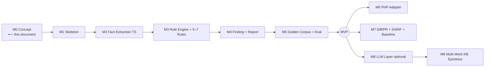

# Roadmap – MVP, Expansion Stages, Milestones

> Status: Concept phase. Defines a realistic MVP with countable
> acceptance criteria and the subsequent stages.
>
> **Implementation status:** the MVP and several expansion stages are now
> implemented (four languages + HTML, 30 rules, three output formats, i18n, optional
> layers) — the current state is in [implementation-status.md](./implementation-status.md).

## 1. MVP Guiding Idea

The MVP does **not** cover all principles or languages. It proves the
**chain**: source code → facts → deterministic rules → finding with evidence +
reasoned (marked) interpretation → understandable report – **without an LLM**.

### MVP Scope

| Area | MVP Content |
|---------|-----------|
| Language | **TypeScript/JavaScript** (one adapter), via TS Compiler API / `ts-morph` |
| Knowledge base | **6 source-verified principles** (`marcus.*`), each with a counterexample |
| Rules | **5–7 deterministic rules** (see [rule-model.md §5](./rule-model.md#5-beispiel-regelsatz-mvp)) |
| Analysis | AST, control flow (local), dependency graph, complexity metrics, error-handling patterns |
| External facts | at least **one** integration (`tsc` diagnostics) as a fact source |
| Finding model | complete finding (observation/interpretation/severity/confidence kept separate) |
| Assessment | **dimension profile** (no default single score) |
| Interface | **CLI** `stoa analyze <path>` + JSON and Markdown report |
| Tests | unit tests per rule (pos/neg), golden-project snapshot, reproducibility test |
| LLM | **off** (No-Op adapter present, but inactive) |

### Deliberately **not** in the MVP
PHP adapter, diff/PR mode, baseline/suppression workflow, SARIF, trend analysis,
LLM enrichment, dedicated rule editor, multi-work KB (Epictetus).

## 2. Acceptance Criteria

Testable criteria by which "does the MVP work?" is decided. Measurements
come from [evaluation.md](./evaluation.md).

| # | Criterion | Measurement / Threshold |
|---|-----------|--------------------|
| AC-1 | **Runnability** | `stoa analyze ./fixtures/project-a` produces JSON+Markdown without errors. |
| AC-2 | **Reproducibility** | Two runs on the same commit ⇒ **byte-identical** findings (without an LLM). |
| AC-3 | **Chain complete** | Every finding carries: location, observation+evidence, ≥1 principle interpretation (marked), separate severity/confidence, suggestion. |
| AC-4 | **Positive/negative per rule** | Every rule has ≥1 passing positive **and** negative test. |
| AC-5 | **False-positive threshold** | Precision per rule on the golden corpus ≥ a defined value (e.g. ≥ 0.8); otherwise "experimental". |
| AC-6 | **Source fidelity** | Every principle has a documented location + separate confidences; uncertain assignments (e.g. `marcus.control`) are visible in the report. |
| AC-7 | **No style-as-defect** | No MVP rule finding is based on pure style preference (review checklist). |
| AC-8 | **Context beats threshold** | At least one negative test shows that a metric threshold is correctly suppressed by context (`suppressWhen`). |
| AC-9 | **Determinism separation** | With the (mock) LLM enabled, semantic findings are marked as `source: "semantic"` and can be switched off. |
| AC-10 | **Self-analysis (dogfooding)** | *stoa* analyzes its own code and produces a plausible report. |

## 3. Milestones

| Milestone | Content | Dependency |
|-------------|--------|--------------|
| **M0** | Concept & specification (this docs/ set) | — |
| **M1** | Project skeleton, schemas (Fact/Rule/Finding as JSON Schema), CLI scaffold | M0 + approval |
| **M2** | TS adapter: parse + fact extraction (complexity, deps, error handling), `tsc` fact adapter | M1 |
| **M3** | Deterministic rule engine + 5–7 rules + principle coupling | M2 |
| **M4** | Finding generation, de-dup, dimension profile, JSON/Markdown reporter | M3 |
| **M5** | Golden corpus, unit/snapshot tests, precision/recall, reproducibility test | M4 |
| **M6** | PHP adapter (`nikic/php-parser` bridge) → validation of language independence | MVP |
| **M7** | Diff/PR mode, SARIF, baseline/suppression | MVP |
| **M8** | LLM adapter (local/external), groundedness eval, marked enrichment | MVP |
| **M9** | Second work (Epictetus) → `marcus.control` gains a primary source | M8 |

## 4. Expansion Stages (after MVP, prioritization preliminary)

1. **Breadth of languages** (PHP first — fits the project environment).
2. **Workflow integration** (CI/PR, SARIF, editor).
3. **Optional semantics** (LLM) — only with a robust eval framework.
4. **Knowledge base breadth** (further works/principles, expert review pipeline).
5. **Trend/history** (quality profile over time, without single-score misincentive).

## 5. Risks on the Roadmap

See [open-questions.md](./open-questions.md). Critical for the roadmap:
false-positive quality of the heuristic rules (M3/M5), language independence of the
fact schema (only really tested at M6), effort of interprocedural analysis.
