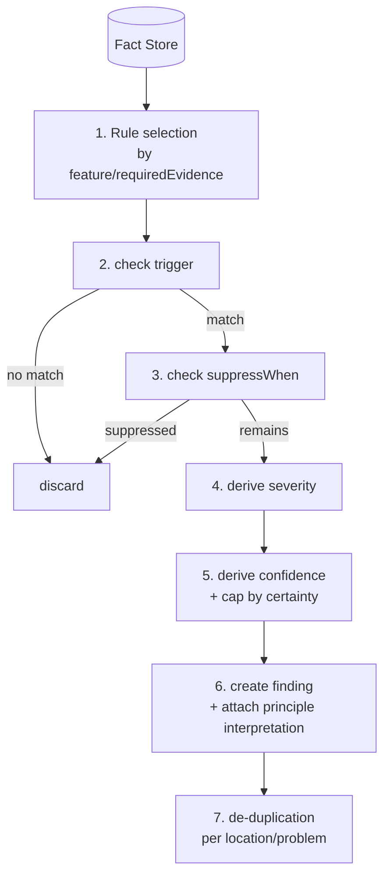

# Rule Model – Definition & Execution of the Rule Engine

> Status: Concept phase. Defines how rules are structured, how they
> are executed deterministically and how they are coupled to principles.
> Data basis: Facts from [architecture.md](./architecture.md#a-source-analysis).

## 1. Principles

- **Rules check technically, not philosophically.** A rule evaluates facts.
  The philosophical interpretation is added via the referenced principles
  (separation from [knowledge-model.md](./knowledge-model.md)).
- **Determinism.** Same facts + same rule version + same config ⇒
  identical findings. No clock, no randomness, no network dependency.
- **Facts instead of AST.** Rules only see the neutral fact schema, never the
  raw language-specific AST → language independence, easy testability.
- **Context beats threshold.** A rule must never evaluate a metric on its own as a
  deficiency; it must take context/exception signals into account (guiding principle L4).
- **No style as deficiency.** Rules that merely reflect subjective style preference
  are impermissible (non-goal N4).

## 2. Fact Schema (Input of the Rules)

Facts are normalized, language-neutral observations. Minimal form:

```jsonc
{
  "id": "fact:...",
  "kind": "metric.cognitiveComplexity", // stable fact kind
  "subject": {                           // what the fact refers to
    "file": "src/user.ts",
    "symbol": "formatAddress",
    "kindOf": "function",
    "range": { "startLine": 10, "startCol": 1, "endLine": 48, "endCol": 2 }
  },
  "value": 25,                           // depending on kind: number | bool | string | struct
  "evidence": [                          // derived from
    { "source": "ast", "detail": "nesting depth 5" }
  ],
  "certainty": "syntactic",              // syntactic | semantic-heuristic | external-tool
  "producedBy": { "adapter": "typescript", "version": "0.1.0" }
}
```

`certainty` is decisive: it limits the maximum finding confidence
(a purely heuristic fact cannot trigger a high-confidence rule).

## 3. Rule Definition

A rule must, per the mandate, specify: *which feature*, *which condition*,
*which principles*, *which evidence*, *when no finding*, *which severity/
certainty*. Model:

```jsonc
{
  "id": "R-COMPLEXITY-COGNITIVE",
  "version": "1.0.0",
  "title": "Excessive cognitive complexity",
  "feature": "metric.cognitiveComplexity",   // examined feature (fact kind)
  "appliesTo": ["function", "method"],
  "principles": ["marcus.simplicity"],         // principle references (KB)
  "dimensions": ["complexity", "understandability"],

  "trigger": {                                 // when a finding is triggered
    "all": [
      { "fact": "metric.cognitiveComplexity", "op": ">=", "value": 15 }
    ]
  },

  "requiredEvidence": [                         // without these facts, no finding
    "metric.cognitiveComplexity", "metric.nestingDepth"
  ],

  "suppressWhen": {                             // when NO finding is justified
    "any": [
      { "fact": "flag.generatedCode", "op": "==", "value": true },
      { "fact": "flag.hasTests", "op": "==", "value": true,
        "and": [{ "fact": "metric.cognitiveComplexity", "op": "<", "value": 30 }] },
      { "fact": "shape.isFlatSwitch", "op": "==", "value": true }
    ]
  },

  "severity": {                                 // derived, not fixed
    "base": "medium",
    "escalateWhen": [
      { "fact": "metric.cognitiveComplexity", "op": ">=", "value": 30, "to": "high" },
      { "fact": "metric.churn", "op": ">=", "value": 10, "to": "high" }
    ]
  },

  "confidence": {
    "base": 0.7,
    "capBy": "certainty",                       // syntactic→1.0, heuristic→0.6, external→0.9
    "reduceWhen": [
      { "fact": "doc.hasComplexityRationale", "op": "==", "value": true, "by": 0.3 }
    ]
  },

  "message": "Cognitive complexity {value} in {symbol} impedes understanding.",
  "remediationRef": "fix:reduce-cognitive-complexity",
  "tests": "tests/rules/R-COMPLEXITY-COGNITIVE/"   // mandatory: test catalog
}
```

### Field Meaning (Brief)
| Field | Purpose |
|------|-------|
| `feature` / `requiredEvidence` | which feature; without the named facts **no** run (avoids guessing) |
| `trigger` | conditions that produce a candidate |
| `suppressWhen` | explicit non-finding conditions (context!) |
| `severity` / `confidence` | derived **separately**; confidence capped by `certainty` |
| `principles` / `dimensions` | coupling to KB & evaluation model |
| `tests` | mandatory test catalog per rule |

## 4. Execution Model



**Properties:**
- **Order-independent**: rules only read the fact store; no
  order dependency between rules (pure function `facts → findings`).
- **Stable sorting** of the findings (file, line, rule ID) for byte-stable
  output.
- **No rule may produce facts** – only read (layer rule).

## 5. Rule Set `default@1` (implemented)

> The actually-implemented rule set (20 rules). Overview, facts and opt-in flags:
> [implementation-status.md](./implementation-status.md).

Declarative rules (`rules/default/*.json`, on by default):

| Rule ID | Feature (Fact) | Principle | Dimension | Character |
|---------|----------------|-----------|-----------|-----------|
| `R-COMPLEXITY-COGNITIVE` | `metric.cognitiveComplexity` (+ `nestingDepth`) | `marcus.simplicity` | Complexity | syntactic |
| `R-DEEP-NESTING` | `metric.nestingDepth` | `marcus.simplicity` | Complexity | syntactic |
| `R-FN-TOO-MANY-PARAMS` | `metric.parameterCount` | `marcus.purpose` | Responsibility boundaries | syntactic |
| `R-WIDE-PUBLIC-SURFACE` | `metric.exportCount` | `marcus.purpose` | Responsibility boundaries | syntactic (TS/JS only) |
| `R-ERR-SWALLOWED` | `ast.catchSwallowsError` | `marcus.obstacle` | Error handling | syntactic |
| `R-SIDEEFFECT-NONDETERMINISM` | `ast.usesNondeterminism` | `marcus.control` | Side-effect control | heuristic |
| `R-DEP-UNUSED` | `deps.importUnused` | `marcus.cooperation` | Dependencies | syntactic |
| `R-DEEP-IMPORT` | `deps.importDeep` | `marcus.cooperation` | Dependencies | syntactic |
| `R-TYPE-UNSOUND` | `external.tsc` | `marcus.judgment` | Decision-evidence, robustness | external-tool, opt-in `--typecheck` |
| `R-FLOATING-PROMISE` | `external.floatingPromise` | `marcus.obstacle` | Error handling, robustness | external-tool, opt-in `--typecheck` |

Persistence / ORM (TypeORM, TS/JS only, on by default):

| Rule ID | Feature (Fact) | Principle | Dimension | Character |
|---------|----------------|-----------|-----------|-----------|
| `R-ORM-SYNCHRONIZE-ENABLED` | `orm.synchronizeEnabled` | `marcus.control` | Side-effect control, robustness | heuristic |
| `R-ORM-SYNC-WITH-MIGRATIONS` | `orm.syncWithMigrations` | `marcus.judgment` | Decision-evidence, robustness | heuristic |
| `R-ORM-ENTITY-NO-PK` | `orm.entityNoPrimaryKey` | `marcus.judgment` | Robustness, decision-evidence | syntactic (`@Entity` classes) |
| `R-ORM-EAGER-RELATION` | `orm.eagerRelation` | `marcus.control` | Side-effect control, robustness | syntactic (`@Entity` relations) |
| `R-ORM-NULLABLE-NO-DEFAULT` | `migration.nullableNoDefault` | `marcus.obstacle` | Robustness, error handling | heuristic (NOT NULL add in `up()`) |
| `R-MIGRATION-UNGUARDED-DDL` | `migration.unguardedDdl` | `marcus.obstacle` | Robustness, error handling | heuristic (migration files only) |
| `R-MIGRATION-NO-DOWN` | `migration.noDown` | `marcus.judgment` | Robustness, decision-evidence | syntactic (migration files only) |
| `R-MIGRATION-DATA-LOSS` | `migration.dataLoss` | `marcus.judgment` | Robustness, decision-evidence | heuristic (drops in `up()`) |

> `R-MIGRATION-UNGUARDED-DDL` fires only in migration files (a class that
> `implements MigrationInterface`) and covers two paths: raw SQL
> (`CREATE/DROP TABLE`, `ADD/DROP COLUMN` without `IF [NOT] EXISTS`) and the
> query-builder API (`createTable`/`dropTable` without `ifNotExist`/`ifExist`,
> `addColumn`/`dropColumn` without a surrounding `hasColumn()` check).
> Deliberately conservative (confidence 0.7): `IF [NOT] EXISTS` is a safety net,
> not a substitute for a clean baseline, and the true DB state is only known at
> run time (→ a CI migration dry-run against a fresh DB).

> `R-MIGRATION-NO-DOWN` reports a migration class with no `down()` or an empty
> `down()` (not reversible). A deliberately throwing `down()` (an explicitly
> one-way migration) counts as a documented decision and is not flagged.

> `R-MIGRATION-DATA-LOSS` reports destructive steps in `up()` (`DROP TABLE`/
> `DROP COLUMN` or `dropTable`/`dropColumn`) — regardless of an `IF EXISTS`
> guard, because the guard prevents the crash, not the data loss. Scoped to
> `up()` so expected drops in `down()` (reversing a create) are not flagged; it
> complements `R-MIGRATION-UNGUARDED-DDL` (existence guard) with the data-loss
> perspective.

> `R-ORM-NULLABLE-NO-DEFAULT` reports a `NOT NULL` column added in `up()` with no
> `DEFAULT` (raw SQL `ADD COLUMN … NOT NULL`, or `addColumn` with an explicit
> `isNullable: false` and no `default`) — it breaks against a populated table.
> Auto-increment/generated columns and an absent explicit `isNullable` are left
> out (conservative).

Procedural rules (`ProjectRule`, cross-file):

| Rule ID | Basis | Principle | Dimension | Character |
|---------|-------|-----------|-----------|-----------|
| `R-DEP-CYCLE` | module graph from `deps.import` (Tarjan SCC) | `marcus.cooperation` | Dependencies | syntactic |
| `R-UNUSED-EXPORT` | `deps.export` × `deps.importName` | `marcus.cooperation` | Dependencies | heuristic, opt-in `--dead-exports` |

> **Not yet implemented** (documented as ideas): `R-RESP-MIXED-CONCERNS`
> (layer/namespace mixing, `marcus.purpose`) and `R-ARCH-LAYER-VIOLATION`
> (import against a declared layer rule, `marcus.judgment`).

> Pure style rules (indentation, quotation marks, name length) are
> **excluded**. Such checks remain with ESLint/CS-Fixer.

## 6. Versioning & Determinism Guarantees

- **Rule version (semver)** per rule; **rule set version** (`default@1`) bundles
  rules + thresholds. Reports stamp both (reproducibility).
- Thresholds (`value` limits) are **part of the rule version** – a
  threshold change is a version change, not a silent config drift.
- **Config overrides** are allowed, but are disclosed in the report (so that
  "why does my result differ?" remains answerable).

## 7. Testability (Mandatory per Rule)

Every rule has a test catalog with at least:
- **≥ 1 positive fixture** (correctly triggers a finding),
- **≥ 1 negative fixture** (correctly triggers *no* finding — checks
  `suppressWhen`/counterexamples),
- **Snapshot** of the produced finding (fields, severity, confidence).

See [evaluation.md](./evaluation.md#3-tests-und-referenzkorpus).

## 8. Limits of the Rule Model

- Rules are only as good as the facts. Missing interprocedural data flows
  limit, for example, `R-SIDEEFFECT-IN-PURE`.
- Context rules (`suppressWhen`) need reliable context facts
  (tests present? generated? documented?) — their quality must itself be tested.
- Semantic judgments ("is the abstraction really superfluous?") do **not** belong in
  deterministic rules, but in the optional LLM layer (as a separately
  marked, evidence-required addition).
