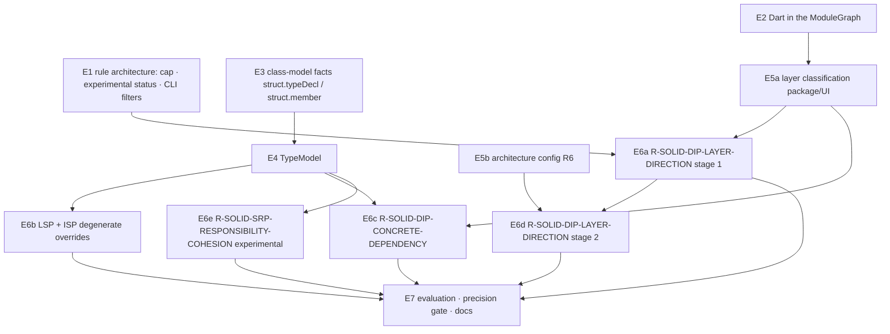

# SOLID – implementation plan (Flutter quality track, Phase E)

> Status: **plan, no implementation.** It is based on the feasibility analysis
> [solid-feasibility.md](./solid-feasibility.md) (Phase D). German version:
> [../de/solid-implementation-plan.md](../de/solid-implementation-plan.md).
>
> **User decisions (Phase E):**
>
> | Topic | Decision |
> |---|---|
> | DIP layer rule | staged: a hint via package classification first, later certain violations of a declared architecture config (R6) |
> | Activation | all SOLID rules only via opt-in `--solid` |
> | Cross-cutting | the rule-architecture groundwork (confidence cap for project rules, "experimental" rule status, CLI filters) comes **before** SOLID |

## 0. Implementation principles

- **Each step E1–E7 is a phase of its own.**
  - Each phase is approved and reported separately: changes, files, tests, findings, open points, git status.
  - No commits without being asked.
- **APIs are only extended additively**, following the pattern of `symbolGraph`, `flutterWidgetGraph` and `dartLibraryIndex`:
  - new fields are optional;
  - new facts get new kinds;
  - existing fact values stay unchanged.
- **Without `--solid` every output stays byte-identical.** The golden corpus and the
  real apps are compared against the previous state in every step. The only planned
  exception is E1b (confidence cap). It is flagged as a correction that needs approval.
- **Unknown stays unknown.** Ambiguous identity, unresolved types, DI containers and
  parse errors never produce a finding. At most they appear as a coverage note in
  `missingContext`.
- **No size or name heuristics as the basis of a finding.** Class size, method count
  and name patterns such as "…Service" may only add evidence, never trigger a finding.
- **New dependencies:** none planned.
  - ajv (schema validation), ts-morph and web-tree-sitter are already present.
  - A Dart grammar update (Dart 3) is **not** part of this plan.

## 1. Overview and order



| Step | Content | Effort | Changes findings without `--solid`? |
|---|---|---|---|
| E1 | rule-architecture groundwork | M | **yes, E1b** (two confidence values), needs approval |
| E2 | Dart import edges in the ModuleGraph | M | no (the cycle rule keeps its previous edges) |
| E3 | neutral class-model facts (Dart, TS) | L | no (new fact kinds, no rule reads them) |
| E4 | TypeModel | M | no |
| E5a | layer classification (packages, UI identity) | S | no |
| E5b | architecture config R6 (`--architecture`) | M | no (inactive without a file) |
| E6a–e | SOLID rules | S–M each | no (only with `--solid`) |
| E7 | corpus, precision gate, docs | M | no |

The paths E1, E2→E5a→E6a and E3→E4→E6b are independent of each other.

**Recommended sequence:**

1. E1 → E2 → E5a → E6a: the first usable SOLID hint with the smallest foundation.
2. E3 → E4 → E6b → E6c.
3. E5b → E6d.
4. E6e only after E7 calibration.

## 2. E1 – rule-architecture groundwork

**E1a – rule status `maturity`**

- `src/rules/RuleTypes.ts`: an optional field `maturity?: 'stable' | 'experimental'`
  in `Rule` (JSON) and `ProjectRule`; absent means `stable`.
- `schemas/rule.schema.json`: the field as an optional enum.
- `Finding`: additive `ruleMaturity?: 'experimental'`, set only when experimental.
  Plus `schemas/finding.schema.json`.
- `src/reporting/Reporter.ts`: an "experimental" marker (i18n de/en).
- `SarifReporter.ts`: `properties.maturity`.
- Tests: schema, reporter and SARIF tests; existing outputs are unchanged because the field is absent.

**E1b – central confidence cap for project rules too**

- `src/rules/RuleEngine.ts`: after `projectRule.evaluate()`,
  `confidence = min(confidence, certaintyCap(certaintyBasis))`. This is the same table as
  for declarative rules (`semantic-heuristic` ≤ 0.6, `external-tool` ≤ 0.9).
- **Correction that needs approval:** `R-UNUSED-EXPORT` (0.7 → 0.6, only with
  `--dead-exports`) and `R-VALIDATION-CONTRACT-MISMATCH` (0.7 → 0.6, only with
  `--contracts`). All other project rules are already below their cap; this was
  checked in the code (Phase E).
- Tests: a cap test per certainty; the affected rule tests are adjusted and listed in the report.

**E1c – CLI filters**

- `src/Cli.ts`: `--min-confidence <0..1>`, `--certainty <list>`, `--no-experimental`.
- `src/Pipeline.ts`: the filters act **after** evaluation and only on the output. The
  baseline keeps storing all findings, so changing a filter never makes findings look "fixed".
- Report header: the number of filtered findings and the active filters. Nothing is filtered silently.
- Tests: CLI tests for all three options, and combined with `--baseline`/`--only-new`.

**Acceptance E1:** without the new options the output is identical, except for the two
E1b values. Typecheck, ESLint, build and all tests are green.

## 3. E2 – Dart in the ModuleGraph

- `src/model/ModuleGraph.ts`: an additive option `buildModuleGraph(facts, analyzed,
  resolver, dartIndex?)`.
  - Every `dart.importSpec` of kind `import`/`export` whose URI the `DartLibraryIndex`
    resolves to a project file becomes an edge.
  - `part` and `part of` create no edge: they form one library, not a dependency.
- `ModuleEdge` gets an additive `origin?: 'deps.import' | 'dart.importSpec'`. Absent means `deps.import`.
- **`R-DEP-CYCLE` keeps evaluating only `deps.import` edges.** Circular imports are
  legal and common in Dart. Including them would produce new findings nobody asked
  for. Whether Dart cycles should be reported is a separate, later decision. E2
  measures their number on the real apps and reports it.
- External targets (`package:flutter/…`, third-party packages) appear as unresolved
  imports with their URI. That is where the package classification of E5a starts.
- Tests (`test/ModuleGraph.test.ts`):
  - relative, `package:` and `export` edges;
  - no edge for `part`;
  - determinism;
  - `R-DEP-CYCLE` on a Dart cycle fixture: no finding.

## 4. E3 – class-model facts

There are two new, neutral fact kinds, one per type declaration and one per member.
They are file-local and cacheable and carry no judgement.

```ts
// struct.typeDecl  (kindOf 'class', symbol = type name)
{ v: 1, declKind: 'class' | 'abstract-class' | 'interface' | 'mixin' | 'enum',
  supertypes: { kind: 'extends' | 'implements' | 'with', prefix: string | null, name: string }[],
  hasParseError: boolean }

// struct.member  (kindOf 'method' | 'field' | 'constructor', symbol = Type.member)
{ v: 1, owner: string, memberKind: 'method' | 'getter' | 'setter' | 'field' | 'constructor',
  isStatic: boolean, isAbstract: boolean, isOverride: boolean,          // @override / TS `override`
  body: 'abstract' | 'empty' | 'throws-unsupported' | 'normal' | null,   // methods only
  throwsType: string | null,                                             // for throws-unsupported
  declaredType: { prefix: string | null, name: string } | null,          // field/return
  params: { name: string, type: { prefix: string | null, name: string } | null, isFieldFormal: boolean }[],
  refsMembers: string[],   // own members the body references (this.x / x), sorted
  refsImports: string[],   // import prefixes or imported identifiers the body references, sorted
  instantiates: { prefix: string | null, name: string }[],  // constructor calls in the body
  staticAccess: { prefix: string | null, name: string, member: string }[] } // X.instance etc.
```

- **Dart:** a new module `src/analysis/dart/DartMembers.ts`, called from `DartExtraction.ts`.
  - It uses `DartCallSite` (constructor calls) and the existing class detection.
  - `@override` is read from the annotation before the method. The Phase D prototype
    showed that this needs its own test.
  - `throws-unsupported`: the body is only `throw UnsupportedError(…)` or
    `UnimplementedError(…)` (block or `=>`).
- **TypeScript:** a new module `src/analysis/typescript/TsMembers.ts` using ts-morph.
  - It covers classes and interfaces, `override`/`implements`/`extends`, and
    `throw new Error(...)` when the message contains "not implemented/supported".
  - Parameter properties count as fields.
- **PHP and C++:** not in this plan. The fact format is chosen so that those adapters
  can provide it later.
- **Cost:** as in Phase A, the growth of facts and cache is measured on the four apps
  and on stoa/flyingfish. Significant growth (> 10 % of all facts) is reported before
  approval. The memory test (`MemoryPipelineScaling`) must stay green.
- Tests: new fixtures per language for every body shape, `@override`, field formals,
  prefixed types, parse errors (`hasParseError`), determinism and the FactCache round trip.

## 5. E4 – TypeModel

- New: `src/model/TypeModel.ts`. It is built once per analysis after extraction, from
  facts only, like ModuleGraph and SymbolGraph. It holds strings and fact IDs, no AST.
- **Supertype resolution:**
  - Dart via `DartLibraryIndex.resolve(file, name, prefix)`;
  - TS via SymbolGraph bindings or same-file declarations.
  - Result per supertype: `project` (with its target declaration), `framework`/`external`
    (origin known, members unknown), `ambiguous` or `unresolved`.
- **Inherited members** come only from resolved project supertypes, transitively and cycle-safe.
  - Framework supertypes contribute a small declared catalog of known members:
    Flutter `State` (`widget`, `context`, `mounted`, `setState`, lifecycle hooks).
    It has the same origin as `FlutterCatalog` (SDK 3.29.2), as its own entry.
  - This removes the LCOM artefacts found in Phase D.
- `ProjectRuleInput.typeModel?` is additive and optional; the fallback builds the model from `facts`.
- Tests:
  - hierarchy across files, barrels and prefixes;
  - ambiguous and unresolved supertypes;
  - inherited members;
  - determinism with reversed fact order.

## 6. E5 – layers

**E5a – classification without a config (stage 1 of the DIP layer rule)**

- New: `src/model/LayerClassification.ts`. It works from facts and graphs only.
- **UI unit:**
  - Dart: a class whose supertype resolves via the TypeModel to `State`/
    `StatelessWidget`/`StatefulWidget` from `package:flutter/`.
  - TS: **not** included at first. JSX, Angular and Vue components come from other
    adapters, and frontend network I/O often goes through the global `fetch` without
    an import. This is documented as a limit; extending it is a follow-up step of its own.
- **Data access or I/O:** a static, versioned package catalog `DATA_ACCESS_PACKAGES`,
  Dart only at first: `http`, `dio`, `shared_preferences`, `sqflite`,
  `cloud_firestore`, `firebase_database`, `firebase_storage`, `hive`, `isar`,
  `drift`, `supabase_flutter`, `graphql_flutter`, `dart:io` (file and socket access
  only, not Platform).
  - A project module counts as a data-access module if it imports such a package
    itself. This is one level deep, not transitive: transitively almost everything would become data layer.
- Tests: classification per case; a package outside the catalog stays `unknown`.

**E5b – architecture config R6 (stage 2)**

- A new file `stoa.architecture.json` with the schema
  `schemas/architecture.schema.json` and a loader following the pattern of
  `src/contracts/ValidationContract.ts` (ajv; errors abort with a clear message).
  CLI: `--architecture <file>`.

  ```json
  { "version": "1.0.0",
    "layers": [ { "name": "ui",   "include": ["lib/Pages/**", "lib/Widgets/**"] },
                { "name": "data", "include": ["lib/Service/**", "lib/Db/**"] } ],
    "allow":  [ { "from": "ui", "to": "domain" }, { "from": "data", "to": "domain" } ],
    "forbidPackages": [ { "layer": "ui", "packages": ["http", "dio", "sqflite"] } ] }
  ```

- Semantics:
  - A file belongs to the **first** matching layer; multiple matches are reported as a configuration warning.
  - Edges between layers that are not in `allow` are violations.
  - Edges within one layer are always allowed.
  - A file without a layer counts as unknown (no finding).
- Tests: schema validation, glob assignment, allowed, forbidden and unknown edges, package bans.

## 7. E6 – rules (all only with `--solid`)

Common to all rules:

- They are project rules in `src/rules/project/SolidRules.ts`, registered in
  `Pipeline.ts` only when `options.solid === true`.
- `requiredFactKinds` is declared, and `ProjectRuleCategorization.test.ts` is extended.
- Evidence always names the concrete building blocks (edge, import, member, origin).
  `missingContext` names the detection limits.

| Rule | What | Principle / dimension | Certainty · severity · confidence · status |
|---|---|---|---|
| **E6a `R-SOLID-DIP-LAYER-DIRECTION`** (stage 1) | A UI class (E5a) sits in a file that imports a data-access package or module **and** uses an identifier from it in the UI class body (`refsImports`; file level only before E3) | `marcus.cooperation` + `marcus.control` / `dependencies` | `semantic-heuristic` · `low` · 0.5 · experimental |
| **E6b `R-SOLID-LSP-CONTRACT-COMPATIBILITY`** | An override (`isOverride`) with `throws-unsupported` against a **concrete** method of a resolved **project** supertype | `marcus.judgment` / `responsibility-boundaries` | `syntactic` · `low` · 0.8 · stable |
| **E6b `R-SOLID-ISP-INTERFACE-COHESION`** | An implementation of a resolved project interface or abstract project class fulfils **≥ 2** members with `throws-unsupported` or `empty` | `marcus.purpose` / `responsibility-boundaries` | `syntactic` · `info` · 0.7 · stable |
| **E6c `R-SOLID-DIP-CONCRETE-DEPENDENCY`** | A UI class creates a **concrete project class** (`instantiates`, identity resolved, not abstract) whose module is a **data-access module** (E5a), or accesses its `instance` statically. No name patterns: the Phase D data model `Provider` drops out because its module has no data access | `marcus.cooperation` / `dependencies` | `semantic-heuristic` · `low` · 0.5 · experimental |
| **E6d `R-SOLID-DIP-LAYER-DIRECTION`** (stage 2) | With `--architecture`: a ModuleGraph edge (incl. Dart from E2) between layers that is not allowed, or a forbidden package | `marcus.cooperation` / `dependencies` | `syntactic` · `medium` · 0.9 · stable |
| **E6e `R-SOLID-SRP-RESPONSIBILITY-COHESION`** | A class's members (via the TypeModel, incl. inherited and framework members) split into ≥ 2 groups that use **both** disjoint fields **and** disjoint import groups | `marcus.purpose` / `responsibility-boundaries` | `semantic-heuristic` · `info` · 0.4 · experimental; **off by default even with `--solid`** until E7 confirms the precision gate |

Exclusions that the rules build in and test:

- **E6b:**
  - Framework bases (`State.dispose` etc.) are excluded, because only project supertypes count.
  - An empty override of an *abstract* method is not an LSP finding.
  - Classes in `test/` paths and classes with `Mock`/`Fake`/`Stub` in the type name are
    excluded. This is a documented name exception that only **excludes**.
- **E6c:**
  - Self-singletons (the class creates itself) are excluded.
  - Creation via DI (`GetIt.I`, `context.read`, `Provider.of`) is unknown, so no finding.
- **E6a/E6c:** ambiguous or unresolved identity never leads to a finding.
- **E6d:** files without a layer never lead to a finding.

**Not planned** (rationale in Phase D):

- `R-SOLID-OCP-EXTENSION-COUPLING`: Dart 3 `sealed` is idiomatic and not parseable;
  the only measured hit was legitimate.
- DIP via concrete constructor types: a blanket judgement, since the apps have practically no abstractions.

**Test cases:** the 21 designed cases from Phase D (§8) become fixtures:
`test/fixtures/solid/{dip-layer,dip-concrete,lsp,isp,srp,ocp}/`, each with positive,
negative and unknown cases, plus a run without `--solid` (not a single SOLID finding).

## 8. E7 – evaluation, precision gate, docs

- **Golden corpus:** `test/corpus` gets SOLID cases with expected findings. They are
  scored with the existing `eval` command (precision/recall).
- **Precision gate:**
  - A rule only becomes `stable` with precision ≥ 0.9 on the corpus **and** at most one
    manually confirmed false positive per 10 findings on the four apps and stoa/flyingfish.
  - For E6e (SRP) additionally: the labelled classes of the apps are classified by hand
    (open question OQ-6) before the rule appears via `--solid` at all.
- **Docs (de/en in sync):**
  - `rule-model.md`: new rules, `maturity`;
  - `finding-model.md`: `ruleMaturity`, cap for project rules;
  - `implementation-status.md`: per step;
  - CLI help / README: `--solid`, `--architecture`, filters;
  - `open-questions.md`: update OQ-6.

## 9. Risks

| Risk | Mitigation |
|---|---|
| Fact growth from `struct.member` (E3) | measure before approval; compact encoding like `ui.flutterWidgetTree`; `refsMembers`/`refsImports` as names only |
| Dart 3 code not parseable (2–5 % of classes) | `hasParseError` → the class is never judged, coverage note; decide a grammar update separately |
| Dart cycles in the ModuleGraph could change `R-DEP-CYCLE` | edge `origin`; the cycle rule stays on `deps.import` (E2 test) |
| Package catalog goes stale | versioned and tested, like `FlutterCatalog`; packages outside the catalog stay `unknown` |
| SOLID hints mix with certain findings | opt-in `--solid`, `maturity`, cap, filters (E1) |
| SRP false positives | precision gate, off by default, evidence as groups instead of a number |

## 10. Acceptance criteria per step

- Typecheck, ESLint, build and all tests are green; new regression tests for every new behaviour.
- Without `--solid`, `--architecture` and the filters, the output on the golden corpus
  and on the four apps is byte-identical. Exception: E1b, explicitly flagged.
- Evaluation is deterministic, checked with reversed fact order.
- AST lifecycle: trees are released after extraction; models hold no AST.
- The FactCache stays file-local. New models are built after extraction and never cached.
